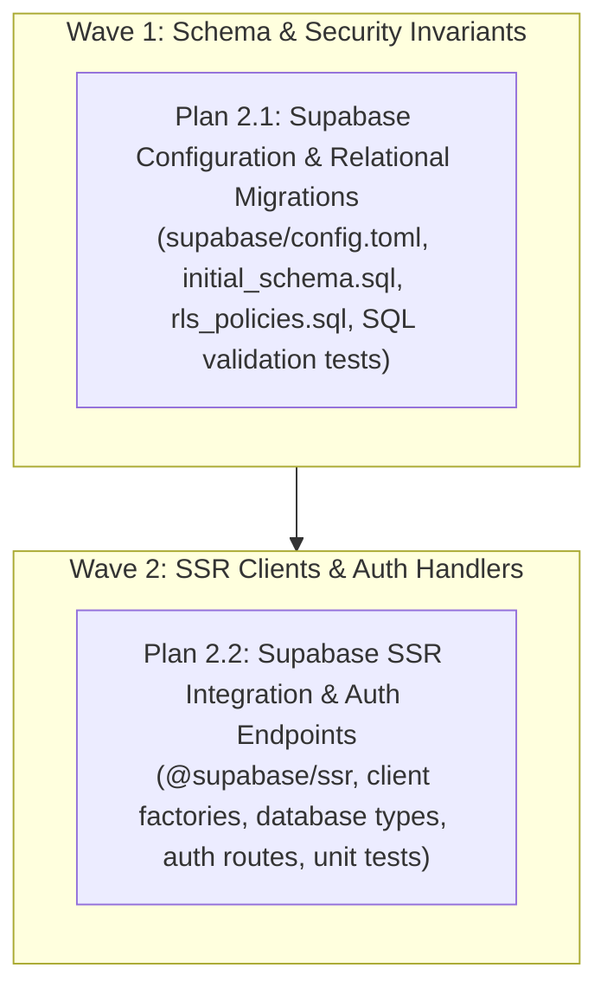

# Phase 2 Research: Database & Authentication Infrastructure

**Phase:** 2 - Database & Authentication Infrastructure  
**Target Milestone:** v1.0 - Core Platform Foundation & Architecture  
**Document Status:** Complete  
**Last Updated:** 2026-11-15  

---

## 1. Executive Summary & Phase Objectives

Phase 2 establishes the persistence and identity bedrock for Jarvis. It delivers a reproducible PostgreSQL relational and vector database schema via Supabase migrations, enforces strict Row-Level Security (RLS) policies, provisions typed client factories for Next.js App Router, and establishes authentication route handlers. Specifically, Phase 2 satisfies:

- **REQ-DB-01:** Local Supabase configuration and reproducible migration scripts.
- **REQ-DB-02:** Core database schema defining `user_profiles`, `projects`, `milestones`, `tasks`, `specifications`, `plans`, `approvals`, `agent_runs`, `run_artifacts`, `cost_records`, `audit_events`, and `memories` (with `pgvector`).
- **REQ-DB-03 & NFR-SEC-03:** 100% Row-Level Security (RLS) coverage on owner-specific tables ensuring isolation via `auth.uid() = user_id`.
- **REQ-DB-04:** Typed database interfaces and client factory generation (`src/types/database.ts`).
- **REQ-AUTH-01:** Secure authentication handling via `@supabase/ssr` with Next.js App Router (Server Components, Route Handlers, and session cookies).

---

## 2. Technology & Architecture Research

### 2.1 Supabase Configuration & Portable SQL Migrations
- **Directory Structure:**
  - `supabase/config.toml`: Project configuration for local Supabase emulator, port bindings (`54321` API, `54322` DB, `54323` Studio), and auth provider configuration.
  - `supabase/migrations/`: Sequential timestamps for reproducible DDL scripts:
    - `20261115000001_initial_schema.sql`: Core tables, indexes, check constraints, foreign keys, and vector extension.
    - `20261115000002_rls_policies.sql`: RLS enablement, tenant ownership policies, and immutable audit log constraints.
- **Portability Invariant:** All SQL syntax strictly adheres to standard PostgreSQL 15+ without proprietary cloud locks, ensuring complete compatibility with self-hosted Docker deployments.

### 2.2 Next.js App Router SSR Integration (`@supabase/ssr`)
- **Key Packages:**
  - `@supabase/supabase-js`: `^2.46.1`
  - `@supabase/ssr`: `^0.5.2`
- **Architectural Separation:**
  - `src/lib/supabase/client.ts`: Uses `createBrowserClient(process.env.NEXT_PUBLIC_SUPABASE_URL!, process.env.NEXT_PUBLIC_SUPABASE_ANON_KEY!)`. Used in Client Components.
  - `src/lib/supabase/server.ts`: Uses `createServerClient` with `cookies()` store from `next/headers`. Used in Server Components, Server Actions, and Route Handlers.
  - `src/lib/supabase/middleware.ts`: Refreshes Auth tokens before routing requests to avoid stale sessions.
  - `src/lib/supabase/admin.ts`: Server-only service client using `SUPABASE_SERVICE_ROLE_KEY` (strictly quarantined from client bundles to prevent secret leakage per NFR-SEC-02).

### 2.3 TypeScript Database Definitions (`src/types/database.ts`)
- Explicitly exports types for:
  - `Database['public']['Tables']['user_profiles']`
  - `Database['public']['Tables']['projects']`
  - `Database['public']['Tables']['milestones']`
  - `Database['public']['Tables']['tasks']`
  - `Database['public']['Tables']['specifications']`
  - `Database['public']['Tables']['plans']`
  - `Database['public']['Tables']['approvals']`
  - `Database['public']['Tables']['agent_runs']`
  - `Database['public']['Tables']['run_artifacts']`
  - `Database['public']['Tables']['cost_records']`
  - `Database['public']['Tables']['audit_events']`
  - `Database['public']['Tables']['memories']`
- Provides strongly-typed helper types: `Project`, `Task`, `Approval`, `AgentRun`, `CostRecord`, `AuditEvent`.

### 2.4 Auth Route Handlers
- `src/app/api/auth/callback/route.ts`: Exchanges temporary Auth code for session cookie.
- `src/app/api/auth/login/route.ts`: Email/password and OTP authentication endpoint.
- `src/app/api/auth/logout/route.ts`: Invalidates session and clears cookies.
- `src/app/api/auth/session/route.ts`: Read-only endpoint to inspect current authenticated user state.

---

## 3. Plan Decomposition & Wave Strategy

- **Wave 1 (Plan 2.1):** Supabase config, portable SQL migration suite, RLS policies, and automated SQL syntax/policy test suite.
- **Wave 2 (Plan 2.2):** `@supabase/supabase-js`, `@supabase/ssr`, client factory modules, typed schema, Next.js Auth route handlers, and unit tests.
