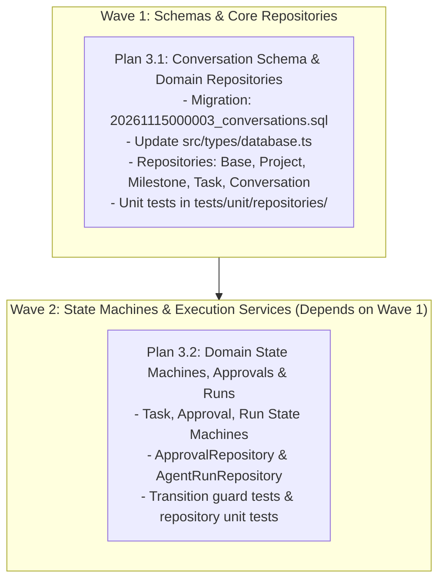

# Phase 3 Research: Core Domain Models & Repositories

**Phase:** 3 - Core Domain Models & Repositories  
**Target Milestone:** v1.0 - Core Platform Foundation & Architecture  
**Document Status:** Complete  
**Last Updated:** 2026-11-15  

---

## 1. Executive Summary & Phase Objectives

Phase 3 builds the typed data access and domain state layer for Jarvis, translating raw database tables into strongly-typed, validated domain services. It delivers CRUD repositories for projects, milestones, tasks, and conversations, introduces deterministic state machines for task and approval lifecycles, and implements durable agent run tracking. Specifically, Phase 3 satisfies:

- **REQ-REPO-01:** Repository data access layer for CRUD operations on Projects, Milestones, and Tasks with input validation.
- **REQ-REPO-02:** Persistent Conversation and Message management with support for structured payloads (plans, code diffs, logs).
- **REQ-REPO-03:** Durable Approval record service with strict state transition validation (Pending, Approved, Rejected, Expired).
- **REQ-REPO-04:** Durable Agent Run state machine and event logger persisting timestamps, status transitions, logs, and artifacts.
- **NFR-REL-01:** Durable Persistence (all agent runs, approvals, and tasks survive restarts without data loss).

---

## 2. Architecture & Design Specifications

### 2.1 Database Migration: Conversations & Messages
To support `REQ-REPO-02` (thread persistence, task intake, and hybrid structured messages):
- **`conversations`:**
  - `id UUID PRIMARY KEY DEFAULT gen_random_uuid()`
  - `user_id UUID NOT NULL REFERENCES public.user_profiles(id) ON DELETE CASCADE`
  - `project_id UUID REFERENCES public.projects(id) ON DELETE SET NULL`
  - `title TEXT NOT NULL`
  - `channel TEXT DEFAULT 'web' NOT NULL CHECK (channel IN ('web', 'telegram'))`
  - `status TEXT DEFAULT 'active' NOT NULL CHECK (status IN ('active', 'archived'))`
  - `metadata JSONB DEFAULT '{}'::jsonb NOT NULL`
  - `created_at TIMESTAMPTZ DEFAULT NOW() NOT NULL`
  - `updated_at TIMESTAMPTZ DEFAULT NOW() NOT NULL`
- **`messages`:**
  - `id UUID PRIMARY KEY DEFAULT gen_random_uuid()`
  - `conversation_id UUID NOT NULL REFERENCES public.conversations(id) ON DELETE CASCADE`
  - `sender_type TEXT NOT NULL CHECK (sender_type IN ('user', 'agent', 'system'))`
  - `content TEXT NOT NULL`
  - `payload JSONB DEFAULT '{}'::jsonb NOT NULL` (supports structured code diffs, plans, task cards, run logs)
  - `token_count INT DEFAULT 0 NOT NULL`
  - `created_at TIMESTAMPTZ DEFAULT NOW() NOT NULL`
- **RLS Invariant:** Owner isolation via `auth.uid() = user_id` for conversations, and join check for messages (`EXISTS (SELECT 1 FROM conversations WHERE conversations.id = messages.conversation_id AND conversations.user_id = auth.uid())`).

### 2.2 Repository Pattern Architecture (`src/lib/repositories/`)
- All repositories accept a typed Supabase client instance (server, browser, or admin), enabling dependency injection in both Server Components, API routes, and isolated tests.
- **`BaseRepository`:**
  - Standard error wrapping (`RepositoryError` with error codes `NOT_FOUND`, `UNAUTHORIZED`, `VALIDATION_FAILED`, `DATABASE_ERROR`).
  - Pagination helpers (`limit`, `offset`, `sortBy`, `sortDirection`).
- **`ProjectRepository`:**
  - `create(userId, data)`: Generates URL-friendly slug, validates name, stores default settings.
  - `getById(id, userId)`: Fetches project by ID with tenant owner scoping.
  - `getBySlug(slug, userId)`: Fetches project by unique slug.
  - `list(userId, options)`: Returns list of user's active/archived projects.
  - `update(id, userId, data)`: Modifies project fields and bumps `updated_at`.
  - `archive(id, userId)`: Soft-archives project (`status: 'archived'`).
- **`MilestoneRepository`:**
  - `create(projectId, data)`: Creates deliverable milestone with auto-incremented sequence order.
  - `listByProject(projectId)`: Returns ordered milestones (`ORDER BY sequence_order ASC`).
  - `updateStatus(id, status)`: Transitions milestone state.
- **`TaskRepository`:**
  - `create(projectId, data)`: Creates task in `intake` status.
  - `getById(id)`: Returns task with optional relations (milestone, specifications, plans).
  - `listByProject(projectId, filters)`: Filters by status, priority, risk level.
  - `updateCost(id, estimatedCost, actualCost)`: Aggregates financial expenditure in INR.
- **`ConversationRepository`:**
  - `createConversation(userId, title, channel, projectId)`: Creates new chat thread.
  - `addMessage(conversationId, senderType, content, payload)`: Inserts user or agent response with structured payload.
  - `listMessages(conversationId, options)`: Chronological message history.
- **`ApprovalRepository`:**
  - `createRequest(userId, actionType, targetResource, scope, expiresAt, taskId)`: Creates durable approval request.
  - `recordDecision(id, userId, decision, reason)`: Records atomic `approved` or `rejected` with timestamp.
  - `listPending(userId)`: Lists active, non-expired pending approvals.
- **`AgentRunRepository`:**
  - `createRun(taskId, agentEngine)`: Initializes queued agent run.
  - `updateStatus(id, status, exitCode, diffPatch, testResults)`: Transitions status and attaches diffs/logs.
  - `addArtifact(runId, type, storagePath, sizeBytes, mimeType, checksum)`: Persists output artifact metadata.

### 2.3 Domain State Machines (`src/lib/state-machines/`)
To eliminate invalid state mutations and ensure 100% testable state transitions:
1. **Task State Machine (`TaskStateMachine`):**
   ```
   intake -> specifying -> planned -> awaiting_approval -> running -> verifying -> completed
      │          │           │               │              │          │
      └──────────┴───────────┴───────────────┴──────────────┴──────────┴─> cancelled / failed
   ```
   - Transition rules: Disallows jumping from `intake` directly to `running`. Requires plan before `awaiting_approval`.
2. **Approval State Machine (`ApprovalStateMachine`):**
   ```
   pending -> approved (terminal)
   pending -> rejected (terminal)
   pending -> expired  (terminal)
   ```
   - Transition rules: Terminal states (`approved`, `rejected`, `expired`) cannot transition to any other state. Attempting to approve an expired request throws an error.
3. **Agent Run State Machine (`AgentRunStateMachine`):**
   ```
   queued -> running -> verifying -> completed (terminal)
   queued -> running -> failed (terminal / retryable)
   running -> timed_out (terminal)
   ```

---

## 3. Plan Decomposition & Wave Strategy



- **Wave 1 (Plan 3.1):** Database migration for conversations & messages, TypeScript schema updates, base repository, project repository, milestone repository, task repository, and conversation repository with unit tests.
- **Wave 2 (Plan 3.2):** Deterministic state machines (`TaskStateMachine`, `ApprovalStateMachine`, `AgentRunStateMachine`), approval repository, agent run repository with artifact registration, and unit tests.
