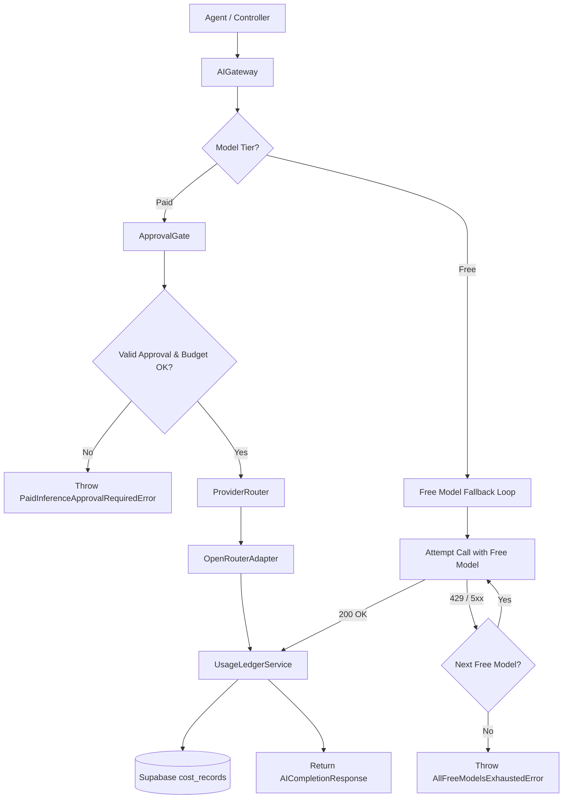

# Phase 4 Research: Provider Adapters & AI Gateway Configuration

## 1. Domain Context & Requirements Overview

Phase 4 establishes the AI execution layer for Jarvis, fulfilling the following core directives:
- **`REQ-AI-01`**: Provider-independent AI Gateway interface with OpenRouter implementation.
- **`REQ-AI-02`**: Free-tier model prioritization and automatic fallback within allowed free models (`llama-3.3-70b`, `gemini-2.0-flash-exp`, `qwen-2.5-coder-32b`).
- **`REQ-AI-03`**: Approval enforcement gate blocking any paid inference or unapproved model dispatch.
- **`REQ-AI-04`**: AI usage ledger service recording model, purpose, token count, latency, and estimated cost in INR.
- **`NFR-COST-01`**: Strict financial boundaries (₹25/day limit, ₹20/day 80% alert, ₹750/month ceiling, ₹250 reserve requiring approval, ₹1,000 inviolable cap).

---

## 2. OpenRouter API Architecture & Protocols

OpenRouter provides an OpenAI-compatible REST API for LLM inference across multiple underlying providers.

### 2.1 Connection Parameters
- **Base Endpoint:** `https://openrouter.ai/api/v1/chat/completions`
- **Required Headers:**
  - `Authorization: Bearer <OPENROUTER_API_KEY>`
  - `HTTP-Referer: https://jarvis.internal` (Identifies the client application)
  - `X-Title: Jarvis AI Assistant` (Displays in OpenRouter dashboard)
  - `Content-Type: application/json`

### 2.2 Completion Payloads
- **Chat Request:**
  ```json
  {
    "model": "meta-llama/llama-3.3-70b-instruct:free",
    "messages": [
      { "role": "system", "content": "You are Jarvis..." },
      { "role": "user", "content": "Hello Jarvis" }
    ],
    "temperature": 0.2,
    "max_tokens": 4096,
    "response_format": { "type": "json_object" }
  }
  ```
- **Streaming Response:**
  Server-Sent Events (`text/event-stream`):
  ```
  data: {"id":"gen-xxx","choices":[{"delta":{"content":"Hello"},"index":0}]}
  data: {"id":"gen-xxx","choices":[{"delta":{"content":" world"},"index":0}]}
  data: [DONE]
  ```

---

## 3. Model Hierarchy, Fallback Chains & Invariants

Jarvis strictly separates **Free-Tier Models** from **Paid-Tier Models**.

### 3.1 Model Catalog Matrix

| Model Identifier | Tier | Category | Context | Input USD/1M | Output USD/1M |
|---|---|---|---|---|---|
| `meta-llama/llama-3.3-70b-instruct:free` | Free | General / Reasoning | 128,000 | $0.00 | $0.00 |
| `google/gemini-2.0-flash-exp:free` | Free | Multi-modal / Fast Spec | 1,000,000 | $0.00 | $0.00 |
| `qwen/qwen-2.5-coder-32b-instruct:free` | Free | Code Generation | 32,768 | $0.00 | $0.00 |
| `anthropic/claude-3.5-sonnet` | Paid | Advanced Coding / Arch | 200,000 | $3.00 | $15.00 |
| `openai/gpt-4o` | Paid | General Complex Tasks | 128,000 | $2.50 | $10.00 |

### 3.2 Free Model Fallback Order
1. **Primary Model:** Selected based on task category (e.g., `qwen-2.5-coder` for coding, `gemini-2.0-flash-exp` for specification, `llama-3.3-70b` for general orchestration).
2. **First Fallback:** If the primary hits HTTP 429 (Rate Limit) or HTTP 5xx (Provider Outage), switch to alternate free model (e.g. `meta-llama/llama-3.3-70b-instruct:free`).
3. **Second Fallback:** If alternate hits 429/5xx, switch to third free model (e.g. `google/gemini-2.0-flash-exp:free`).
4. **End of Free Tier:** If all free models fail, **HALT IMMEDIATELY**.
   - *Inviolable Rule:* **NEVER** automatically fall back to a paid model.
   - Emit `AllFreeModelsExhaustedError` and create a pending `Approval` request for paid inference.

---

## 4. Paid Inference Approval Gate (`REQ-AI-03`)

Before any call is dispatched to a paid model:
1. Verify whether the requested model is classified as `tier === 'paid'` in the Model Catalog.
2. If `paid`:
   - Query `ApprovalRepository` for an active approval matching:
     - `action_type = 'paid_ai_inference'`
     - `user_id = target_user_id`
     - `status = 'approved'`
     - `expires_at > NOW()`
     - Scope includes the requested model or cost limit.
   - If no valid, unexpired approval exists:
     - Halt execution and throw `PaidInferenceApprovalRequiredError`.
     - Automatically register a new `Approval` in `approvals` with estimated cost in INR.
3. If valid approval exists:
   - Check daily and monthly budget ceilings before final dispatch.

---

## 5. Usage Ledger & Cost Accounting (`REQ-AI-04`, `NFR-COST-01`)

### 5.1 Currency Conversion
- Standard exchange rate: **₹84.00 INR = $1.00 USD** (configurable via `USD_INR_EXCHANGE_RATE` environment variable).
- Cost computation formula:
  $$\text{Cost}_{\text{INR}} = \left( \frac{\text{PromptTokens} \times \text{InputPriceUSD} + \text{CompletionTokens} \times \text{OutputPriceUSD}}{1,000,000} \right) \times 84.00$$

### 5.2 Ledger Persistence
Every inference call records an immutable row in `public.cost_records`:
- `user_id`: UUID
- `run_id`: UUID (nullable, links to `agent_runs.id`)
- `provider`: `'openrouter'`
- `model`: Model string identifier
- `prompt_tokens`: integer
- `completion_tokens`: integer
- `total_tokens`: integer
- `cost_inr`: numeric(10, 4)
- `is_estimated`: boolean (true if calculated locally, false if confirmed by provider headers)

### 5.3 Budget Circuit Breakers
- **Daily Spend Calculation:** $\sum \text{cost\_inr}$ for current UTC day.
  - At ₹20.00 (80%): Emit warning notification.
  - At ₹25.00 (100%): Circuit breaker triggers; reject further paid inference with `DailyBudgetExceededError`.
- **Monthly Spend Calculation:** $\sum \text{cost\_inr}$ for current calendar month.
  - At ₹750.00: Circuit breaker triggers; reject all billable inference with `MonthlyBudgetExceededError`.
  - ₹250.00 emergency reserve can only be unlocked with explicit owner approval.
  - Inviolable absolute cap: ₹1,000.00.

---

## 6. Implementation Architecture



---

## 7. Recommended Test Strategy
1. **Mock Adapter Unit Tests:** Fast, isolated testing of router logic, failover loops, and budget circuit breakers without real HTTP requests.
2. **OpenRouter Adapter Unit Tests:** Mock `fetch` to verify headers, payload serialization, JSON extraction, SSE streaming chunk parsing, and 429/5xx error handling.
3. **Approval Gate Tests:** Verify rejection of unapproved paid requests, rejection of expired approvals, and passage of active approvals.
4. **Ledger & Budget Tests:** Verify exact token cost math in INR at ₹84/$, daily ₹25 limit enforcement, and monthly ₹750 ceiling enforcement.
