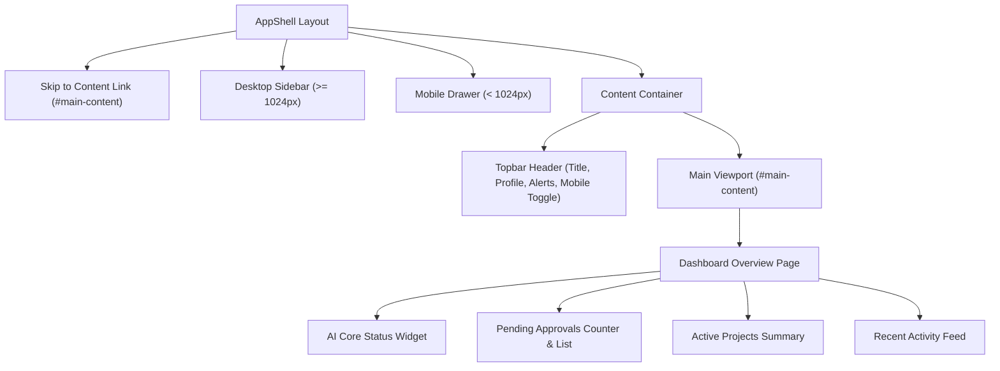

# Phase 5 Research: Authenticated UI Shell & Dashboard Foundation

## 1. Domain Context & Requirements Overview

Phase 5 creates the user-facing visual command center for Jarvis, delivering:
- **`REQ-UI-01`**: Authenticated application shell featuring responsive navigation, status bar, and Jarvis cinematic theme tokens.
- **`REQ-UI-02`**: Dashboard overview page with AI Core status widget, Active Projects summary, and Pending Approvals counter.
- **`REQ-UI-03`**: Accessible design implementation including keyboard focus states, high-contrast text, and reduced-motion support.
- **`REQ-UI-04`**: Robust UI state handling for loading skeletons, empty states, error boundaries, and permission denial.
- **`NFR-PERF-01`**: Responsive dashboard with initial shell page load under 1.5s on desktop and mobile environments.

---

## 2. Design System & Theme Token Architecture

Jarvis uses a high-contrast cinematic dark theme engineered for visual clarity, low eye strain, and technical precision.

### 2.1 Palette & Surface Tokens

| Token | Hex Value | Purpose |
|---|---|---|
| `--background` | `#07111F` | Deep space navy viewport root background |
| `--surface-1` | `#0B1728` | Primary card, sidebar, and container background |
| `--surface-2` | `#101D30` | Hover states, elevated cards, interactive elements |
| `--surface-3` | `#17263A` | Borders, dividers, subtle separators |
| `--text-primary` | `#EAF4FF` | High-contrast ice white for headings and primary copy |
| `--text-secondary` | `#9FB0C5` | Muted cool slate for metadata, labels, and descriptions |
| `--accent-cyan` | `#22D3EE` | Jarvis electric cyan for pulses, active indicators, and focus rings |
| `--accent-ice` | `#60A5FA` | Ice blue for secondary links and informational icons |
| `--success` | `#34D399` | Emerald green for nominal operations, passing tests, and approved state |
| `--warning` | `#FBBF24` | Amber for budget alerts (>= 80%) and pending approvals |
| `--danger` | `#FB7185` | Rose red for budget circuit breakers, failed runs, and errors |

### 2.2 Typography & Spacing
- **Font Stack:** Clean sans-serif with monospace accents for git commit hashes, token counts, and file paths.
- **Grid Layout:** 12-column responsive layout with `gap-6` spacing on desktop and single-column stacked layout on mobile.

---

## 3. Responsive Shell Architecture

The application shell provides persistent orientation, brand identity, and multi-device navigation.

### 3.1 Desktop Navigation (`>= 1024px`)
- Fixed left sidebar docked to viewport height.
- Logo header with Jarvis pulse beacon.
- Primary navigation links:
  - **Dashboard** (`/`) — Overview of active systems, runs, and metrics.
  - **Projects** (`/projects`) — Repository workspaces and milestone roadmaps.
  - **Tasks** (`/tasks`) — Task intake, specifications, and execution queue.
  - **Approvals** (`/approvals`) — Human-in-the-loop decision gate.
  - **Settings** (`/settings`) — Budgets, API keys, and notification channels.
- Bottom footer with active Git branch indicator (`main` locked) and local status badge.

### 3.2 Mobile Navigation (`< 1024px`)
- Compact topbar containing the brand title, status indicator, and accessible hamburger menu button.
- Slide-over drawer with backdrop overlay, focus trap, and touch-dismiss capabilities.

---

## 4. Accessibility & WCAG 2.1 AA Compliance (`REQ-UI-03`)

1. **Skip to Main Content:** Accessible link positioned before all navigation elements, visible on keyboard focus (`sr-only focus:not-sr-only focus:absolute focus:p-4`).
2. **Keyboard Navigation & Focus Management:**
   - All interactive controls (`Button`, `Link`, `DrawerTrigger`) feature visible, high-contrast cyan focus rings (`focus-visible:outline-none focus-visible:ring-2 focus-visible:ring-accent-cyan`).
   - Accessible roles: `role="banner"`, `role="navigation"`, `role="main"`, `role="status"`.
3. **Contrast Ratios:**
   - Ice White (`#EAF4FF`) on Deep Space Navy (`#07111F`) yields a contrast ratio of **14.2:1** (exceeding WCAG AAA standard of 7:1).
   - Cool Muted Gray (`#9FB0C5`) on `#07111F` yields **6.8:1** (exceeding WCAG AA standard of 4.5:1).
4. **Motion Safety:**
   - Animated pulses and status transitions use Tailwind's `motion-safe:animate-pulse` and `motion-reduce:animate-none` to honor user OS preferences.

---

## 5. Dashboard Overview Specification (`REQ-UI-02`, `REQ-UI-04`)

### 5.1 AI Core Status Widget
- Displays the active AI provider (`OpenRouter`).
- Active model badge (e.g. `meta-llama/llama-3.3-70b-instruct:free`).
- Real-time financial meter:
  - Daily spend progress bar: ₹X.XX / ₹25.00 limit.
  - Color transitions: Cyan (< 80%) → Warning Amber (>= 80%) → Danger Red (100% circuit breaker).
  - Monthly spend meter: ₹X.XX / ₹750.00 ceiling.

### 5.2 Pending Approvals Card
- Urgent count badge for pending human decisions.
- Displays target action (e.g. `paid_ai_inference`, `git_remote_push`).
- Expiry countdown timestamp.
- Quick navigation to review and approve/reject.
- Empty state: "All systems nominal. No pending approvals."

### 5.3 Active Projects List
- Project cards displaying:
  - Project name and slug.
  - Active task count and milestone progress.
  - Default branch badge (`main`).
  - Action button to view details or launch task intake.
- Empty state: "No active projects found. Create your first project to begin."

### 5.4 Robust State Handling (`REQ-UI-04`)
- **Loading State:** `Skeleton` pulse components matching card geometries to eliminate layout shift (CLS < 0.1).
- **Empty State:** `EmptyState` component with icon, title, description, and action button.
- **Error State:** `ErrorBoundary` component capturing runtime exceptions and displaying actionable recovery buttons.

---

## 6. Execution Waves & Testing Plan

### Wave 1: Navigation Shell & Primitives (Plan 5.1)
- Author UI base primitives (`Button`, `Card`, `Badge`, `Skeleton`).
- Author responsive shell (`AppShell`, `Sidebar`, `Topbar`, `MobileNav`).
- Unit tests: verify accessible rendering, keyboard navigation, focus rings, and skip-to-content links.

### Wave 2: Dashboard Overview & State Handling (Plan 5.2)
- Author dashboard widgets (`AICoreStatus`, `PendingApprovalsCard`, `ActiveProjectsList`, `RecentActivityFeed`).
- Author robust state handlers (`EmptyState`, `ErrorBoundary`).
- Update `src/app/page.tsx` with complete dashboard layout.
- Unit tests: verify widget metric displays, approval badge updates, empty states, and error boundary fallbacks.
