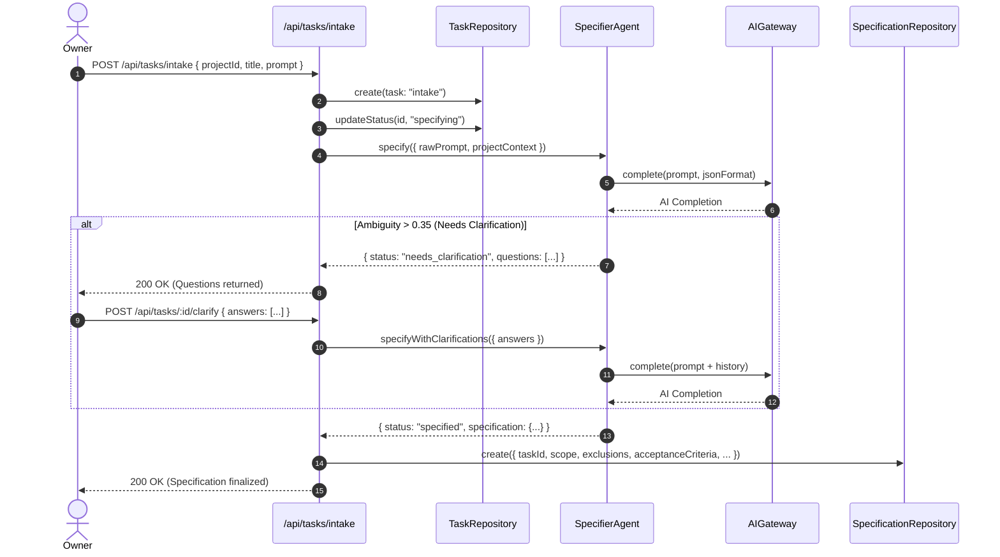

# Phase 6 Research: Task Intake & Specification Engine

## 1. Domain Context & Requirements Overview

Phase 6 marks the beginning of Milestone 2 (Specification & Planning Workflow). Its core mandate is to transform raw, natural-language human requests into unambiguous, structured specifications with explicit out-of-scope boundaries and testable Given-When-Then acceptance criteria before any code or execution plan is produced.

### 1.1 Requirements
- **`REQ-SPEC-01` (Specifier Agent):** Analyzes natural language prompts to extract structured scope, exclusions, raw prompt history, and testable acceptance criteria (`Given-When-Then` format).
- **`REQ-SPEC-02` (Clarification Loop):** Socratic clarification engine detecting ambiguity and prompting the user with targeted questions before plan generation.
- **`REQ-SPEC-03` (Specification Repository):** Strongly-typed CRUD and versioning for specifications stored in `public.specifications`.
- **`NFR-REL-02` (Deterministic Schema Validation):** Structured JSON payloads for specifications and plans validated against strict schemas (powered by Zod).

---

## 2. Specifier Agent Persona & Prompt Engineering

The Specifier Agent serves as the first intelligent gatekeeper in the Jarvis multi-agent pipeline. It operates as a senior requirements engineer and technical architect.

### 2.1 Persona Invariants
1. **Never Assume Ambiguous Intent:** If critical architectural constraints, technical scope, or business rules are missing, the agent MUST NOT guess. It must trigger the Socratic Clarification Loop.
2. **Explicit Scope Fencing:** Every specification must delineate both what **is** in scope and what **is excluded** (non-goals). Preventing scope creep is a primary objective.
3. **Formal Acceptance Criteria:** All requirements must be translated into testable acceptance criteria using the Gherkin-inspired `Given-When-Then` format:
   - `Given`: Initial system state or precondition.
   - `When`: Specific user action, API call, or trigger event.
   - `Then`: Concrete, empirically observable and verifiable outcome.
4. **Free-Model Efficiency:** Prompts must be structured to run reliably within free-tier OpenRouter models (`meta-llama/llama-3.3-70b-instruct:free`, `google/gemini-2.0-flash-exp:free`, `qwen/qwen-2.5-coder-32b-instruct:free`) using JSON object mode (`response_format: { type: "json_object" }`).

---

## 3. Ambiguity Detection & Scoring Model

To avoid premature planning on underspecified requests, the Specifier Agent evaluates prompts across four distinct dimensions, each scored from 0.0 (crystal clear) to 1.0 (completely missing/opaque):

### 3.1 Dimensions
1. **Goal Clarity ($W_1 = 0.35$):** Is the end objective clearly stated? What problem does this solve?
2. **Technical Boundaries ($W_2 = 0.25$):** Are target components, endpoints, database entities, or protocols specified or inferable from project architecture?
3. **Acceptance Measurability ($W_3 = 0.25$):** Can success or failure be measured deterministically with unit, integration, or visual tests?
4. **Preconditions & Constraints ($W_4 = 0.15$):** Are dependencies, auth rules, external services, or destructive operations identified?

### 3.2 Composite Ambiguity Score
The composite score is calculated as:
$$\text{Ambiguity Score} = \sum_{i=1}^4 W_i \times D_i$$

- **Threshold for Clarification:** If $\text{Ambiguity Score} > 0.35$ or if essential requirements are unresolvable:
  - Agent outputs `status: "needs_clarification"`.
  - Generates 1 to 3 targeted, Socratic questions.
- **Threshold for Specification:** If $\text{Ambiguity Score} \le 0.35$:
  - Agent outputs `status: "specified"`.
  - Emits the complete structured specification payload.

---

## 4. Socratic Clarification Loop Protocol

When a task is underspecified:
1. **Targeted Inquiries (Max 3):** To minimize cognitive load on the user and token overhead, the agent generates at most 3 concise questions.
2. **Context-Aware Options:** Each question provides a rationale, clear options (recommended default first), and freeform acceptance.
3. **Iterative Convergence:**
   - User answers are appended as conversational context messages.
   - The Specifier Agent is re-dispatched with the accumulated context.
   - Ambiguity scores decrease monotonically as questions are answered.
   - Once below the 0.35 threshold, the agent transitions the task to `specified`.



---

## 5. Schema Validation Architecture (Zod & NFR-REL-02)

To satisfy `NFR-REL-02`, runtime validation must be deterministic and reject malformed LLM outputs.

### 5.1 Zod Schemas
```typescript
import { z } from "zod";

export const AcceptanceCriterionSchema = z.object({
  id: z.string().min(1),
  title: z.string().min(1),
  given: z.string().min(1),
  when: z.string().min(1),
  then: z.string().min(1),
});

export const ClarificationQuestionSchema = z.object({
  id: z.string().min(1),
  question: z.string().min(1),
  rationale: z.string().min(1),
  options: z.array(z.string()).optional(),
  recommendedOption: z.string().optional(),
});

export const AmbiguityAssessmentSchema = z.object({
  score: z.number().min(0).max(1),
  dimensions: z.object({
    goalClarity: z.number().min(0).max(1),
    technicalBoundaries: z.number().min(0).max(1),
    acceptanceMeasurability: z.number().min(0).max(1),
    preconditions: z.number().min(0).max(1),
  }),
  reasoning: z.string().min(1),
});

export const SpecificationPayloadSchema = z.object({
  scope: z.string().min(10),
  exclusions: z.string().min(5),
  acceptanceCriteria: z.array(AcceptanceCriterionSchema).min(1),
  assumptions: z.array(z.string()).default([]),
});

export const SpecifierAgentResponseSchema = z.discriminatedUnion("status", [
  z.object({
    status: z.literal("specified"),
    ambiguity: AmbiguityAssessmentSchema,
    specification: SpecificationPayloadSchema,
  }),
  z.object({
    status: z.literal("needs_clarification"),
    ambiguity: AmbiguityAssessmentSchema,
    questions: z.array(ClarificationQuestionSchema).min(1).max(3),
  }),
]);
```

---

## 6. Database Storage & Versioning Model

The `public.specifications` table was initialized in Phase 2 migration `20261115000001_initial_schema.sql`:
```sql
CREATE TABLE IF NOT EXISTS public.specifications (
    id UUID PRIMARY KEY DEFAULT gen_random_uuid(),
    task_id UUID NOT NULL REFERENCES public.tasks(id) ON DELETE CASCADE,
    scope TEXT NOT NULL,
    exclusions TEXT NOT NULL,
    acceptance_criteria JSONB NOT NULL DEFAULT '[]'::jsonb,
    raw_user_prompt TEXT NOT NULL,
    version INT DEFAULT 1 NOT NULL,
    created_at TIMESTAMPTZ DEFAULT NOW() NOT NULL
);
```

### 6.1 Versioning Strategy
- When a task is initially specified, a row is inserted with `version = 1`.
- If the owner requests revisions or refines the scope in later stages, a new row is inserted with `version = current_max + 1`, preserving historical specifications for traceability.
- `SpecificationRepository.findByTaskId` retrieves the latest specification by `ORDER BY version DESC LIMIT 1`.

---

## 7. State Transitions & Invariants

1. **Intake to Specifying:**
   - Creation of a task initializes it in `intake`.
   - Dispatch of the Specifier Agent transitions it to `specifying` via `TaskStateMachine.assertTransition(current, "specifying")`.
2. **Clarification Holding:**
   - While questions are pending, task status remains `specifying`.
3. **Spec Finalization:**
   - Upon successful specification persistence in `public.specifications`, the task remains in `specifying` until Phase 7 Planner decomposes it into execution steps, transitioning it to `planned`.

---

## 8. Test Strategy & Empirical Verification

1. **Unit Tests (`tests/unit/agents/specifier-agent.test.ts`):**
   - High-ambiguity prompts (e.g., "build an app") produce `needs_clarification` with <= 3 questions and score > 0.35.
   - Crisp prompts (e.g., "Create a GET /api/health endpoint returning status: 'ok'") produce `specified` with Given-When-Then acceptance criteria and score <= 0.35.
   - Clarification answers resolve questions into a `specified` outcome.
   - Malformed JSON responses trigger automatic error handling and fallback parsing.
2. **Repository Tests (`tests/unit/repositories/specification-repository.test.ts`):**
   - CRUD operations on `SpecificationRepository`.
   - Version incrementing on revision creation.
   - Retrieval of latest vs historical versions.
3. **API Route Tests (`tests/unit/api/tasks-intake-route.test.ts`):**
   - `POST /api/tasks/intake` validation of input fields.
   - Successful dispatch and response formatting for both `needs_clarification` and `specified` states.
