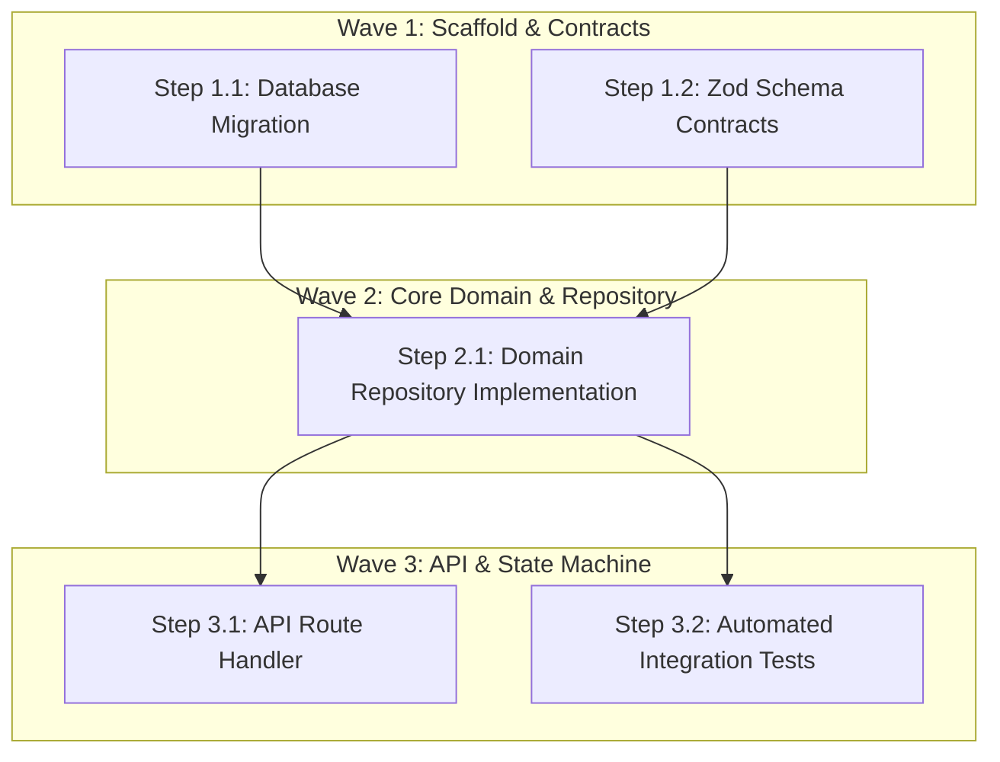

# Phase 7 Research: Execution Planning Engine

## 1. Domain Context & Requirements Overview

Phase 7 continues Milestone 2 (Specification & Planning Workflow). Its core mandate is to decompose approved specifications into atomic, dependency-aware execution steps organized into sequential execution waves, accompanied by automated risk assessment and explicit rollback procedures.

### 1.1 Requirements
- **`REQ-PLAN-01` (Planner Agent):** Decomposes specifications into atomic execution steps with wave-based dependency ordering and rollback procedures.
- **`REQ-PLAN-02` (Risk Assessment & Approval Gate Detection):** Evaluates proposed steps against security policies and flags actions requiring human approval.
- **`REQ-PLAN-03` (Plan Repository):** Strongly-typed CRUD, dependency DAG storage, and versioning for plans in `public.plans`.
- **`NFR-REL-02` (Deterministic Schema Validation):** Structured JSON payloads for specifications and plans validated against strict schemas (powered by Zod).

---

## 2. Planner Agent Architecture & Invariants

The Planner Agent acts as an expert software architect and systems engineer. It takes a finalized specification from Phase 6 (`scope`, `exclusions`, `acceptanceCriteria`, `assumptions`) and transforms it into an actionable, verifiable execution graph.

### 2.1 Core Invariants
1. **Atomic Step Discipline:** Each plan step must address one cohesive unit of work (e.g., a specific file creation, a database migration, or a focused module change). Monolithic steps are strictly rejected.
2. **Deterministic Wave Ordering (DAG):** Steps are organized into numbered execution waves ($1, 2, 3, \dots$). Steps within Wave $N$ can execute concurrently, but Wave $N$ cannot start until all prerequisites in Waves $< N$ have succeeded.
3. **No Circular Dependencies:** The dependency graph formed by steps and their prerequisites must be a Directed Acyclic Graph (DAG). Cycle detection must be executed programmatically.
4. **Targeted File Fencing:** Every step must declare the explicit set of files it will touch (`filesTargeted`).
5. **Empirical Verification Command:** Every step must specify a deterministic verification command (e.g. `pnpm test tests/unit/...` or `pnpm tsc --noEmit`) to evaluate completion.
6. **Rollback Procedures:** Every step must provide a concrete, step-specific rollback procedure (e.g., `git checkout -- <file>` or reverting a specific migration).

---

## 3. Automated Risk Assessment & Approval Policy

In accordance with Jarvis Governance (`ANTIGRAVITY_FRESH_PROJECT_PROMPT.md` and `docs/PERMISSION_POLICY.md`), actions that carry operational or security risks must be identified and tagged for human approval.

### 3.1 Step Risk Classification Matrix

| Risk Level | Trigger Criteria | Action Types | Human Approval Required? |
|---|---|---|---|
| **Low** | Read-only operations, creating new isolated unit tests, non-breaking cosmetic changes. | `create` (test/docs), `read` | No |
| **Medium** | Modifying existing business logic, creating new internal components or endpoints, adding non-critical dependencies. | `create`, `modify` | No (unless policy rule triggered) |
| **High** | Modifying database schemas/migrations, touching authentication middleware or security tokens, changing package dependencies, modifying configuration files. | `migration`, `modify` (auth/core) | Yes (`requiresApproval: true`) |
| **Critical** | Deleting files/tables, performing remote Git push actions, executing destructive shell commands, initiating paid AI inference. | `delete`, `push`, `paid_inference` | Yes (Mandatory Approval Gate) |

### 3.2 Required Approval Categories
- `database_migration`: Any change to database schemas, tables, or RLS policies.
- `git_push_remote`: Pushing local `main` to `origin/main`.
- `paid_ai_inference`: Disagreeing or falling back to paid LLM models.
- `destructive_operation`: Deleting files, dropping columns, or wiping caches.

---

## 4. DAG Analysis & Cycle Detection Algorithm

The Planner Agent output must be verified by a deterministic DAG analyzer prior to persistence:

1. **Adjacency List Construction:** Map each step $S$ and its dependencies $D \subseteq S$.
2. **Topological Sort & Cycle Detection (Kahn's Algorithm / DFS with 3-color marking):**
   - White (unvisited), Gray (currently exploring on stack), Black (fully processed).
   - If a back-edge to a Gray node is encountered, a circular dependency exists $\rightarrow$ reject plan.
3. **Wave Number Consistency:**
   $$\forall s \in \text{Steps}, \forall d \in \text{dependencies}(s): \text{wave}(s) > \text{wave}(d)$$
   If any step declares a wave less than or equal to any of its dependencies, the DAG validator automatically repairs or rejects the wave assignment.



---

## 5. Schema Validation Architecture (Zod & NFR-REL-02)

```typescript
import { z } from "zod";

export const StepRiskLevelSchema = z.enum(["low", "medium", "high", "critical"]);
export type StepRiskLevel = z.infer<typeof StepRiskLevelSchema>;

export const StepActionTypeSchema = z.enum(["create", "modify", "delete", "command", "migration"]);
export type StepActionType = z.infer<typeof StepActionTypeSchema>;

export const PlanStepSchema = z.object({
  id: z.string().min(1),
  title: z.string().min(1),
  description: z.string().min(10),
  filesTargeted: z.array(z.string()).min(1),
  actionType: StepActionTypeSchema,
  wave: z.number().int().positive(),
  dependencies: z.array(z.string()).default([]),
  riskLevel: StepRiskLevelSchema,
  requiresApproval: z.boolean(),
  approvalReason: z.string().optional(),
  verificationCommand: z.string().min(1),
  rollbackProcedure: z.string().min(5),
});

export const DependencyEdgeSchema = z.object({
  from: z.string().min(1),
  to: z.string().min(1),
});

export const RiskAssessmentSchema = z.object({
  overallRisk: StepRiskLevelSchema,
  riskFactors: z.array(z.string()),
  requiresHumanApproval: z.boolean(),
  mitigations: z.array(z.string()),
});

export const PlanPayloadSchema = z.object({
  steps: z.array(PlanStepSchema).min(1),
  dependencies: z.array(DependencyEdgeSchema),
  riskAssessment: RiskAssessmentSchema,
  requiredApprovals: z.array(z.string()),
});
```

---

## 6. Database Storage & Task State Progression

The `public.plans` table holds the plan JSON and metadata:
```sql
CREATE TABLE IF NOT EXISTS public.plans (
    id UUID PRIMARY KEY DEFAULT gen_random_uuid(),
    task_id UUID NOT NULL REFERENCES public.tasks(id) ON DELETE CASCADE,
    steps JSONB NOT NULL DEFAULT '[]'::jsonb,
    dependencies JSONB NOT NULL DEFAULT '[]'::jsonb,
    risk_assessment JSONB NOT NULL DEFAULT '{}'::jsonb,
    required_approvals JSONB NOT NULL DEFAULT '[]'::jsonb,
    status TEXT DEFAULT 'draft' NOT NULL CHECK (status IN ('draft', 'pending_approval', 'approved', 'rejected', 'superseded')),
    version INT DEFAULT 1 NOT NULL,
    created_at TIMESTAMPTZ DEFAULT NOW() NOT NULL
);
```

### 6.1 State Transitions
1. Task is initially in `specifying` status with a finalized specification.
2. Generating a valid plan updates task status from `specifying` $\rightarrow$ `planned`.
3. If `riskAssessment.requiresHumanApproval` is true, task is marked for owner approval in Phase 8 (Plan Review UI).

---

## 7. Verification & Test Strategy

1. **DAG & Risk Unit Tests (`tests/unit/agents/dag.test.ts`):**
   - Valid acyclic graphs pass topological sort.
   - Circular graphs (A $\rightarrow$ B $\rightarrow$ A) throw `CircularDependencyError`.
   - Inconsistent wave assignments are detected and flagged.
2. **Planner Agent Tests (`tests/unit/agents/planner-agent.test.ts`):**
   - Decomposing a specification yields ordered waves, files targeted, verification commands, and rollbacks.
   - High-risk operations (e.g. database migrations) automatically flag `requiresApproval: true`.
   - Zod validation rejects missing fields or invalid action types.
3. **Plan Repository Tests (`tests/unit/repositories/plan-repository.test.ts`):**
   - CRUD operations and version tracking on `public.plans`.
   - Retrieving latest plan and revision creation.
4. **API Route Tests (`tests/unit/api/tasks-plan-route.test.ts`):**
   - `POST /api/tasks/[id]/plan` validates specification presence, runs Planner Agent, saves plan, and transitions task to `planned`.
