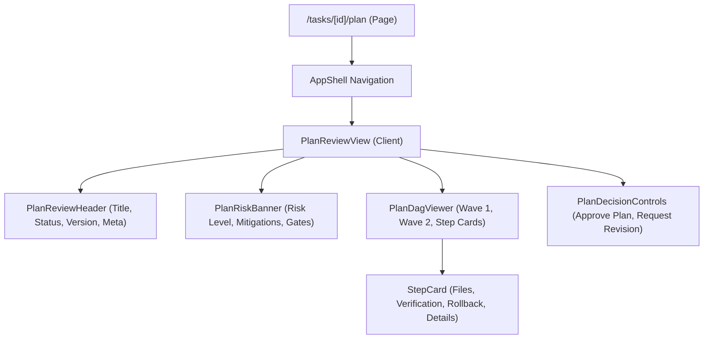
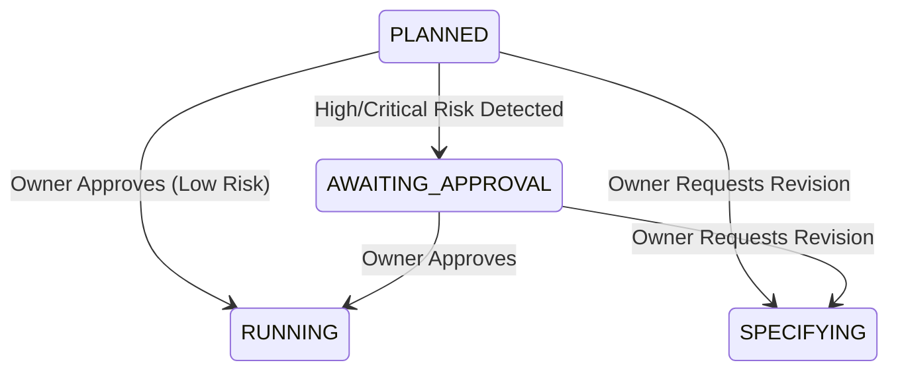

# Phase 8 Research: Plan Review UI & Approval Gate

## 1. Domain Context & Requirements Overview

Phase 8 is the final phase of Milestone 2 (Specification & Planning Workflow). Its core mandate is to deliver an accessible, interactive, and safety-critical Plan Review UI that allows the system owner to inspect the execution plan DAG, evaluate the automated risk breakdown, and execute unambiguous approval decisions before any code execution begins.

### 1.1 Requirements
- **`REQ-PLAN-04` (Visual Plan Review UI):** Interactive plan review interface displaying steps, dependencies, risk breakdown, and one-click Plan Approval or revision request controls.
- **`NFR-PERF-01` (Responsive Performance):** Interface renders with sub-1.5s initial load time on desktop and mobile.
- **`REQ-UI-03` / `REQ-UI-04` (Accessibility & State Handling):** Keyboard accessible, high-contrast dark tokens, no optimistic approval assumption, double-submission prevention.

---

## 2. Safety-Critical Approval UI Design

Per `UI_UX_SPECIFICATION.md` §11 and `UI_SCREEN_INVENTORY.md` §11:
1. **Never Assume Optimistic Approval:** The UI must display a pending / loading state while an approval action is processing and only render success once the backend database transaction confirms it.
2. **Double-Submission Prevention:** Buttons must disable immediately upon click to prevent double dispatch or accidental duplicate approvals.
3. **Auditable Decision Records:** Approvals and revision requests must record the user ID, timestamp, plan version, and optional revision feedback.
4. **Visual Risk Indicators:** High and critical risk actions must be visually prominent with clear badges, warning colors (amber/red), and explicit risk reasons.

---

## 3. Visual Plan Review Hierarchy & Component Architecture



### 3.1 Component Specifications

1. **`PlanReviewHeader`:**
   - Displays task title, project breadcrumb, plan version badge (`v1`, `v2`), and task status pill (`planned`, `pending_approval`, `approved`, `running`).
   - Summary statistics: Total Steps count, Execution Waves count, Total Targeted Files count.

2. **`PlanRiskBanner`:**
   - Overall Risk Level badge: `low` (teal/green), `medium` (blue), `high` (amber), `critical` (red).
   - Lists detected risk factors (e.g., "Database schema changes detected", "Touches auth middleware").
   - Shows human approval requirements (e.g. `database_migration`, `git_push_remote`).
   - Displays recommended mitigations.

3. **`PlanDagViewer`:**
   - Organizes steps grouped by their execution wave (`Wave 1`, `Wave 2`, `Wave 3`...).
   - Each `StepCard` displays:
     - Header: Step ID, Step Title, Action Type pill (`migration`, `create`, `modify`, `delete`, `command`), and Risk Level badge.
     - Description: Concise explanation of what the step builds.
     - Prerequisites: Badges for prerequisite step IDs (`dependencies`).
     - Expandable Accordion:
       - Targeted Files: Monospace file paths.
       - Verification Command: Copyable monospace shell command (`pnpm test ...`).
       - Rollback Procedure: Exact rollback steps.

4. **`PlanDecisionControls`:**
   - Action Bar fixed or anchored at bottom/top of review view.
   - **Approve Plan Button:** High-contrast primary action (green/cyan). Clicking opens an optional confirmation popover or initiates approval with progress spinner.
   - **Request Revision Button:** Secondary outline action (amber). Clicking reveals a feedback input field where the owner can explain required changes, triggering state transition back to `specifying`.

---

## 4. State Transitions & Decision Lifecycle



### 4.1 State Machine Updates
In `src/lib/state-machines/task-state-machine.ts`:
- `planned: ["awaiting_approval", "running", "cancelled", "specifying"]`
- `awaiting_approval: ["running", "cancelled", "specifying"]`

### 4.2 API Endpoint: `POST /api/tasks/[id]/plan/decision`
- **Request Body:**
  ```json
  {
    "decision": "approve" | "request_revision",
    "feedback": "Optional revision notes explaining required changes",
    "userId": "optional user id"
  }
  ```
- **Approve Response:**
  ```json
  {
    "taskId": "task-uuid",
    "planId": "plan-uuid",
    "status": "approved",
    "taskStatus": "running"
  }
  ```
- **Revision Response:**
  ```json
  {
    "taskId": "task-uuid",
    "planId": "plan-uuid",
    "status": "superseded",
    "taskStatus": "specifying",
    "feedback": "..."
  }
  ```

---

## 5. Verification & Testing Strategy

1. **Component Tests (`tests/unit/components/plan-review.test.tsx`):**
   - Renders Plan Review Header, Risk Banner, and steps grouped by wave.
   - Expand/collapse step details (files targeted, verification command, rollback procedure).
   - "Approve Plan" click triggers API call and displays pending state.
   - "Request Revision" click toggles revision feedback form and submits revision.
2. **State Machine Tests (`tests/unit/state-machines/task-state-machine.test.ts`):**
   - Validates `planned -> specifying` transition on revision request.
   - Validates `awaiting_approval -> specifying` transition on revision request.
3. **API Route Tests (`tests/unit/api/tasks-plan-decision-route.test.ts`):**
   - Validates `approve` decision updates plan to `approved` and task to `running`.
   - Validates `request_revision` decision updates plan to `superseded` and task to `specifying`.
   - Rejects invalid states and missing tasks with appropriate status codes (400, 404, 409).
