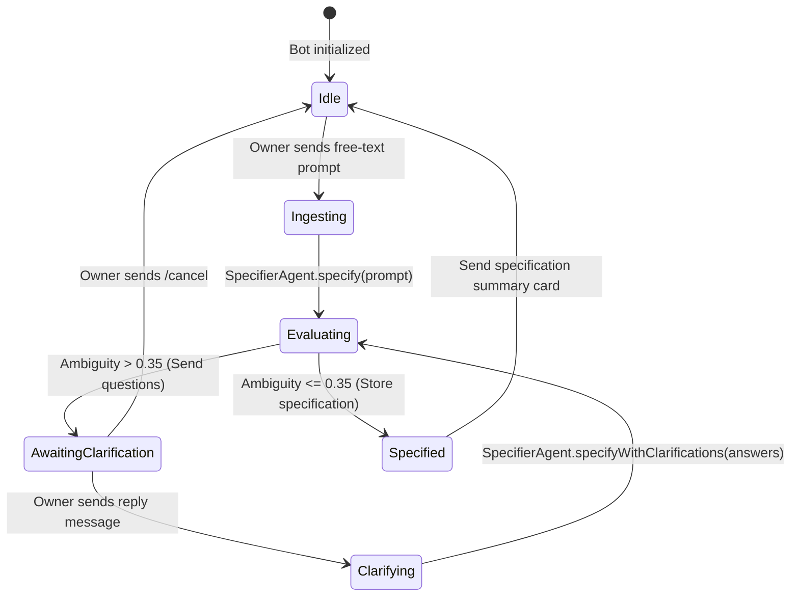

# Phase 10 Research: Telegram Remote Task Intake & Status Reporting

## 1. Executive Summary

Phase 10 connects the Telegram Bot Gateway built in Phase 9 directly to the core Specification Engine developed in Phase 6. This enables the repository owner to submit software tasks remotely via Telegram free-text messages, participate in a Socratic clarification loop for underspecified requests, and receive structured specification cards and status reports directly on their mobile device.

---

## 2. Requirements & Security Invariants

### 2.1 Functional Requirements
- **`REQ-TG-04`**: Remote Task Intake & Clarification Loop:
  - Free-text messages from the authorized owner are routed to `SpecifierAgent`.
  - When ambiguity $> 0.35$, Socratic clarification questions are formatted in MarkdownV2 and sent to Telegram.
  - Owner replies in Telegram are captured as answers to clarification questions and re-evaluated until ambiguity $\le 0.35$.
  - When ambiguity $\le 0.35$, the structured specification is stored in `SpecificationRepository` (`status: "draft"`), and a confirmation card is sent to Telegram.
- **Status Reporting Parity**:
  - Live status reporting on task specification progression (`intake` $\rightarrow$ `specifying` $\rightarrow$ `needs_clarification` $\rightarrow$ `specified`).
  - `/cancel` command to abort pending clarification loops and reset active conversational context.

### 2.2 Security & Multi-Channel Invariants
- All incoming updates must still pass `isAuthorizedSender` (only `OWNER_TELEGRAM_ID`).
- Telegram task creation must use the same underlying `TaskRepository`, `SpecificationRepository`, and `TaskStateMachine` as the web application (`FR-TG-004`).
- Avoid infinite conversational loops: limit clarification questions to $\le 3$ per round, and max 3 rounds before finalizing with best-effort assumptions.

---

## 3. Conversational State Machine for Telegram



### 3.1 State Tracking Mechanism
Using the existing `public.conversations` table (`channel: 'telegram'`):
- Active clarification state stored in `metadata`:
  ```json
  {
    "taskId": "uuid",
    "awaitingClarification": true,
    "originalPrompt": "Build an auth route",
    "questions": [
      { "id": "q1", "question": "What providers are needed?", "dimension": "scope" }
    ],
    "round": 1
  }
  ```
- If an active conversation with `awaitingClarification: true` exists for the owner, the next non-command message is treated as the answer.
- `/cancel` resets `awaitingClarification: false`.

---

## 4. Execution Wave Breakdown

- **Wave 1 (Plan 10.1): Task Intake Service & Specifier Integration**
  - Author `TelegramIntakeService` (`src/lib/telegram/intake.ts`).
  - Connect free-text input to `TaskRepository` and `SpecifierAgent`.
  - Format and send clarification prompts or specification complete cards.
  - Unit tests in `tests/unit/telegram/intake.test.ts`.

- **Wave 2 (Plan 10.2): Conversational Clarification Loop & Status Reporting**
  - Implement answer processing in `TelegramIntakeService`.
  - Update `commands.ts` with `/cancel` and enhanced `/status`.
  - Wire intake service into `POST /api/telegram/webhook` and `scripts/telegram-polling.ts`.
  - Unit tests in `tests/unit/telegram/clarification.test.ts` and `tests/unit/api/telegram-webhook-route.test.ts`.
