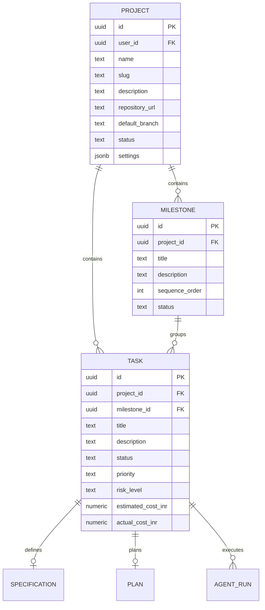

# Phase 23 Research: Project Workspace & Hierarchy UI

## 1. Domain Overview & Problem Statement

Phase 23 launches **Milestone 7 (v7.0 — Projects, Agents & Memory UI)**. It implements **`REQ-UI-PROJ-01` (Project Workspace & Hierarchy Navigation)** and **`REQ-UI-PROJ-02` (Interactive Kanban Board & Task Controls)**, providing the primary operational command interface for managing projects, inspecting hierarchical milestones and tasks, tracking execution velocity, and executing task status transitions.

In earlier milestones, projects and tasks were manageable primarily via API endpoints, automated background workers, or Telegram commands. The Web Dashboard (`/`) rendered an overview widget (`ActiveProjectsList`), but navigating to `/projects` or `/projects/[id]` lacked dedicated interactive workspace views.

### Key Capabilities Required:
1. **Dedicated `/projects` Index Page:** Overview of all projects with status filtering, total task counts, repository connections, and quick launch actions.
2. **Project Detail Workspace (`/projects/[id]`):** Rich dashboard displaying:
   - Project metadata (name, slug, description, GitHub repository URL, default branch, status).
   - Milestone hierarchy tree with progress bars and completion velocity metrics.
   - Dual-view switcher: **Kanban Board** vs. **Milestone Hierarchy List**.
3. **Interactive Kanban Board:**
   - 4 canonical columns:
     - **Backlog** (`intake`, `specifying`, `planned`)
     - **In Progress** (`running`, `verifying`)
     - **Review & Blocked** (`awaiting_approval`, `failed`, `cancelled`)
     - **Completed** (`completed`)
   - Direct status transition controls validating legal transitions against `TaskStateMachine.canTransition`.
4. **Task Detail Slide-Over Drawer:**
   - Detailed task card inspector displaying description, priority badge, risk level, estimated/actual cost in INR.
   - Direct links to Plan Review UI (`/tasks/[id]/plan`) when planned or running.
   - Linked specification scope, exclusions, and acceptance criteria.
   - Associated agent run telemetry shortcuts.
5. **Quick Task Creation Dialog:**
   - Modal to quickly add a task to the project with title, description, priority, and milestone assignment.
6. **API Endpoints:**
   - `GET /api/projects`: List all user projects with milestone and task aggregations.
   - `GET /api/projects/[id]`: Retrieve project details with complete milestone and task hierarchy.
   - `POST /api/projects`: Create a new project.
   - `POST /api/projects/[id]/tasks`: Create a new task within a project.
   - `PATCH /api/tasks/[id]`: Update task status, priority, or milestone assignment with state machine validation.

---

## 2. Technical Architecture & Component Hierarchy

```
                                  /projects
                         (ProjectsIndexPage)
                                  │
                   ┌──────────────┴──────────────┐
                   ▼                             ▼
           ProjectCardsGrid               CreateProjectModal
                   │
                   ▼ (Click Project)
                           /projects/[id]
                        (ProjectWorkspacePage)
                                  │
          ┌───────────────────────┼───────────────────────┐
          ▼                       ▼                       ▼
    ProjectHeader         ViewModeSelector        CreateTaskButton
   (Metadata, Stats,     (Kanban vs Hierarchy)    (Intake Dialog)
   Completion Velocity)           │
                                  ├────────────────────────┐
                                  ▼                        ▼
                         ProjectKanbanBoard       MilestoneHierarchyView
                         (4 Status Columns)      (Accordions by Milestone)
                                  │                        │
                                  └──────────┬─────────────┘
                                             ▼ (Select Task)
                                     TaskDetailDrawer
                                    - Task Metadata & Cost
                                    - Linked Spec & Criteria
                                    - Linked Plan & DAG Steps
                                    - Agent Run Status & Link
                                    - Legal Status Actions
```

---

## 3. Data Models & Entity Relationships



---

## 4. State Machine & Status Mapping

The database schema defines 9 distinct task states (`TaskStatus`):
`intake`, `specifying`, `planned`, `awaiting_approval`, `running`, `verifying`, `failed`, `completed`, `cancelled`.

### Kanban Column Grouping:
1. **`backlog`**: `intake`, `specifying`, `planned`
2. **`in_progress`**: `running`, `verifying`
3. **`blocked_review`**: `awaiting_approval`, `failed`, `cancelled`
4. **`completed`**: `completed`

### Valid Transitions via `TaskStateMachine`:
- `intake` -> `specifying`, `cancelled`
- `specifying` -> `planned`, `cancelled`
- `planned` -> `awaiting_approval`, `running`, `cancelled`, `specifying`
- `awaiting_approval` -> `running`, `cancelled`, `specifying`
- `running` -> `verifying`, `failed`, `cancelled`
- `verifying` -> `completed`, `failed`
- `failed` -> `intake`, `specifying`, `planned`, `running`, `cancelled`

Any status mutation triggered from the UI must validate through `TaskStateMachine.canTransition(current, target)` before applying the change to `tasks` table.

---

## 5. Implementation Wave Decomposition

### Wave 1 (Plan 23.1): Project Workspace, Hierarchy & API Routes
- **Domain API:** `GET /api/projects`, `GET /api/projects/[id]`, `POST /api/projects`.
- **Pages:** `/projects/page.tsx` (projects listing) and `/projects/[id]/page.tsx` (workspace shell).
- **Components:**
  - `ProjectHeader`: Title, slug, description, GitHub link, branch badge, completion progress bar.
  - `MilestoneHierarchyView`: Milestone accordion cards showing sequence order, completion progress, and task list with status pills.
  - `CreateProjectModal`: Dialog to create a project with repository URL and description.
- **Testing:** Unit tests for project routes and components (rendering, empty state, progress calculation).

### Wave 2 (Plan 23.2): Interactive Kanban Board, Task Controls & Drawer
- **Domain API:** `POST /api/projects/[id]/tasks`, `PATCH /api/tasks/[id]`.
- **Components:**
  - `ProjectKanbanBoard`: 4-column responsive grid with task cards, badges, priority indicators, and quick action transitions.
  - `TaskDetailDrawer`: Accessible slide-over drawer displaying task details, linked specification criteria, plan review link, and agent run status.
  - `CreateTaskModal`: Dialog to add a new task assigned to an optional milestone.
- **Testing:** Unit and integration tests for Kanban board column grouping, transition actions, task drawer details, and task mutation APIs.

---

## 6. Verification Criteria & Non-Functional Constraints
- **Zero Warnings:** All TypeScript and ESLint checks pass with 0 errors and 0 warnings.
- **Performance (`NFR-PERF-02`):** Pages load swiftly using server component data fetching with optimistic client state.
- **Security (`NFR-SEC-03`):** All database queries remain strictly owner-scoped (`user_id = auth.uid()` via RLS).
- **Design Consistency:** Styled with Jarvis cinematic theme tokens (`bg-surface-1`, `border-surface-3`, `text-accent-cyan`, Radix UI / shadcn/ui components).
