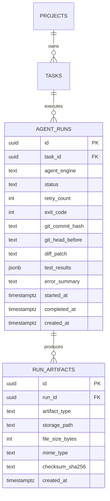

# Phase 24 Research: Agent Operations Console & Telemetry Viewer

## 1. Domain Overview & Problem Statement

Phase 24 is the second phase of **Milestone 7 (v7.0 — Projects, Agents & Memory UI)**. It fulfills:
- **`REQ-UI-AGENT-01` (Agent Operations Console):** Dedicated `/agents` dashboard listing durable agent runs across all projects with status filtering (`queued`, `running`, `completed`, `failed`), engine/model tags, duration/cost metrics, and search.
- **`REQ-UI-AGENT-02` (Run Telemetry & Artifact Inspector):** Drill-down telemetry console (`/agents/runs/[id]`) with step execution timeline, tabbed stdout/stderr log viewer, git diff viewer with quality score badges, and artifact drawer.

Previously, agent runs were inspectable primarily through a compact dashboard widget (`AgentRunsCard`) on the home page (`/`) or raw API payloads. To achieve full observability and operational control over autonomous coding agents, the system requires a dedicated multi-run console and an in-depth telemetry inspector.

---

## 2. Technical Architecture & Component Hierarchy

```
                                  /agents
                          (AgentsConsolePage)
                                  │
                    ┌─────────────┴─────────────┐
                    ▼                           ▼
          ConsoleMetricsBar             AgentRunsFilterBar
         (Total, Active, Success%,      (Status: all/running/done/failed,
          Avg Duration, Total Cost)      Search query, Engine filter)
                    │
                    ▼
          AgentRunsDataTable
         (Run ID, Task Title, Project, Engine, Status Badge,
          Duration, Git Commit, Action: Inspect)
                    │
                    ▼ (Click Run)
                             /agents/runs/[id]
                           (RunTelemetryPage)
                                  │
          ┌───────────────────────┼───────────────────────┐
          ▼                       ▼                       ▼
      RunHeader        ExecutionStepTimeline      ArtifactsDrawer
  (Status, Duration,    (Queued -> Running ->     (Diffs, Test summaries,
   Commit, Engine,       Verifying -> Done)       Logs, Checksums)
   Task/Project Breadcrumbs)      │
                                  ▼
                         RunTelemetryViewer
                       ┌──────────┴──────────┐
                       ▼                     ▼
                   DiffViewer            LogViewer
                (Syntax-colored       (Terminal stdout/
                 unified diff,         stderr, error
                 Quality Badge)        diagnostic trace)
```

---

## 3. Data Models & Entity Relationships

In Supabase schema (`20261115000001_initial_schema.sql`):


### Key Derived Metrics:
- **Duration:** `completed_at - started_at` (formatted as `Xm Ys` or `Xs`).
- **Diff Stats:** Additions count (`+`), deletions count (`-`), files touched parsed from `diff_patch`.
- **Quality Score:** Parsed from `diff-quality.md` artifact or calculated via `QualityScorer`.
- **Step Timeline State:**
  - `queued` -> Step 1 (Queued) active
  - `running` -> Step 2 (Running coding agent) active
  - `completed` -> Step 3 (Completed & Verified) green
  - `failed` -> Step 3 (Failed / Halted) red with error summary

---

## 4. API Endpoints Required

1. **`GET /api/agents/runs` (Enhanced):**
   - Query params: `status`, `agentEngine`, `search`, `limit` (default 50), `offset`.
   - Returns paginated list of runs enriched with task title, task priority, and project name/slug.
2. **`GET /api/agents/runs/[id]` (New):**
   - Retrieves specific run record with linked task details, project details, parsed diff summary, and full list of attached artifacts from `run_artifacts`.

---

## 5. Wave Decomposition

### Wave 1 (Plan 24.1): Agent Operations Console & Runs Listing
- **API:** Enhanced `GET /api/agents/runs` with filtering, search, pagination, and task/project enrichment.
- **Components:**
  - `AgentRunsConsoleView`: Master console view with metrics bar (Total Runs, Active Runs, Success Rate, Average Duration), search input, status filters (`all`, `running`, `completed`, `failed`), and rich data table.
  - Sidebar & Mobile Nav: Add "Agents" item with `Cpu` or `Bot` icon to `NAV_ITEMS`.
- **Page:** `src/app/agents/page.tsx` wrapped in `AppShell`.
- **Tests:** `tests/unit/api/agents-runs-api.test.ts` and `tests/unit/components/agents-console.test.tsx`.

### Wave 2 (Plan 24.2): Telemetry Inspector, Stepper Timeline & Artifact Drawer
- **API:** `GET /api/agents/runs/[id]` returning run details, task/project correlation, and artifacts.
- **Components:**
  - `RunHeader`: Status badge, duration, git commit, breadcrumbs (`Dashboard > Agents > Run #[id]`).
  - `ExecutionStepTimeline`: Visual stepper illustrating run lifecycle.
  - `DiffViewer`: Syntax-colored diff viewer with hunk lines, addition/deletion metrics, and quality score pill.
  - `LogViewer`: Terminal-style dark console displaying execution logs, test outputs, or error summaries.
  - `RunArtifactsList`: List of attached execution artifacts with SHA-256 checksums and download/view triggers.
- **Page:** `src/app/agents/runs/[id]/page.tsx` full telemetry workspace.
- **Tests:** `tests/unit/components/run-telemetry.test.tsx`.

---

## 6. Non-Functional Criteria & Security Constraints
- **Main-Only Branch Discipline (`NFR-SEC-01`):** Run commits and diffs target strictly `main`.
- **Secret Sanitization (`NFR-SEC-02`):** Logs and diff viewers sanitize API keys and credentials before rendering.
- **Owner RLS (`NFR-SEC-03`):** Queries join through `tasks` and `projects` scoped to `user_id = auth.uid()`.
- **Fast Interactive Paint (`NFR-PERF-02`):** Tabbed views load efficiently with client-side state caching.
