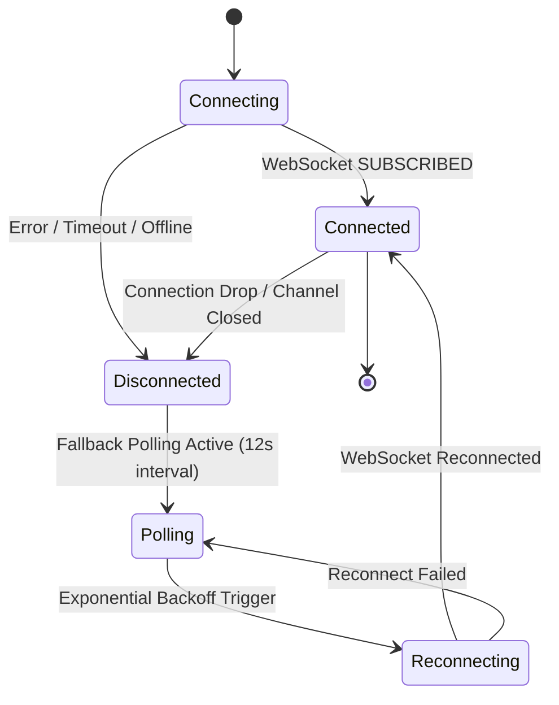

# Phase 26 Research: Real-Time State Synchronization Engine

## 1. Technical Context & Objectives

Phase 26 concludes **Milestone 7 (v7.0 — Projects, Agents & Memory UI)** by delivering the real-time reactive state synchronization layer for Javis. Autonomous agents execute workflows, update tasks, emit telemetry, and request human approvals asynchronously. Without real-time push synchronization, human operators must manually refresh the browser to discover that a task moved from `specifying` to `awaiting_approval` or that an agent run failed.

### Core Requirements
- **`REQ-RT-01` (Real-Time State Synchronization Engine)**:
  - Supabase Realtime client hooks and channel subscriptions across `tasks`, `agent_runs`, `projects`, and `approvals`.
  - Provide instant optimistic UI updates and reactive state updates across the Project Kanban board, Agent Operations Console, Dashboard cards, and Topbar.
- **`NFR-REL-01` (Resilient Realtime Fallback)**:
  - If the WebSocket connection drops, encounters timeout, or the browser enters an offline state, the UI must seamlessly fall back to gentle background polling (interval 10s-15s) without disruptive errors or duplicate events.
  - Automatic reconnection with exponential backoff; tears down polling when the WebSocket re-establishes `SUBSCRIBED` status.

---

## 2. Supabase Realtime Architecture & Integration

### 2.1 Postgres Publication Configuration
In Supabase, Postgres changes are broadcast over WebSockets only if target tables are registered in the `supabase_realtime` publication.
We must add a migration:
```sql
ALTER PUBLICATION supabase_realtime ADD TABLE public.tasks;
ALTER PUBLICATION supabase_realtime ADD TABLE public.agent_runs;
ALTER PUBLICATION supabase_realtime ADD TABLE public.projects;
ALTER PUBLICATION supabase_realtime ADD TABLE public.approvals;
```

### 2.2 Client-Side Subscription API
Using `@supabase/supabase-js` via `@supabase/ssr` (`createBrowserClient`):
```typescript
const channel = supabase.channel(`realtime:${table}:${userId}`)
  .on(
    'postgres_changes',
    { event: '*', schema: 'public', table, filter: `user_id=eq.${userId}` },
    (payload) => {
      // payload.eventType: 'INSERT' | 'UPDATE' | 'DELETE'
      // payload.new, payload.old
    }
  )
  .subscribe((status, err) => {
    // status: 'SUBSCRIBED' | 'TIMED_OUT' | 'CLOSED' | 'CHANNEL_ERROR'
  });
```

### 2.3 Channel Multiplexing & Connection Manager
To prevent multiple components from opening redundant WebSocket channels to the same Supabase table (which exhausts connection pools and wastes memory):
- Implement a centralized `RealtimeManager` singleton or reference-counted registry.
- Tracks active channels per table/filter.
- Multiple React hooks subscribe to the same channel's EventEmitter.
- Unsubscribes from Supabase only when subscriber count drops to 0.

---

## 3. Resilient Fallback Polling & Reconnection Architecture (`NFR-REL-01`)



### 3.1 State Machine: RealtimeStatus
- `'connecting'`: Channel handshake initiated.
- `'connected'`: Channel status is `'SUBSCRIBED'`. Polling is inactive.
- `'disconnected'`: Network offline, channel error, or timeout.
- `'polling'`: Disconnected fallback active. Periodic HTTP fetch keeps UI updated.

### 3.2 Deduplication & Optimistic Concurrency
To ensure that polling responses and real-time WebSocket events never cause duplicate UI elements or revert optimistic changes:
1. **Entity Identity**: All records use UUID primary keys (`id`).
2. **Timestamp Guard**: Track `updated_at` (or sequence version). If an incoming event has `updated_at <= existing.updated_at`, discard it.
3. **List Mutator Functions**:
   - `INSERT`: If `list.some(item => item.id === newRecord.id)`, update in place; otherwise prepend/append according to sort order.
   - `UPDATE`: Replace item by ID preserving UI-specific local state.
   - `DELETE`: Remove item where `item.id === oldRecord.id`.

---

## 4. UI Component Integration Points

1. **`src/components/layout/topbar.tsx`**:
   - Add `RealtimeStatusBadge`: Displays `Live` (green pulsing badge), `Polling` (amber badge), or `Offline` (gray badge).
   - Replaces the hardcoded static `Online` badge with live reactive connection status.
2. **`src/components/projects/project-workspace-view.tsx` & `project-kanban-board.tsx`**:
   - Integrate `useRealtimeTasks({ projectId, initialTasks })`.
   - As tasks change status during autonomous execution, Kanban columns and progress metrics update live.
3. **`src/components/agents/agents-console-view.tsx` & `agent-runs-card.tsx`**:
   - Integrate `useRealtimeRuns({ initialRuns })`.
   - Real-time updates when agent runs transition from `queued` -> `running` -> `completed` / `failed`.
4. **`src/components/dashboard/pending-approvals-card.tsx`**:
   - Integrate `useRealtimeApprovals({ initialApprovals })`.
   - Displays real-time pending approvals and removes cards immediately when approved via Telegram or UI.

---

## 5. Verification Plan

1. **Unit Tests:**
   - `realtime-manager.test.ts`: Channel creation, subscriber count, event fan-out, teardown.
   - `use-realtime-subscription.test.ts`: Hook status changes, fallback polling activation when channel drops, event deduplication.
   - `use-realtime-tasks.test.ts`: CRUD state mutations, optimistic transitions, polling sync.
   - `realtime-status-badge.test.tsx`: Badge visual states and accessibility labels.
2. **Regression Suite:**
   - Run all 85+ test files in Vitest (expect 540+ passing tests).
   - Run `npm run build` to ensure 24+ routes compile with 0 errors and 0 warnings.
