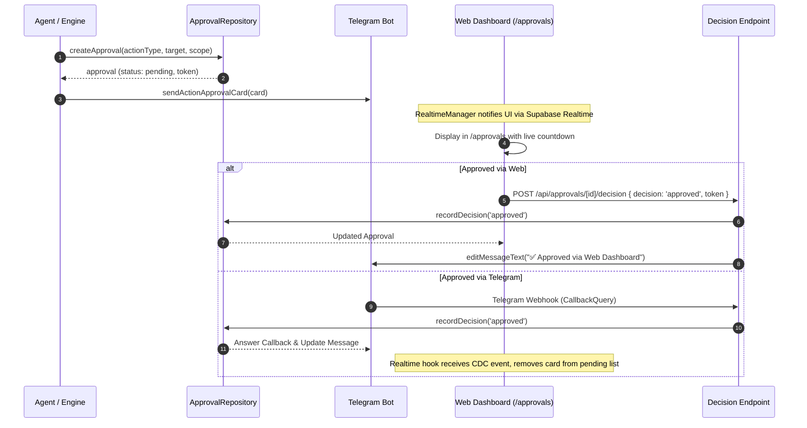

# Phase 27 Research: Unified Approval Centre & Cryptographic Decision Engine

## 1. Technical Context & Scope

Phase 27 launches **Milestone 8 (v8.0 — Approvals, Security & Cost Controls)** by establishing the unified Human Approval Centre and cryptographic decision verification engine. Autonomous systems and background agents frequently encounter high-impact operations that must not execute without explicit, authenticated human authorization (`PRD §7.8, §7.9, §12`).

### Target Requirements
- **`REQ-APP-01` (Unified Approval Centre & UI):** Dedicated `/approvals` portal presenting approval requests with status filtering (`pending`, `approved`, `rejected`, `expired`), action type badges, target resources, risk tier, live expiry countdown timers, and contextual links to linked tasks, plans, or diffs.
- **`REQ-APP-02` (Cryptographic Token Verification & Dual-Channel Parity):** Server-side HMAC-SHA256 signature verification ensuring that decisions made on the Web or via Telegram cannot be spoofed, replayed, or forged for different parameters.

---

## 2. Cryptographic Approval Token Architecture

### 2.1 Threat Model
1. **Parameter Tampering:** An attacker modifies `targetResource` (e.g., swapping a harmless test branch for `origin/main`).
2. **Replay Attacks:** Re-submitting an approval decision payload after it has already been decided or revoked.
3. **Channel Inconsistency:** An approval granted on Telegram should immediately reflect in the Web UI and prevent double-decision execution.
4. **Expiration Bypass:** Submitting an approval decision after the approval TTL has elapsed.

### 2.2 HMAC-SHA256 Token Formulation
We construct a canonical payload string from the immutable attributes of the approval:
```typescript
const canonicalString = [
  approval.id,
  approval.action_type,
  approval.target_resource,
  approval.user_id,
  new Date(approval.expires_at).toISOString(),
].join(":");
```
The signature is generated using `crypto.createHmac("sha256", secret)`:
```typescript
const signature = crypto
  .createHmac("sha256", secret)
  .update(canonicalString)
  .digest("hex");

const token = `${approval.id}.${signature}`;
```

### 2.3 Verification Rules
When `POST /api/approvals/[id]/decision` is called:
1. Verify token signature: Recompute HMAC using server secret and compare using `crypto.timingSafeEqual`.
2. Check expiry: `Date.now() < new Date(approval.expires_at).getTime()`. If expired, mark as expired and reject with `400 EXPIRED_APPROVAL`.
3. Check status: Verify `approval.status === 'pending'`. If already decided, reject with `409 ALREADY_DECIDED`.
4. Transition state: Use `ApprovalStateMachine.assertDecision()` and record decision timestamp and actor.

---

## 3. Dual-Channel Parity (Web & Telegram)



---

## 4. UI / UX Design Specifications

### 4.1 Visual Hierarchy & Tokens
- **Route:** `/approvals` (accessible from Sidebar and Topbar alert pill).
- **Banner Metrics:**
  - Total Requests
  - Pending Approvals (Amber/Warning with pulsing dot when >0)
  - Approved Decisions (Emerald)
  - Rejected Decisions (Rose)
  - Expired Requests (Slate)
- **Status Tabs:** `All`, `Pending`, `Approved`, `Rejected`, `Expired`.
- **Action Type Badges:**
  - `git_remote_push`: Blue badge with `GitCommit` icon
  - `production_deploy`: Purple badge with `Rocket` icon
  - `paid_ai_inference`: Yellow badge with `Coins` icon
  - `destructive_db_mutation`: Red badge with `Database` icon
  - `external_message`: Cyan badge with `Send` icon
- **Countdown Timer:** Live second-by-second countdown with warning color when `< 5m` remaining.
- **Card Drawer / Modal:** Allows owner to enter an optional decision reason before confirming.

---

## 5. Verification Plan

1. **Unit Tests:**
   - `tests/unit/approvals/approval-token.test.ts`: Signature generation, verification, tamper detection, expired token rejection.
   - `tests/unit/repositories/approval-repository.test.ts`: `listApprovals` with filters, metrics calculation, active approval checks.
   - `tests/unit/api/approvals-routes.test.ts`: `GET /api/approvals`, `POST /api/approvals`, `GET /api/approvals/[id]`, and `POST /api/approvals/[id]/decision`.
   - `tests/unit/components/approvals-portal.test.tsx`: Card rendering, countdown timer, filter tabs, modal approval/rejection interactions.
2. **Regression & Build:**
   - Full Vitest suite (`cmd /c npx vitest run`) covering all 90+ test files.
   - Next.js production build (`cmd /c npm run build` with `BypassSandbox: true`).
