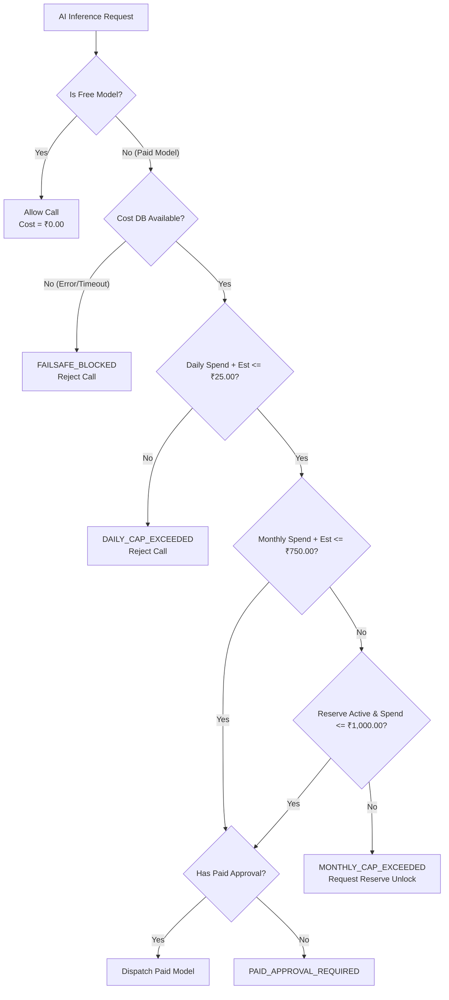

# Phase 28 Research: Cost Ledger, Inference Circuit Breakers & Budget Caps

## 1. Domain & Technical Objectives

Phase 28 establishes **financial guardrails, metered usage accounting, and automated circuit breaking** across Jarvis (`REQ-COST-01`, `REQ-COST-02`, `NFR-REL-02`).

The primary objectives are:
1. **Metered Cost Ledger (`CostRepository`):**
   - Ingests and stores every model interaction into `cost_records`.
   - Tracks prompt tokens, completion tokens, total tokens, provider, model name, inference cost in INR, estimation status, and linked `run_id`.
   - Computes daily and monthly aggregate spend, spending by model, and daily trend summaries.
2. **Inference Circuit Breaker:**
   - Server-side interceptor that validates budget ceilings *before* any billable inference is dispatched to AI providers.
   - Enforces the financial invariants from `docs/BUDGET_AND_COST_CONTROL.md`:
     - Normal Daily Limit: **₹25.00 INR**
     - 80% Daily Warning Threshold: **₹20.00 INR**
     - Normal Monthly Limit: **₹750.00 INR**
     - Emergency Reserve: **₹250.00 INR** (accessible only via explicit authorization)
     - Absolute Monthly Hard Ceiling: **₹1,000.00 INR** (inviolable stop)
3. **Failsafe Rule (`NFR-REL-02`):**
   - If the cost ledger or database fails, times out, or is inaccessible, billable model calls must default to `BLOCKED` rather than proceeding unmetered.
4. **Budget Management UI & API:**
   - App Router `/settings` page featuring a dedicated Cost & Budget Control interface.
   - Displays real-time financial metrics, circuit breaker status indicator, emergency reserve unlock modal, and granular usage ledger logs.

---

## 2. Invariants & Financial Guardrails



---

## 3. Data Contracts & Architecture

### 3.1 Database Schema
Using existing `cost_records` table:
- `id`: UUID (Primary Key)
- `user_id`: UUID (Foreign Key to `user_profiles.id`)
- `run_id`: UUID (Foreign Key to `agent_runs.id`, optional)
- `provider`: TEXT (e.g. "openrouter")
- `model`: TEXT (e.g. "anthropic/claude-3.5-sonnet")
- `prompt_tokens`: INT
- `completion_tokens`: INT
- `total_tokens`: INT
- `cost_inr`: NUMERIC(10, 4)
- `is_estimated`: BOOLEAN
- `created_at`: TIMESTAMPTZ

### 3.2 Emergency Reserve Storage
Stored in `user_profiles.preferences`:
```json
{
  "emergency_reserve": {
    "unlocked_month": "2026-11",
    "unlocked_at": "2026-11-17T13:30:00Z",
    "authorized_by": "user-id",
    "reason": "Production hotfix deployment"
  }
}
```
This avoids unnecessary schema migrations while preserving persistent authorization per billing cycle.

---

## 4. Plan Breakdown

- **Plan 28.1 (Wave 1):** `CostRepository`, spend aggregations, failsafe circuit breaker service (`circuit-breaker.ts`), and REST API endpoints (`GET /api/costs`, `GET /api/costs/summary`, `POST /api/costs/emergency-reserve`).
- **Plan 28.2 (Wave 2):** Budget and Cost Control UI (`src/app/settings/page.tsx`, `src/components/cost/`), integration with `AIGateway`, comprehensive unit and component tests, and Next.js production build verification.
