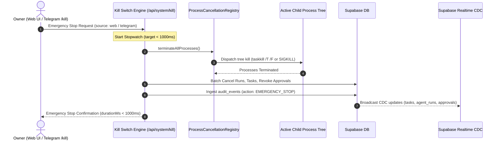

# Phase 29 Research: Emergency Kill Switch & Subprocess Cancellation Protocol

## 1. Domain & Technical Objectives

Phase 29 establishes the **Global Emergency Kill Switch & Subprocess Cancellation Protocol** for Jarvis (`REQ-SEC-01`, `REQ-SEC-02`, `NFR-PERF-03`).

The core objectives are:
1. **Instantaneous Halting (`REQ-SEC-01`):**
   - Provide an irrevocable emergency shutdown mechanism triggered either via the web dashboard or Telegram mobile gateway (`/kill`).
   - Cancels all active agent runs, halts task execution pipelines, and revokes outstanding high-risk authorization approvals.
2. **Process-Tree Signal Termination (`REQ-SEC-02`):**
   - Track all child processes spawned by coding agent runners (e.g. Aider CLI, sandbox runners, verification harnesses).
   - Ensure complete process tree termination on both Windows (`taskkill /pid <PID> /T /F`) and POSIX systems (`SIGTERM` followed by immediate `SIGKILL` if still active).
   - Guarantee zero orphan processes continue mutating files or consuming CPU/memory.
3. **Sub-Second Performance (`NFR-PERF-03`):**
   - The entire emergency stop sequence (terminating active child processes, updating database states, recording audit log, and generating response) must complete within `< 1.0 second` (1000ms).

---

## 2. Architecture & Data Flow

---

## 3. Invariants & Security Guarantees

1. **Dual-Channel Parity:** Both the web topbar button and Telegram `/kill` command must invoke the exact same core `EmergencyKillSwitchService`.
2. **Idempotence & Safety:** Calling the kill switch when no processes are active must succeed harmlessly and report zero processes terminated without error.
3. **Audit Trail:** Every emergency stop must be permanently recorded in `audit_events` with the triggering user ID, channel source (`web` or `telegram`), duration in milliseconds, and count of affected entities.
4. **State Machine Consistency:** Runs transition to `failed` (reason `EMERGENCY_STOP_TERMINATED`), tasks transition to `cancelled`, and pending approvals transition to `rejected` (reason `Revoked by Emergency Kill Switch`).

---

## 4. Plan Decomposition

- **Plan 29.1 (Wave 1):** `ProcessCancellationRegistry`, process-tree signal dispatcher, `EmergencyKillSwitchService`, audit logging, and REST API endpoints (`POST /api/system/kill`, `GET /api/system/kill/status`).
- **Plan 29.2 (Wave 2):** Telegram `/kill` command integration, Web Topbar `EmergencyStopButton`, confirmation dialog, emergency alert banner, sub-second verification tests, and production build checks.
