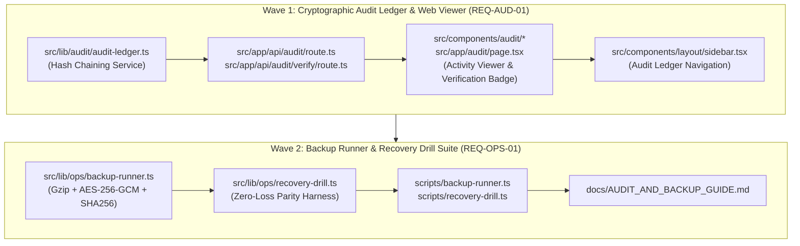

# Phase 30 Research: Tamper-Evident Audit Ledger & Backup Recovery Verification

**Requirements Covered:** `REQ-AUD-01`, `REQ-OPS-01`  
**Milestone:** v8.0 Approvals, Security & Cost Controls  

---

## 1. Domain & Architecture Analysis

### 1.1 Tamper-Evident Cryptographic Hash Chaining (`REQ-AUD-01`)
- **Objective:** Every critical system mutation (task intake, plan approvals, code generations, git pushes, emergency stops, disaster recovery events) must be permanently logged in `audit_events` such that any retroactive modification, record deletion, or unauthorized insertion is immediately detectable mathematically.
- **Underlying Database Schema:**
  - `public.audit_events`:
    - `id UUID PRIMARY KEY`
    - `user_id UUID REFERENCES user_profiles(id)`
    - `event_type TEXT NOT NULL`
    - `resource_type TEXT NOT NULL`
    - `resource_id TEXT NOT NULL`
    - `details JSONB NOT NULL DEFAULT '{}'::jsonb`
    - `ip_address INET`
    - `user_agent TEXT`
    - `created_at TIMESTAMPTZ NOT NULL DEFAULT NOW()`
  - RLS Policies (`20261115000002_rls_policies.sql`):
    - `audit_events_select_own`: `FOR SELECT USING (user_id = auth.uid())`
    - `audit_events_insert_own`: `FOR INSERT WITH CHECK (user_id = auth.uid())`
    - *No UPDATE or DELETE policies exist*, enforcing append-only semantics at the database engine level.
- **Hash-Chaining Protocol:**
  - **Genesis Block:** When no prior audit events exist for a chain or system, the `prev_hash` is initialized to a 64-character zero string: `"0".repeat(64)` (`"0000000000000000000000000000000000000000000000000000000000000000"`).
  - **Canonical Serialization:** In JavaScript/JSON, key order is non-deterministic by default. To produce stable cryptographic digests across environments:
    - Sort object keys deterministically when stringifying JSON payloads.
    - Format canonical block preimage:
      ```
      sequence + ":" + prev_hash + ":" + event_type + ":" + resource_type + ":" + resource_id + ":" + canonicalPayloadJson + ":" + timestampIso
      ```
    - Compute block hash using Node.js `crypto.createHash("sha256").update(preimage).digest("hex")`.
  - **Storage Convention:**
    - The `details` column of `audit_events` holds the chain metadata under an explicit `_audit` envelope:
      ```json
      {
        "_audit": {
          "sequence": 1,
          "prev_hash": "0000000000000000000000000000000000000000000000000000000000000000",
          "hash": "e3b0c44298fc1c149afbf4c8996fb92427ae41e4649b934ca495991b7852b855"
        },
        "action": "task_intake",
        "custom_metadata": "..."
      }
      ```
  - **Chain Verification Algorithm:**
    1. Fetch chronological audit entries ordered by sequence / created_at ascending.
    2. For entry 0: assert `prev_hash` equals Genesis hash.
    3. For entry $k > 0$: assert `entry[k].prev_hash === entry[k-1].hash`.
    4. Recompute expected hash from the entry fields and assert `recomputedHash === entry[k].hash`.
    5. Assert sequence numbers strictly increment by 1 ($seq_k = seq_{k-1} + 1$).
    6. If any check fails, immediately identify the corrupted/tampered entry ID, expected vs actual hash, and fail verification with an alert.

---

### 1.2 Automated Database Backup Runner & Disaster Recovery Drill (`REQ-OPS-01`)
- **Objective:** Establish automated backup snapshot generation with strong encryption (AES-256-GCM), integrity checksum verification (SHA-256), retention rotation, and automated recovery drill testing verifying zero-loss restoration.
- **Reference Document:** `docs/BACKUP_AND_RECOVERY.md`
  - Target RPO: **< 24 Hours** (Automated daily snapshots).
  - Target RTO: **< 1 Hour** (Automated drill verifies in < 15 seconds).
- **Snapshot Creation Process:**
  1. **Table Extraction:** Exports core critical tables (`projects`, `tasks`, `agent_runs`, `approvals`, `cost_records`, `memories`, `audit_events`).
  2. **Deterministic Formatting:** Formats records into canonical, sorted JSON structure with metadata (schema version, timestamp, record counts, table list).
  3. **Compression:** Compresses snapshot payload using gzip (`zlib.gzipSync`).
  4. **Encryption:** Encrypts compressed payload with AES-256-GCM using `crypto.createCipheriv`:
     - 256-bit encryption key (from `BACKUP_ENCRYPTION_KEY` or derived salt).
     - 96-bit unique Initialization Vector (IV).
     - 128-bit authentication tag appended to payload.
  5. **Integrity Digest:** Computes SHA-256 checksum over the encrypted snapshot file and writes an associated `.sha256` verification file.
  6. **Retention Rotation:** Scans backup directory, sorts existing snapshots by timestamp, and retains the most recent $N$ backups (e.g. 7 daily copies), safely pruning older files.
- **Disaster Recovery Drill Protocol:**
  1. **Seed/Snapshot:** Creates or extracts a known state of database entities.
  2. **Snapshot Creation:** Runs `BackupRunner.createSnapshot()`.
  3. **Checksum Verification:** Validates that the `.sha256` checksum matches the file hash exactly.
  4. **Simulated Disaster/Loss:** Simulates database corruption or table truncation.
  5. **Decryption & Decompression:** Reads encrypted snapshot, decrypts with AES-256-GCM, validates auth tag, and decompresses gzip.
  6. **Restoration:** Restores all tables and rows in topological dependency order (honoring foreign keys: `user_profiles` → `projects` → `tasks` → `approvals` → `agent_runs` → `audit_events`).
  7. **Zero-Loss Parity Assertion:** Compares 100% of rows and columns between pre-backup state and restored state. Row count must match exactly, field values must match exactly.
  8. **Performance Benchmarking:** Measures total elapsed restoration time to certify compliance with RTO targets.

---

## 2. Plan Phasing & Dependency Graph



---

## 3. Risk & Mitigation Strategy

1. **JSON Key Order Inconsistency:**
   - *Risk:* Differing JSON key order produces divergent SHA-256 hashes for identical payloads.
   - *Mitigation:* Implement deterministic deep sorting of object keys prior to hash generation.
2. **Postgres RLS Append-Only Guarantee:**
   - *Risk:* Direct SQL updates or deletions could break chain verification.
   - *Mitigation:* `audit_events` has strictly `INSERT` and `SELECT` RLS policies. Any external database modification will immediately trip `verifyChainIntegrity()`.
3. **Large Database Dump Performance:**
   - *Risk:* Heavy database snapshots take minutes and consume memory.
   - *Mitigation:* Use streaming gzip and streamable AES-256-GCM chunks for production, and batch table queries in chunks of 500 rows.
4. **Disaster Recovery Isolation:**
   - *Risk:* Running recovery drills against production could destroy live data.
   - *Mitigation:* Recovery drills run in isolated staging/mock environments or dry-run transactions with explicit validation guards.
