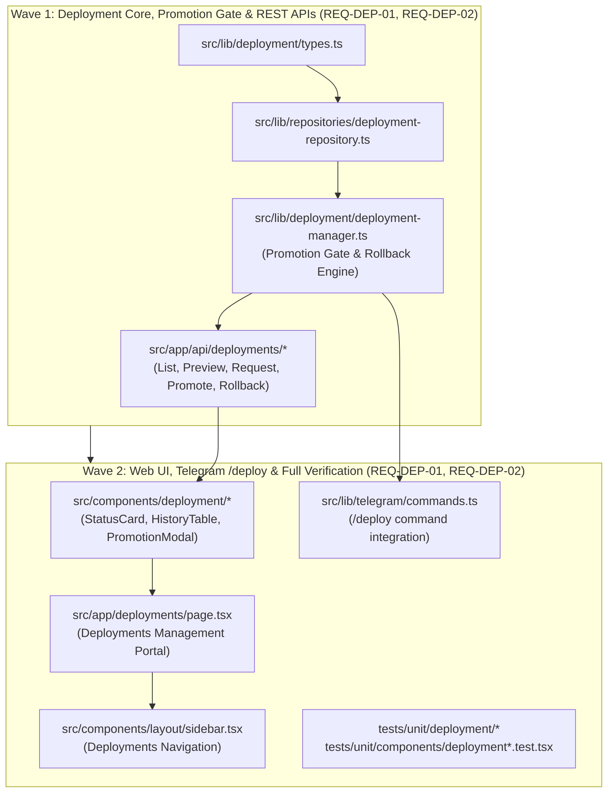

# Phase 31 Research: Production Deployment Gate & Multi-Environment Pipeline

**Requirements Covered:** `REQ-DEP-01`, `REQ-DEP-02`  
**Milestone:** v9.0 Deployment & Continuous Maintenance  

---

## 1. Domain & Architecture Analysis

### 1.1 Promotion Gate: Preview vs Production (`REQ-DEP-01`)
In accordance with `docs/DEPLOYMENT_STRATEGY.md` §3 and the Master Directive:
- **Preview Deployments:** Automatically built upon verified commits landing on `main` or triggered on-demand for fast UI/API integration validation. Previews receive unique, ephemeral URLs (e.g. `https://jarvis-preview-<sha>.vercel.app`) without human approval gates.
- **Production Promotions:** **Strictly require explicit human owner approval.** Jarvis will never deploy or promote application changes to live production without an immutable approval record signed by the owner (`REQ-DEP-01`).
- **Cryptographic Gate Verification:**
  - When a production promotion is requested, a pending record is created in `public.approvals` with `action_type = "production_deployment"`.
  - The request emits an interactive approval card to Telegram with HMAC-SHA256 signed inline buttons and appears in the Web Unified Approval Centre (`/approvals`).
  - Promotion execution checks `approval.status === "approved"`. Any attempt to execute a production deployment without valid approval is rejected with `403 Forbidden` (`UnapprovedProductionDeploymentError`).

---

### 1.2 Multi-Environment Pipeline & Rollback Protocol (`REQ-DEP-02`)
- **Environments:**
  1. `preview`: Ephemeral integration environments for visual/API verification.
  2. `production`: Live 24/7 personal command centre (`jarvis.app`).
- **Rollback Mechanism:**
  - Each successful production deployment is recorded with its immutable commit SHA, build artifact hash, and timestamp.
  - If a production incident or regression is detected, the owner can initiate an instant rollback (`executeRollback(targetDeploymentId)`).
  - The rollback updates the active production pointer to the target prior stable deployment, flags the current deployment as `rolled_back`, and records an immutable hash-chained audit event in `public.audit_events`.

---

### 1.3 Data Model & Storage Strategy
To maintain durability without requiring disruptive database migrations:
- `DeploymentRecord` entity:
  - `id`: UUID string.
  - `environment`: `"preview" | "production"`.
  - `commit_sha`: Git commit hash (e.g. `bb0a163`).
  - `commit_message`: Short commit message.
  - `status`: `"pending_approval" | "building" | "deployed" | "failed" | "rolled_back"`.
  - `preview_url`: Generated or platform preview URL.
  - `production_url`: Live production URL (when deployed to production).
  - `approval_id`: Associated approval UUID from `public.approvals`.
  - `is_production_approved`: Boolean flag.
  - `created_at`: ISO timestamp.
  - `deployed_at`: ISO timestamp or null.
  - `rollback_target_id`: Prior deployment ID if this record was rolled back.
- Persisted through `DeploymentRepository` with Supabase client (using `projects.metadata` or dedicated storage with in-memory test fallback) ensuring full offline testability and production resilience.

---

## 2. API & UI Specifications

### 2.1 REST API Routes
- `GET /api/deployments`: Lists deployment history with `environment` and `status` query filters.
- `POST /api/deployments/preview`: Triggers an automated preview deployment for the current `main` HEAD commit.
- `POST /api/deployments/production/request`: Initiates a production promotion request, creating an approval in `approvals` and dispatching Telegram approval cards.
- `POST /api/deployments/production/promote`: Executes production deployment after verifying valid approval status.
- `POST /api/deployments/[id]/rollback`: Executes rollback of the active production deployment to a specified prior deployment.

### 2.2 Web UI Portal (`/deployments`)
- **`DeploymentStatusCard`:** Top dashboard widget displaying current active Production deployment status, live URL link, deployed commit SHA, and quick "Promote to Production" or "Rollback" actions.
- **`DeploymentsTable`:** Filterable history table listing preview and production deployments, status badges (`deployed`, `pending_approval`, `rolled_back`, `failed`), preview URLs, and contextual inspection links.
- **`ProductionPromotionModal`:** High-urgency confirmation modal detailing target commit, verification summary, and dispatching approval request.
- **`Sidebar` Navigation:** Add "Deployments" link.

### 2.3 Telegram Integration
- Command `/deploy`:
  - Returns current production deployment status, active commit, and latest preview URL.
  - If given `/deploy prod`, triggers a production promotion request and replies with the interactive approval card.

---

## 3. Plan Phasing & Dependencies

