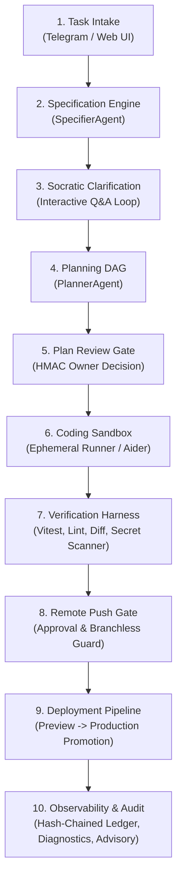

# Phase 35: End-to-End System Integration & Full Autonomous User Journey — Research & Architecture

## Objective
Establish an automated end-to-end integration and resilience verification harness (`REQ-SYS-01`, `NFR-QUAL-01`) that exercises the entire 10-stage autonomous developer loop from intake to production promotion, asserting zero regressions, strict error containment, and fault recovery.

---

## 1. Requirements & Invariants

| ID | Specification | Architectural Requirement |
|---|---|---|
| **REQ-SYS-01** | End-to-End Autonomous Lifecycle Verification | Automated integration test harness executing the full developer journey: Intake → Clarification → Spec → Planning → Coding → Verification → Diff Review → Push Gate → Preview → Production Gate → Telemetry. |
| **NFR-QUAL-01** | Zero Regressions & Clean Build Standard | 0 TypeScript compilation errors, 0 warnings, 100% test pass rate across the entire repository. |
| **NFR-SEC-04** | Main-Only Branch Discipline | All simulated lifecycle commits occur strictly on `main` with zero branch mutations. |
| **NFR-PERF-03** | Sub-Second Performance Bounds | Subprocess termination and health probe checks complete under respective latency budgets. |

---

## 2. Technical Findings & Design Decisions

### A. The 10-Stage Autonomous Lifecycle (`REQ-SYS-01`)
The complete Jarvis autonomous software engineering pipeline spans 10 connected stages across Milestones 1 through 9:

### B. Lifecycle Integration Orchestrator (`AutonomousLifecycleHarness`)
- Located in `src/lib/testing/e2e-harness.ts`.
- Manages an in-memory or isolated database mock executing each stage with realistic payload transitions.
- Validates:
  1. Data integrity: Artifacts and status flags carry forward accurately through all 10 stages.
  2. Cryptographic signatures: HMAC-SHA256 tokens validate correctly at the Plan Review Gate, Git Push Gate, and Production Deployment Gate.
  3. Audit trail: Every mutation produces a deterministic, tamper-evident block in the hash-chained audit ledger.

### C. Failure Resilience & Boundary Scenarios (`ResilienceHarness`)
- Located in `src/lib/testing/resilience-harness.ts`.
- Evaluates 5 boundary conditions and fault-recovery protocols:
  1. **Test Failure & 3-Strike Bounded Repair:** Fault injection into code; validates self-repair engages and aborts safely at strike 3 without infinite recursion (`REQ-VR-04`).
  2. **Secret Leak Prevention:** High-entropy token injection; validates pre-commit secret scanner blocks mutation (`REQ-VR-03`).
  3. **Circuit Breaker Ceiling Trip:** Simulated ₹25 daily / ₹750 monthly budget overflow; validates paid inference blocked until emergency reserve authorization (`REQ-COST-02`).
  4. **Emergency Stop Cascading:** Simulated mid-execution kill switch; validates active subprocess tree terminated in <1s, task cancelled, approvals revoked, audit event emitted (`REQ-SEC-01`, `REQ-SEC-02`).
  5. **Disaster Recovery Zero-Loss Restoration:** Backup snapshot + recovery drill verifying 100% table parity (`REQ-OPS-01`).

---

## 3. Execution Wave Plan
1. **Wave 1 (`35-01-PLAN.md`):** Complete 10-Stage Lifecycle Integration Orchestrator & End-to-End Test Suite
   - `src/lib/testing/e2e-harness.ts`
   - `tests/integration/autonomous-lifecycle.test.ts`
2. **Wave 2 (`35-02-PLAN.md`):** Failure Resilience, Boundary Condition Scenarios & Full Verification Suite
   - `src/lib/testing/resilience-harness.ts`
   - `tests/integration/resilience-recovery.test.ts`
   - Full repository Vitest execution & Next.js production build verification
