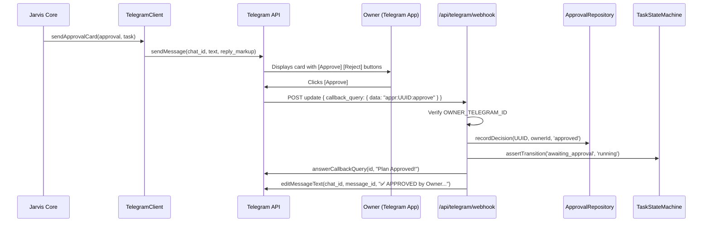

# Domain Research: Telegram Bot Gateway Architecture

## 1. Executive Summary & Design Constraints

Milestone 3 establishes the Telegram Gateway for Jarvis. The gateway acts as an auxiliary control plane for mobile task intake, real-time status reporting, and immediate decision-making on human approval requests.

### Core Architectural Principles:
1. **Single-Owner Allow-List:** Telegram updates originate outside the trusted application perimeter. Any update not originating from the configured `OWNER_TELEGRAM_ID` must be rejected immediately (dropping or returning 403) before processing.
2. **Dual-Mode Operation:**
   - **Production (Webhook):** Next.js App Router route handler `POST /api/telegram/webhook` secured via `X-Telegram-Bot-Api-Secret-Token` header validation.
   - **Local Development (Long Polling):** Standalone polling script (`scripts/telegram-polling.ts`) invoking `getUpdates` to allow local testing behind Windows NAT without public tunneling.
3. **No Direct State Manipulation:** The Telegram Gateway does not invent custom database mutations or bypass validations. It dispatches commands directly into existing shared services:
   - Task intake calls `SpecifierAgent` and `SpecificationRepository`.
   - Approval callbacks invoke `ApprovalRepository` and `TaskStateMachine`.
   - Status checks query `TaskRepository`, `UsageLedgerService`, and `ProjectRepository`.
4. **Rich Interactive UI (MarkdownV2 & Inline Keyboards):**
   - Approval requests render structured MarkdownV2 cards with inline callback buttons: `[ ✅ Approve ]` and `[ ❌ Reject ]`.
   - Callback queries respond immediately with `answerCallbackQuery` and update the message in-place (`editMessageText`) with timestamped owner decisions.

---

## 2. Telegram Bot API Specification & Payloads

### 2.1 Update Types
```typescript
export interface TelegramUser {
  id: number;
  is_bot: boolean;
  first_name: string;
  last_name?: string;
  username?: string;
}

export interface TelegramChat {
  id: number;
  type: "private" | "group" | "supergroup" | "channel";
  title?: string;
  username?: string;
  first_name?: string;
}

export interface InlineKeyboardButton {
  text: string;
  callback_data?: string;
  url?: string;
}

export interface InlineKeyboardMarkup {
  inline_keyboard: InlineKeyboardButton[][];
}

export interface TelegramMessage {
  message_id: number;
  from?: TelegramUser;
  chat: TelegramChat;
  date: number;
  text?: string;
  reply_markup?: InlineKeyboardMarkup;
}

export interface TelegramCallbackQuery {
  id: string;
  from: TelegramUser;
  message?: TelegramMessage;
  data?: string;
}

export interface TelegramUpdate {
  update_id: number;
  message?: TelegramMessage;
  callback_query?: TelegramCallbackQuery;
}
```

### 2.2 MarkdownV2 Escaping
Telegram MarkdownV2 requires escaping the characters: `_`, `*`, `[`, `]`, `(`, `)`, `~`, `` ` ``, `>`, `#`, `+`, `-`, `=`, `|`, `{`, `}`, `.`, `!`.
A robust utility function `escapeMarkdownV2(text: string): string` ensures unescaped user text or error logs do not cause HTTP 400 Bad Request rejections from Telegram.

---

## 3. Approval Card Interaction Sequence



---

## 4. Phase Breakdown for Milestone 3

- **Phase 9: Telegram Core Client & Security Guard**
  - Zero-dependency fetch-based `TelegramClient` with full TypeScript typing.
  - Owner allow-list validator and webhook secret token authenticator.
  - Next.js Webhook route handler (`/api/telegram/webhook`) and dev polling script.
  - Command routing framework (`/start`, `/status`, `/budget`, `/projects`).
- **Phase 10: Telegram Remote Task Intake & Status Reporting**
  - Free-text message intake dispatcher linking to `SpecifierAgent`.
  - Clarification loop handling: sending Socratic questions and ingesting replies.
  - Detailed status reports (`/status` with active tasks, `/budget` with daily/monthly spend).
- **Phase 11: Telegram Interactive Approval Cards & Decision Webhook**
  - Formatted approval notification cards with inline buttons.
  - Callback query handler resolving approvals in `public.approvals` and advancing `TaskStateMachine`.
  - In-place message updating (`editMessageText`) confirming decision.
