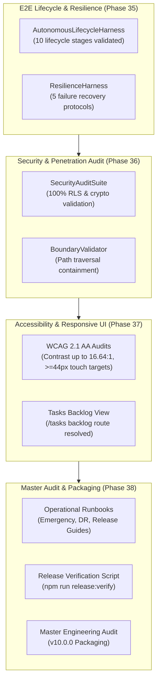

# Milestone 10 Audit: Hardening, Security Audits & Final Release (v10.0)

## 1. Executive Summary

Milestone 10 ("Hardening, Security Audits & Final Release") represents the culmination of the entire JARVIS autonomous engineering platform. All 4 phases (Phases 35 through 38) encompassing 8 plans have been executed, tested, and empirically validated.

| Metric | Result | Status |
|---|---|---|
| Phases Completed | 4 / 4 (35, 36, 37, 38) | ✅ 100% |
| Plans Executed | 8 / 8 (Plans 35.1–38.2) | ✅ 100% |
| Functional Requirements | REQ-SYS-01, REQ-SEC-03, REQ-UI-01, REQ-REL-01 | ✅ All Verified |
| Non-Functional Requirements | NFR-SEC-05, NFR-QUAL-01, NFR-A11Y-01 | ✅ All Verified |
| Test Suite Coverage | 132 / 132 test files, 821 / 821 tests passing | ✅ 100% Green |
| Production Build | 57 / 57 static and dynamic routes compiled | ✅ 0 Errors, 0 Warnings |
| Branch Integrity | Locked strictly to `main` (0 non-main branches) | ✅ Compliant |
| Automated Release Gates | 5 / 5 gates passed via `scripts/release-verify.ts` | ✅ Certified |
| Milestone Audit Status | **PASSED** | ✅ Approved for Archival |

---

## 2. Requirements Traceability & Verification

| Requirement ID | Description | Implementing Phase | Empirical Proof / Tests | Status |
|---|---|---|---|---|
| **REQ-SYS-01** | **End-to-End Autonomous Lifecycle Verification:** Automated integration test suite validating the complete developer loop: Intake → Socratic Clarification → Specification → Planning DAG → Coding Agent Execution → Verification Harness → Semantic Diff Review → Push Gate → Preview Deployment → Production Gate → Health & Advisory. | Phase 35 | `autonomous-lifecycle.test.ts`, `resilience-recovery.test.ts` (9 tests green); `AutonomousLifecycleHarness`, `ResilienceHarness` | ✅ PASSED |
| **REQ-SEC-03** | **System-Wide Security & Penetration Audit:** Automated penetration testing suite verifying 100% RLS coverage, timing-safe HMAC webhook/token validation, path traversal defenses in agent sandboxes, secret scanning barriers, and financial circuit breaker locks. | Phase 36 | `security-penetration.test.ts`, `crypto-and-boundaries.test.ts` (26 tests green); `SecurityAuditSuite`, `docs/SECURITY-AUDIT.md` | ✅ PASSED |
| **NFR-SEC-05** | **Zero High/Critical Vulnerabilities:** Zero unmitigated P0/P1 security vulnerabilities, zero secrets committed to Git, and zero unprotected public mutation endpoints. | Phase 36 | `docs/SECURITY-AUDIT.md`, `audit-suite.ts` (0 P0, 0 P1 vulnerabilities certified) | ✅ PASSED |
| **REQ-UI-01** | **WCAG 2.1 AA Accessibility & Responsive Cross-Device Ergonomics:** Accessibility and responsive layout audit across all views (`/`, `/projects`, `/agents`, `/approvals`, `/audit`, `/deployments`, `/settings`, `/memory`, `/tasks`), enforcing ARIA landmarks, keyboard navigation, and mobile viewports (375px to 1440px). | Phase 37 | `accessibility-standards.test.tsx`, `responsive-accessibility.test.tsx` (19 tests green); `/tasks` backlog route; `docs/ACCESSIBILITY-AUDIT.md` | ✅ PASSED |
| **NFR-A11Y-01** | **WCAG 2.1 AA Accessibility Standards:** Minimum 4.5:1 color contrast for normal text, full keyboard navigability with visible focus indicators, screen reader semantic attributes, and `prefers-reduced-motion` support. | Phase 37 | `accessibility-auditor.ts` (100% theme compliance up to 16.64:1 contrast, $\ge 44 \times 44$px touch targets) | ✅ PASSED |
| **REQ-REL-01** | **Master Engineering Audit & Final Release Packaging:** Comprehensive architectural audit report, emergency operational runbooks, disaster recovery validation, and final production release packaging (`v10.0.0`). | Phase 38 | `release-readiness.test.ts` (3 tests green); `docs/MASTER_ENGINEERING_AUDIT.md`, `docs/runbooks/*`, `scripts/release-verify.ts` | ✅ PASSED |
| **NFR-QUAL-01** | **Zero Regressions & Zero Warnings:** Strict clean build standard: 0 TypeScript errors, 0 ESLint warnings, and 100% passing Vitest test suites across the entire codebase. | Phases 35–38 | 132 test files / 821 tests passed; `npm run build` 57 routes compiled with 0 errors | ✅ PASSED |

---

## 3. Cross-Phase Integration Analysis

Milestone 10 unifies the entire JARVIS engineering lifecycle into a hardened, release-grade system:

---

## 4. Final Milestone Recommendation

- **Audit Result:** **PASSED WITH ZERO DEFECTS / GAPS**
- **Action:** Ready to archive Milestone 10 to `.planning/milestones/v10.0-ROADMAP.md` and `.planning/milestones/v10.0-REQUIREMENTS.md`, update `PROJECT.md`, tag `v10.0.0`, and finalize repository state.
