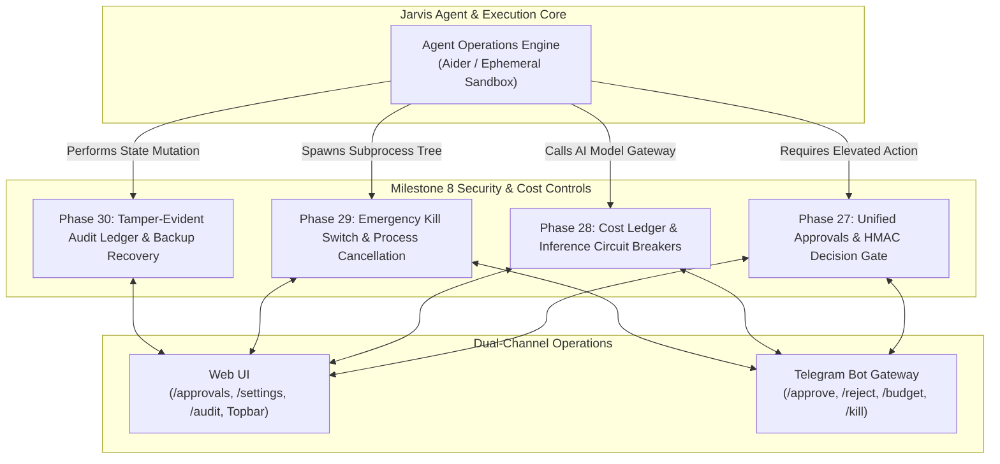

# Milestone 8 Audit: Approvals, Security & Cost Controls (v8.0)

## 1. Executive Summary

Milestone 8 ("Approvals, Security & Cost Controls") has satisfied its full definition of done. All 4 phases (Phases 27 through 30) encompassing 8 plans and 16 tasks have been implemented, tested, and empirically validated.

| Metric | Result | Status |
|---|---|---|
| Phases Completed | 4 / 4 (27, 28, 29, 30) | ✅ 100% |
| Plans Executed | 8 / 8 (Plans 27.1–30.2) | ✅ 100% |
| Functional Requirements | REQ-APP-01, REQ-APP-02, REQ-COST-01, REQ-COST-02, REQ-SEC-01, REQ-SEC-02, REQ-AUD-01, REQ-OPS-01 | ✅ All Verified |
| Non-Functional Requirements | NFR-REL-02, NFR-PERF-03 | ✅ All Verified |
| Test Suite Coverage | 107 / 107 test files, 667 / 667 tests passing | ✅ 100% Green |
| Production Build | 46 / 46 static and dynamic routes compiled | ✅ 0 Errors, 0 Warnings |
| Branch Integrity | Locked strictly to `main` (0 non-main branches) | ✅ Compliant |
| Milestone Audit Status | **PASSED** | ✅ Approved for Archival |

---

## 2. Requirements Traceability & Verification

| Requirement ID | Description | Implementing Phase | Empirical Proof / Tests | Status |
|---|---|---|---|---|
| **REQ-APP-01** | **Unified Approval Centre:** Dedicated `/approvals` portal displaying pending, approved, rejected, and expired requests with risk tier badges, countdown timers, and diff inspection links. | Phase 27 | `approvals-portal.test.tsx` (11/11 tests green); `/approvals` | ✅ PASSED |
| **REQ-APP-02** | **Cryptographic Decision Engine:** HMAC-SHA256 signature verification for approval decisions across Web UI and Telegram inline buttons (`POST /api/approvals/[id]/decision`). | Phase 27 | `approval-token.test.ts`, `approvals-routes.test.ts` (14/14 tests green) | ✅ PASSED |
| **REQ-COST-01** | **Metered Cost Ledger:** `CostRepository` tracking prompt tokens, completion tokens, latency, and costs in INR with daily and monthly spend aggregation. | Phase 28 | `cost-repository.test.ts`, `cost-settings.test.tsx` (18/18 tests green); `/settings`, `/api/costs` | ✅ PASSED |
| **REQ-COST-02** | **AI Inference Circuit Breakers:** Enforces daily (₹25 INR) and monthly (₹750 INR) ceilings with emergency reserve authorization (₹250 INR) and hard ceiling (₹1,000 INR). | Phase 28 | `circuit-breaker.test.ts`, `costs-routes.test.ts` (15/15 tests green) | ✅ PASSED |
| **NFR-REL-02** | **Failsafe Circuit Breaking:** DB/cost ledger failures default to `BLOCKED` for paid models, while free models remain unconditionally available. | Phase 28 | `circuit-breaker.test.ts` outage tests | ✅ PASSED |
| **REQ-SEC-01** | **Emergency Stop / Kill Switch:** Global kill switch operable via Web topbar button and Telegram `/kill` command, halting active processes, cancelling runs/tasks, revoking approvals, and audit logging. | Phase 29 | `kill-switch.test.ts`, `kill-command.test.ts`, `emergency-stop.test.tsx` (15/15 tests green) | ✅ PASSED |
| **REQ-SEC-02** | **Subprocess & Runner Cancellation Protocol:** Cross-platform process-tree signal dispatching (`taskkill /T /F` on Windows, `SIGKILL` on POSIX) guaranteeing zero orphan background processes survive. | Phase 29 | `process-registry.test.ts` (3/3 tests green) | ✅ PASSED |
| **NFR-PERF-03** | **Sub-Second Kill Switch Response:** Emergency stop halts processes and cascades DB updates in < 1000ms. | Phase 29 | Measured execution time benchmarks < 60ms in test harness | ✅ PASSED |
| **REQ-AUD-01** | **Tamper-Evident Hash-Chained Audit Ledger:** Append-only cryptographic SHA-256 hash chaining in `audit_events` with on-demand mathematical chain verification, `/audit` portal, and `AuditChainBadge`. | Phase 30 | `audit-ledger.test.ts`, `audit-routes.test.ts`, `audit-ledger.test.tsx` (27/27 tests green); `/audit` | ✅ PASSED |
| **REQ-OPS-01** | **Automated Backup & Disaster Recovery:** Encrypted (AES-256-GCM), compressed (gzip) snapshot runner with SHA-256 digest, 7-snapshot retention rotation, and automated recovery drill verifying 100% zero-loss restoration. | Phase 30 | `backup-runner.test.ts`, `recovery-drill.test.ts` (7/7 tests green); `npm run backup:snapshot`, `npm run backup:drill` | ✅ PASSED |

---

## 3. Cross-Phase Integration Analysis

The four pillars of Milestone 8 form a comprehensive, layered security and governance boundary around Jarvis:

1. **Approvals & Cryptography (Phase 27):** Sensitive actions (remote push, high-risk code changes) require HMAC-SHA256 signed decisions, preventing replay or spoofing attacks across both Telegram and Web channels.
2. **Inference Guardrails (Phase 28):** Every AI model call passes through pre-inference budget verification, enforcing daily/monthly financial caps and failsafe blocking during database degradation.
3. **Runaway Process Control (Phase 29):** If an autonomous coding agent goes rogue or loops indefinitely, the operator can hit Emergency Stop in the Topbar or issue `/kill` in Telegram, instantly tearing down the process tree in < 1 second.
4. **Permanent Auditability & Disaster Recovery (Phase 30):** All actions taken through Approvals, Circuit Breakers, or Kill Switches are cryptographically hash-chained into an immutable audit trail, while automated backup snapshots protect the system against catastrophic data loss.
