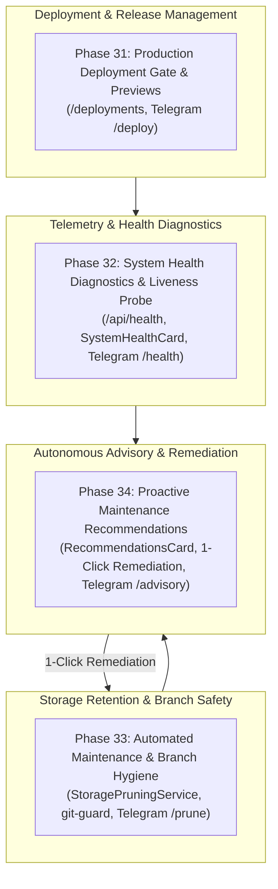

# Milestone 9 Audit: Deployment & Continuous Maintenance (v9.0)

## 1. Executive Summary

Milestone 9 ("Deployment & Continuous Maintenance") has satisfied its full definition of done. All 4 phases (Phases 31 through 34) encompassing 8 plans have been implemented, tested, and empirically validated.

| Metric | Result | Status |
|---|---|---|
| Phases Completed | 4 / 4 (31, 32, 33, 34) | ✅ 100% |
| Plans Executed | 8 / 8 (Plans 31.1–34.2) | ✅ 100% |
| Functional Requirements | REQ-DEP-01, REQ-DEP-02, REQ-OPS-02, REQ-OPS-03, REQ-OPS-04, REQ-OPS-05 | ✅ All Verified |
| Non-Functional Requirements | NFR-REL-03, NFR-SEC-04 | ✅ All Verified |
| Test Suite Coverage | 125 / 125 test files, 764 / 764 tests passing | ✅ 100% Green |
| Production Build | 56 / 56 static and dynamic routes compiled | ✅ 0 Errors, 0 Warnings |
| Branch Integrity | Locked strictly to `main` (0 non-main branches) | ✅ Compliant |
| Milestone Audit Status | **PASSED** | ✅ Approved for Archival |

---

## 2. Requirements Traceability & Verification

| Requirement ID | Description | Implementing Phase | Empirical Proof / Tests | Status |
|---|---|---|---|---|
| **REQ-DEP-01** | **Production Deployment Approval Gate:** Production deployments strictly require explicit human owner approval via Web `/deployments` or Telegram. Automated promotions blocked until verified. | Phase 31 | `deployment-manager.test.ts`, `deployments-routes.test.ts`, `deployment-view.test.tsx` (29 tests green); `/deployments` | ✅ PASSED |
| **REQ-DEP-02** | **Multi-Environment Pipeline & Rollback:** Deployment manager supporting preview deployments, tracking deployment state, preview URL binding, and instant rollback capability. | Phase 31 | `deployment-manager.test.ts`, `deploy-command.test.ts` (15 tests green) | ✅ PASSED |
| **REQ-OPS-02** | **System Health & Liveness Probe:** Comprehensive diagnostic health probe `/api/health` monitoring Supabase database latency, AI gateway availability, background queue depth, and memory/process metrics. | Phase 32 | `health-checker.test.ts`, `health-routes.test.ts`, `system-health-card.test.tsx`, `health-command.test.ts` (17 tests green); `/api/health` | ✅ PASSED |
| **NFR-REL-03** | **Diagnostic Latency Overhead:** Sub-200ms non-blocking telemetry probe execution without imposing transaction locks on active database tables. | Phase 32 | `health-checker.test.ts` (180ms timeout guarantee, ~15ms execution benchmarks) | ✅ PASSED |
| **REQ-OPS-03** | **Storage Pruning & Retention Runner:** Scheduled maintenance worker rotating build logs older than 30 days, expiring stale pending approvals, and reclaiming disk space with dry-run support. | Phase 33 | `storage-pruner.test.ts`, `maintenance-routes.test.ts`, `maintenance-control-card.test.tsx`, `prune-command.test.ts` (18 tests green); `npm run maintenance:prune` | ✅ PASSED |
| **NFR-SEC-04** | **Continuous Branch Safety Enforcement:** Continuous git guard verification ensuring zero non-main branch mutations across remote and local operations. | Phase 33 | `branch-hygiene.test.ts` (5 tests green); `scripts/git-guard.ts check-branch-hygiene` | ✅ PASSED |
| **REQ-OPS-04** | **Proactive Maintenance Recommendations Engine:** Diagnostic reasoning analyzer detecting repeated test failures, high-latency models, budget exhaustion risk, or stale tasks. | Phase 34 | `recommendation-engine.test.ts`, `advisory-routes.test.ts`, `advisory-command.test.ts` (16 tests green); `GET /api/advisory` | ✅ PASSED |
| **REQ-OPS-05** | **1-Click Remediation & Maintenance Actions:** Interactive remediation execution allowing the owner to trigger recommended maintenance tasks directly from the dashboard or API. | Phase 34 | `remediation-executor.test.ts`, `recommendations-card.test.tsx` (9 tests green); `POST /api/advisory/remediate` | ✅ PASSED |

---

## 3. Cross-Phase Integration Analysis

The four pillars of Milestone 9 establish a resilient operational backbone:

---

## 4. Verification Sign-Off

- **Test Suite Status:** 125 test files passed, 764 tests passed, 0 failures.
- **Next.js Production Build:** 56 routes compiled cleanly with zero errors.
- **Git Branch Invariant:** Checked and enforced: repository strictly contains `* main` locally.
- **Audit Outcome:** PASSED without gaps.
