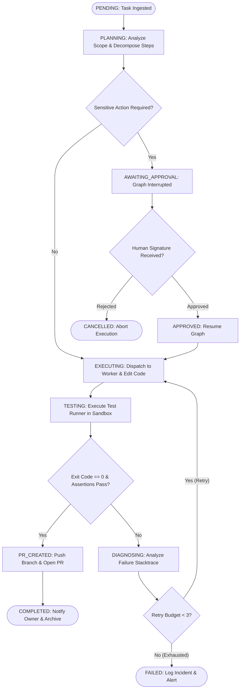

# Project Jarvis — Architecture Documentation Review

**Audit Identifier:** `AUDIT-2026-11-14-DOC`  
**Audit Date:** 2026-11-14  
**Operating Role:** Independent Principal Technical Documentation Audit Board  
**Target Documents:** `SYSTEM_ARCHITECTURE.md`, `TECH_STACK.md`, `AGENT_DESIGN.md`, `CODING_AGENT_SPEC.md`, `MEMORY_DESIGN.md`, `DECISION_LOG.md`

---

## 1. Architectural Architecture Review & Assessment

Project Jarvis's documented architecture is centered around a **Bifurcated Enclave Architecture**. The design partitions the system into three distinct security and operational zones:

```
+---------------------------------------------------------------------------------------+
|  Zone 0: Public & Untrusted Ingress                                                  |
|  - Next.js 15 Web Dashboard (Mobile Safari / Chrome, TLS 1.3, HttpOnly Cookies)        |
|  - Telegram Bot Gateway (HTTPS Long Polling / Webhook)                                |
+-------------------------------------------+-------------------------------------------+
                                            | Outbound HTTPS / Strict Auth
                                            v
+---------------------------------------------------------------------------------------+
|  Zone 1: Trusted Control Plane (High-Trust Enclave)                                  |
|  - FastAPI Gateway (Argon2id Auth, JWT Session Validator, Single-Owner Policy)        |
|  - LangGraph Stateful Orchestration Engine (StateGraph, PostgreSQL Checkpointer)     |
|  - Deterministic Policy & Approval Engine (SHA-256 Canonical Hashing, Non-Self Gate)  |
|  - AI Provider Gateway (OpenRouter `openrouter/auto`, MockProvider, Circuit Breaker)  |
|  - PostgreSQL 16 (Supabase Free / Docker, SQLAlchemy 2.0 Async, Fernet Secrets)       |
+-------------------------------------------+-------------------------------------------+
                                            | Ephemeral Job Dispatch (Token, Target)
                                            v
+---------------------------------------------------------------------------------------+
|  Zone 2: Untrusted Execution Plane (Zero-Trust Sandbox)                              |
|  PRIMARY: GitHub Actions Hosted Runner       | SECONDARY: Hardened Ephemeral Docker   |
|  - Ephemeral Ubuntu VM (2 vCPU, 7GB RAM)     | - User 1000:1000, --cap-drop=ALL       |
|  - Short-lived 60-min GitHub App Token       | - Read-only rootfs, tmpfs workspace    |
|  - File Edit & Diagnostic Test Execution     | - Network: none / restricted egress    |
|  - Patch, Exit Code, and Diff Capture        | - Ephemeral destroy on completion      |
+---------------------------------------------------------------------------------------+
```

### 1.1 Structural Soundness of the Enclave Model
The architectural decision to bifurcate the Control Plane and Execution Plane (ADR-002) is **highly sound** and aligns with best practices for autonomous coding systems (such as GitHub Copilot Workspace, OpenHands, and Devin). 
- **Separation of Secrets:** The Execution Plane never holds database credentials, master encryption keys, or broad cloud provider tokens. It receives only a scoped, 60-minute GitHub App installation access token (`ghs_...`) restricted to a single target repository.
- **Isolation of Untrusted Execution:** Untrusted code execution (arbitrary `pytest`, `npm test`, or compiler runs) occurs strictly within disposable GitHub Actions runners or unprivileged containers, preventing host contamination on the owner's Windows 11 machine.

---

## 2. Agent Orchestration Engine (LangGraph Analysis)

The orchestration subsystem is documented primarily in `SYSTEM_ARCHITECTURE.md` (§4) and `AGENT_DESIGN.md`.

### 2.1 State Graph Topology
Jarvis utilizes a stateful cyclic directed graph implemented via LangGraph's `StateGraph`. The documented execution sequence is:



### 2.2 Orchestration Strengths
1. **Durable Checkpointing (`AsyncPostgresSaver`):** Every node boundary is persisted to PostgreSQL. If the FastAPI process restarts during `EXECUTING` or `DIAGNOSING`, the task resumes seamlessly from its last checkpoint using the `thread_id` (Task ID).
2. **Deterministic Human-in-the-Loop Interrupts:** LangGraph's `interrupt_before` mechanism cleanly freezes execution without maintaining active socket connections or in-memory threads, enabling multi-hour human review pauses with zero resource consumption.
3. **Bounded Diagnostic Loops:** The retry counter is tracked deterministically in graph state (max 3 retries), preventing runaway LLM billing cycles.

### 2.3 Orchestration Deficiencies
1. **Context Window Pruning Specification:** The documentation lacks a defined mechanism for context compression or state pruning during extended retry cycles. In multi-step refactoring, accumulating raw test logs across 3 diagnostic retries will cause context overflow on models with 128k token limits.
2. **Missing Sub-Agent Protocol:** While `AGENT_DESIGN.md` lists 5 conceptual roles (Planner, Researcher, Coding Worker, Reviewer, Memory Extractor), the graph definition in `SYSTEM_ARCHITECTURE.md` only implements 3 nodes (Planner, Coder, PR Generator). The roles of "Researcher" and "Reviewer" lack formal graph node definitions and transition edges.

---

## 3. AI Gateway & Model Provider Architecture

### 3.1 The ADR-004 vs ADR-013 Inconsistency
A major architectural discrepancy exists regarding AI provider routing:
- **`SYSTEM_ARCHITECTURE.md` & `TECH_STACK.md`:** Document an internal adapter abstraction with `MockProvider`, `GeminiAdapter`, and `OpenAIAdapter`. The primary model is stated to be Gemini 1.5/2.0 Flash via Google AI Studio.
- **`DECISION_LOG.md` (ADR-013):** Dated 2026-11-14, this accepted decision designates **OpenRouter** as the primary default AI provider (`DEFAULT_AI_PROVIDER=openrouter`) with **`openrouter/auto`** as the default model string to achieve automated dynamic model routing (Claude 3.5 Sonnet, Gemini 2.0 Flash, DeepSeek V3/R1, Llama 3.3).

**Architectural Assessment:**
ADR-013 is superior from a product and vendor-independence perspective: it eliminates single-provider lock-in and mitigates individual provider rate-limit outages. However, `SYSTEM_ARCHITECTURE.md`, `TECH_STACK.md`, and `ENVIRONMENT_VARIABLES.md` were never updated to reflect this decision. 

### 3.2 Paid-Call Circuit Breaker
The documented `PaidCallBlocker` circuit breaker is architecturally sound. It intercepts outbound model requests at the networking layer:
1. Validates whether `AI_PAID_CALLS_ENABLED` is true.
2. Validates whether an active `ApprovalRequest` exists granting a spending ceiling for the specific `task_id`.
3. If neither condition is met, it drops the request immediately without network egress, raising `SpendingBlockedException`.

---

## 4. Execution Plane & Worker Sandbox Analysis

### 4.1 Primary: GitHub Actions Runner (Cloud Hosted)
- **Mechanism:** The control plane uses the GitHub API (`POST /repos/{owner}/{repo}/dispatches` or workflow dispatch) to trigger a GitHub Actions workflow.
- **Payload:** Jarvis passes a signed ephemeral task payload containing the scoped branch name, file modification specifications, and test commands.
- **Evaluation:** Outstanding design choice. GitHub provides 2,000 free minutes/month for private repositories, executing on fresh 2-core Ubuntu virtual machines. This completely offloads CPU and memory pressure from the owner's 16 GB Windows 11 machine and ensures tasks continue when the laptop is asleep.

### 4.2 Secondary: Hardened Ephemeral Docker Sandbox (Local)
For local offline development, the architecture defines a hardened container execution profile:
- `USER 1000:1000` (non-root)
- `--cap-drop=ALL` (drops all Linux capabilities)
- `--security-opt=no-new-privileges:true` (prevents setuid escalation)
- `--read-only` root filesystem with `--tmpfs` mounts for `/tmp` and `/workspace`
- Resource quotas: `--memory=2g`, `--cpus=1.5`, `--pids-limit=100`
- **Evaluation:** Conforms to CIS Docker Benchmark standards. However, the documentation must clarify how dependencies are pre-warmed or cached if `--network=none` is enforced during test execution.

---

## 5. Data Flow & Persistence Architecture

The persistence model utilizes PostgreSQL 16 (via Supabase Free Tier or local Docker):
1. **Relational Integrity:** Strong foreign-key relationships (`users` -> `projects` -> `tasks` -> `task_steps` -> `executions` -> `artifacts` / `approvals`).
2. **Audit Ledger:** Append-only `audit_events` table capturing all security and consequential actions.
3. **LangGraph Checkpoints:** Dedicated checkpoint tables storing binary serialized graph states.

### Persistence Weaknesses Identified:
- **Schema Omissions:** As detailed in the gap analysis, `DATABASE_SCHEMA.md` omits `password_hash` in `users` and completely omits the LangGraph checkpoint tables.
- **Connection Pool Exhaustion:** Supabase Free Tier restricts direct connections (default max 15-20 connections). The documentation correctly mandates port 6543 (Supavisor transaction pooler) for FastAPI async workers, but must explicitly specify connection pooling settings in `SQLAlchemy` (`pool_size=5`, `max_overflow=10`) to prevent pool exhaustion.

---

## 6. Resilience, Failure Modes & Recovery

| Failure Scenario | Documented Handling | Architectural Evaluation |
|:---|:---|:---|
| **FastAPI Coordinator Crash** | Startup recovery queries uncompleted tasks; LangGraph rehydrates from PostgreSQL checkpoint using `thread_id`. | **Strong:** High durability; zero state loss for inflight tasks. |
| **Worker Hanging / Infinite Loop** | Hard execution timeout (10 minutes) kills runner process; coordinator marks task timed out. | **Strong:** Prevents runaway compute consumption. |
| **Model Rate Limiting (HTTP 429)** | Jittered exponential backoff (`min(2^attempt + jitter, 60s)`); pauses task if quota exhausted. | **Adequate:** Needs fallback routing to secondary models via OpenRouter. |
| **Supabase 7-Day Inactivity Pause** | Automated weekly keep-alive ping; database retains data for up to 1 year during pauses. | **Adequate:** Requires documentation of the concrete ping script or cron job. |
| **Database Network Partition** | Connection pooler exponential retry; fail-closed behavior on state transitions. | **Strong:** Prevents unverified state mutation. |

---

## 7. Architecture Recommendations & Action Items

1. **Formalize OpenRouter in Core Architecture:** Update `SYSTEM_ARCHITECTURE.md` and `TECH_STACK.md` to incorporate ADR-013, showing OpenRouter as the primary gateway while retaining `MockProvider` for CI testing.
2. **Harmonize Task States:** Standardize on the 11-state machine across `SYSTEM_ARCHITECTURE.md`, `API_SPECIFICATION.md`, and frontend dashboard specs.
3. **Incorporate Repository AST Mapping:** Update `CODING_AGENT_SPEC.md` to include Tree-sitter / AST indexing before file modification to support large codebases efficiently.
4. **Define Context Compaction Policies:** Specify explicit token budget limits and sliding-window summarization for LangGraph checkpoint state.
