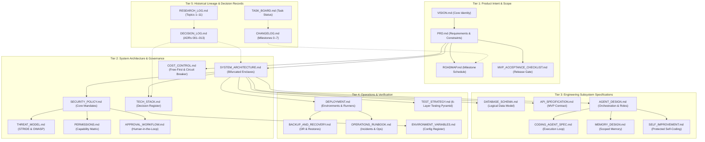

# Project Jarvis — Technical Documentation Inventory & Relationship Map

**Audit Identifier:** `AUDIT-2026-11-14-DOC`  
**Audit Date:** 2026-11-14  
**Operating Role:** Independent Principal Technical Documentation Audit Board  
**Total Documents Audited:** 27  
**Scope:** Complete recursive inventory of `docs/`

---

## 1. Documentation Inventory Register

The table below catalogs all 27 Markdown documents discovered in `docs/`.

| ID | Document Name | File Path | Category | Purpose | Scope | Audience | Authoritative Status | Dependencies | Completeness | Currency | Conflicts / Notes |
|:---|:---|:---|:---|:---|:---|:---|:---|:---|:---|:---|:---|
| D01 | `INDEX.md` | `docs/INDEX.md` | Development & Quality | Master index and navigation for documentation | All 27 docs | All Team Members | Baseline Reference | All docs | Complete | Outdated | Mentions missing `README.md`; omits `ROADMAP.md` from table |
| D02 | `VISION.md` | `docs/VISION.md` | Product & Requirements | Defines product identity, long-term goals, core principles, and non-goals | Product Scope | Owner, Architects | Authoritative | None | Complete | Current | Aligned with core autonomous coding mission |
| D03 | `PRD.md` | `docs/PRD.md` | Product & Requirements | Functional and non-functional requirements, constraints, acceptance criteria | MVP System | Developers, Product | Authoritative | `VISION.md` | Complete | Current | High-level requirements baseline |
| D04 | `ROADMAP.md` | `docs/ROADMAP.md` | Product & Requirements | Milestone schedule, assumptions, phase exit criteria (Phases 0–7) | Project Timeline | Management, Team | Contradictory | `PRD.md` | Complete | Contradictory | Banner claims v1.0 MVP complete, contradicting `MVP_ACCEPTANCE_CHECKLIST.md` |
| D05 | `SYSTEM_ARCHITECTURE.md` | `docs/SYSTEM_ARCHITECTURE.md` | Architecture & Engineering | Bifurcated enclave architecture, state machine, trust zones, recovery | System Design | Architects, Engineers | Authoritative Baseline | `PRD.md`, `TECH_STACK.md` | Complete | Partially Desynced | State machine conflicts with `API_SPECIFICATION.md`; omits ADR-013 OpenRouter |
| D06 | `TECH_STACK.md` | `docs/TECH_STACK.md` | Architecture & Engineering | Technology decision register, version matrix, evaluation rationale | Tech Choices | Engineers, DevOps | Authoritative Baseline | `SYSTEM_ARCHITECTURE.md` | Complete | Inaccurate / Desynced | Fernet crypto error; omits ADR-013 OpenRouter |
| D07 | `DATABASE_SCHEMA.md` | `docs/DATABASE_SCHEMA.md` | Architecture & Engineering | Initial logical data model across 12 core tables | Data Layer | Backend Engineers | Proposed Logical Model | `SYSTEM_ARCHITECTURE.md` | Incomplete | Incomplete | Missing `password_hash` in users; missing LangGraph tables |
| D08 | `API_SPECIFICATION.md` | `docs/API_SPECIFICATION.md` | Architecture & Engineering | MVP REST API contract, endpoints, state enums | Control Plane API | Full-Stack Engineers | Proposed Contract | `SYSTEM_ARCHITECTURE.md` | Incomplete | Inconsistent | State enum conflicts with Architecture; missing Auth and Memory endpoints |
| D09 | `AGENT_DESIGN.md` | `docs/AGENT_DESIGN.md` | Architecture & Engineering | Multi-role agent definitions, deterministic services, workflow | AI Subsystem | AI Engineers | Authoritative | `PRD.md`, `SYSTEM_ARCHITECTURE.md` | Complete | Current | Sound role separation (Planner, Researcher, Coder, Reviewer) |
| D10 | `CODING_AGENT_SPEC.md` | `docs/CODING_AGENT_SPEC.md` | Architecture & Engineering | Detailed specification for the autonomous coding execution loop | Coding Worker | AI / Sandbox Engineers | Authoritative | `AGENT_DESIGN.md`, `PERMISSIONS.md` | Complete | Current | Comprehensive 13-step lifecycle; lacks AST repo mapping |
| D11 | `MEMORY_DESIGN.md` | `docs/MEMORY_DESIGN.md` | Architecture & Engineering | Scoped memory architecture (shared vs project), extraction, conflict rules | Memory System | AI Engineers | Authoritative | `DATABASE_SCHEMA.md` | Complete | Current | Strong provenance tracking; missing API specification |
| D12 | `SECURITY_POLICY.md` | `docs/SECURITY_POLICY.md` | Security & Operations | Core security mandates, secret storage, token lifetimes, kill-switch | All Operations | DevSecOps, All | Authoritative | `SYSTEM_ARCHITECTURE.md` | Complete | Inaccurate | Fernet crypto error; strong operational mandates |
| D13 | `THREAT_MODEL.md` | `docs/THREAT_MODEL.md` | Security & Operations | STRIDE threat matrix, OWASP LLM Top 10 analysis, security tests | Security Posture | DevSecOps, Architects | Authoritative | `SECURITY_POLICY.md` | Complete | Current | Excellent threat coverage; requires test verification |
| D14 | `PERMISSIONS.md` | `docs/PERMISSIONS.md` | Security & Operations | Fine-grained capability matrix by role and action | Access Control | Engineers, Security | Authoritative | `SECURITY_POLICY.md` | Complete | Current | Strict least-privilege matrix |
| D15 | `APPROVAL_WORKFLOW.md` | `docs/APPROVAL_WORKFLOW.md` | Security & Operations | Human-in-the-loop authorization, payload hashing, approval lifecycle | Governance | Full-Stack, Security | Authoritative | `SECURITY_POLICY.md`, `PERMISSIONS.md`| Complete | Current | Cryptographic payload binding is robust |
| D16 | `COST_CONTROL.md` | `docs/COST_CONTROL.md` | Security & Operations | Free-first operating policy, paid-call circuit breaker, quota limits | Financial Policy | All Team Members | Authoritative | `PRD.md`, `TECH_STACK.md` | Complete | Current | Strict zero-spend guarantees |
| D17 | `DEPLOYMENT.md` | `docs/DEPLOYMENT.md` | Security & Operations | Environment definitions, worker deployment, release gates | DevOps / Infra | DevOps, SRE | Conceptual Guidance | `TECH_STACK.md` | Partially Complete | Current | Lacks concrete CI/CD pipeline code and Helm/Compose specs |
| D18 | `BACKUP_AND_RECOVERY.md` | `docs/BACKUP_AND_RECOVERY.md` | Security & Operations | Disaster recovery, database restore, data retention policies | SRE / Ops | SRE, SysAdmin | Incomplete | `DATABASE_SCHEMA.md` | Incomplete (TBDs) | Outdated | RPO, RTO, frequency, retention all marked `[TBD]` |
| D19 | `OPERATIONS_RUNBOOK.md` | `docs/OPERATIONS_RUNBOOK.md` | Security & Operations | Routine incident response, worker failure, rollback procedures | Production Ops | SRE, On-Call | Incomplete (TBDs) | `DEPLOYMENT.md` | Incomplete (TBDs) | Outdated | Emergency contacts and escalation marked `[TBD]` |
| D20 | `ENVIRONMENT_VARIABLES.md` | `docs/ENVIRONMENT_VARIABLES.md`| Development & Quality | Master environment variables register and secret classification | Configuration | All Engineers | Proposed Template | `TECH_STACK.md` | Incomplete | Inconsistent | Missing OpenRouter, Fernet master key; naming conflicts |
| D21 | `TEST_STRATEGY.md` | `docs/TEST_STRATEGY.md` | Development & Quality | 6-layer testing pyramid, CI requirements, AI evaluation scenarios | QA / Testing | QA, Engineers | Authoritative | `PRD.md`, `TECH_STACK.md` | Complete | Current | Sound strategy; requires benchmark harness details |
| D22 | `MVP_ACCEPTANCE_CHECKLIST.md`| `docs/MVP_ACCEPTANCE_CHECKLIST.md`| Development & Quality | Final acceptance checklist for v1.0 release gating | Release Gating | Owner, QA, Leads | Authoritative Gate | All Specifications | Complete | Pending Verification | All checkboxes empty, contradicting `CHANGELOG.md` |
| D23 | `SELF_IMPROVEMENT.md` | `docs/SELF_IMPROVEMENT.md` | Architecture & Engineering | Guardrails and workflow for autonomous codebase analysis and PRs | Self-Enhancement | AI Engineers | Authoritative | `CODING_AGENT_SPEC.md` | Complete | Current | Strict protected components list |
| D24 | `DECISION_LOG.md` | `docs/DECISION_LOG.md` | Historical | Architectural Decision Records (ADR-001 to ADR-013) | Architecture Records | Architects, Engineers | Authoritative ADRs | All Architecture Docs | Complete | Current | Contains ADR-013 (OpenRouter) added 2026-11-14 |
| D25 | `RESEARCH_LOG.md` | `docs/RESEARCH_LOG.md` | Historical | Formal research records across 11 technical topics (Milestone 0) | Technical Research | Architects, Engineers | Historical Record | `TECH_STACK.md` | Complete | Historical (2026-11-13)| Thorough research; requires 2026-11-14 update |
| D26 | `CHANGELOG.md` | `docs/CHANGELOG.md` | Historical | Keep-a-Changelog record of all milestone additions (M0 to M7) | Project History | All | Implementation Claim | All Code & Docs | Complete | Pending Verification | Claims 43 tests passing (classified as NOT VERIFIED) |
| D27 | `TASK_BOARD.md` | `docs/TASK_BOARD.md` | Historical | Milestone task tracking and implementation status | Project Management | Management, Team | Internally Contradictory| `ROADMAP.md`, `CHANGELOG.md`| Complete | Contradictory | Internal status conflict (M4 vs M7); claims 43 tests passing |

---

## 2. Document Relationship & Hierarchy Map

The documentation follows a formal 5-tier hierarchical model:

---

## 3. Historical Decision & Lineage Tracking

| Decision ID | Title | Date Recorded | Status in Docs | Audit Evaluation | Superseded By / Affects |
|:---|:---|:---|:---|:---|:---|
| **ADR-001** | Coding-First Autonomous Product Scope | 2026-11-13 | Accepted | Sound & Authoritative | Protects MVP focus; defers voice/general assistant |
| **ADR-002** | Strict Separation of Control Plane & Execution Plane | 2026-11-13 | Accepted | Sound & Authoritative | Underpins Bifurcated Enclave Architecture |
| **ADR-003** | Deterministic Capability Gating & Human Approval | 2026-11-13 | Accepted | Sound & Authoritative | Establishes AI model as untrusted proposal engine |
| **ADR-004** | Provider-Independent AI Gateway with Mock Provider | 2026-11-13 | Accepted | Partially Superseded | Superseded in part by ADR-013 regarding default provider |
| **ADR-005** | Free-First Infrastructure & Hard Paid-Call Blocking | 2026-11-13 | Accepted | Sound & Authoritative | Strictly preserves zero-spend policy |
| **ADR-006** | GitHub App Authentication with Short-Lived Tokens | 2026-11-13 | Accepted | Sound & Authoritative | Least-privilege 60-min installation token model |
| **ADR-007** | Ephemeral Cloud Execution via GitHub Actions | 2026-11-13 | Accepted | Sound & Authoritative | Solves Windows 11 host resource / uptime constraints |
| **ADR-008** | LangGraph with PostgreSQL Checkpointing | 2026-11-13 | Accepted | Sound & Authoritative | State survivability and human-in-the-loop pause/resume |
| **ADR-009** | Telegram Bot with Long Polling & Single-User Allowlist | 2026-11-13 | Accepted | Sound & Authoritative | Firewall-friendly mobile interface |
| **ADR-010** | Mobile-First Responsive Web Dashboard via Next.js 15 | 2026-11-13 | Accepted | Sound & Authoritative | Modern web interface for diffs and approvals |
| **ADR-011** | Managed Supabase Free Tier with Keep-Alive Ping | 2026-11-13 | Accepted | Sound & Authoritative | 24/7 cloud database with self-host portability |
| **ADR-012** | Controlled Supervised Self-Improvement | 2026-11-13 | Accepted | Sound & Authoritative | Protects core security files from agent mutation |
| **ADR-013** | Primary AI Engine via OpenRouter (`openrouter/auto`) | 2026-11-14 | Accepted | Unintegrated Baseline | Not yet propagated to Tech Stack, Architecture, or Env docs |
