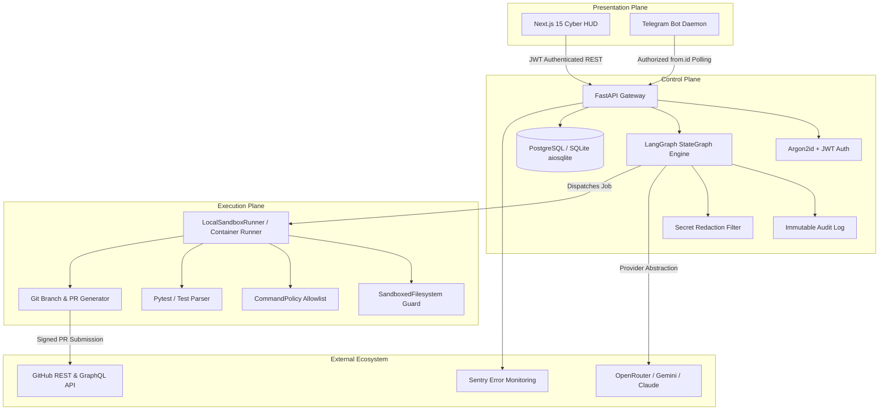

# Project Jarvis — System Architecture Map

**Document Version:** 1.0.0  
**Status:** Verified Architecture Contract  
**Security Model:** Bifurcated Enclave Model  

---

## 1. High-Level Architectural Overview

Project Jarvis is structured into three strictly decoupled operational enclaves:
1. **Control Plane (Orchestration & Governance):** Secure, authenticated API backend handling state persistence, cryptographic verification, human authorization gates, and audit trails.
2. **Execution Plane (Sandboxed Worker):** Disposable, strictly contained execution runtime where repository checkouts, file modifications, command executions, and test runs occur.
3. **Presentation Plane (User Interfaces):** Mobile-first Telegram bot and Next.js 15 cybernetic HUD dashboard for real-time monitoring and authorization.

---

## 2. Component Inventory & Responsibilities

| Component | Technology | Directory | Responsibility | Inputs | Outputs | Security Boundary |
|---|---|---|---|---|---|---|
| **API Gateway** | FastAPI, Uvicorn | `backend/app/api/v1/` | REST endpoints for tasks, approvals, fleet audit, telemetry, system kill switch | HTTP Requests (JSON) | JSON Responses, status codes | JWT Bearer, CORS, Rate Limit |
| **Auth & Security Core** | Argon2id, PyJWT, Fernet | `backend/app/core/security.py` | Password hashing, token minting/verification, secret encryption | Passwords, Tokens, Secrets | Hashes, JWTs, Ciphertext | Single-owner allowlist |
| **Database Layer** | SQLAlchemy 2.0 Async, aiosqlite/psycopg | `backend/app/models/`, `core/database.py` | Persistent state storage for Users, Tasks, Approvals, Memory, Audits | ORM Models, Queries | Query Results, Commits | Foreign keys, Constraints |
| **Orchestration Graph** | LangGraph StateGraph | `backend/app/orchestrator/` | Declarative task lifecycle, Human-in-the-Loop interrupts, diagnostic retry | TaskGraphState | State checkpoints, Step status | Checkpoint rollback, interrupt |
| **AI Provider Abstraction** | OpenRouter, Mock, Google GenAI | `backend/app/providers/` | Standardized interface for prompt generation, planning, and code patch repair | Prompts, Code Context | JSON plans, Code patches | Input sanitization, cost cap |
| **Sandbox Runner** | Subprocess, Timeout | `backend/app/workers/runner.py` | Isolated command execution with timeout and process tree killing | Shell commands, Arguments | Stdout, Stderr, Exit code | 60s hard timeout, killed on cancel |
| **Sandboxed Filesystem** | Python Pathlib | `backend/app/workers/filesystem.py` | Bounded file reading/writing preventing directory traversal | Relative paths, Content | File bytes, directory trees | Directory traversal block (`..`) |
| **Command Policy** | Tokenizer, Allowlist | `backend/app/workers/command_policy.py` | Validates commands against strict safe executable allowlist | Command strings | Sanitized argv list | Reject shell metachars (`\|`, `;`, `&`) |
| **GitHub App Service** | PyJWT RS256, httpx | `backend/app/services/github_service.py` | Ephemeral installation tokens, branch creation, PR drafting | Repo name, PR title, Diff | PR URL, Commit SHA | Protected branch guard (`main`) |
| **Telegram Bot Service** | python-telegram-bot, httpx | `backend/app/services/telegram_service.py` | Mobile task intake, notifications, emergency stop | Telegram webhook / poll | Formatted MarkdownV2 alerts | Strict `from.id` verification |
| **HUD Dashboard** | Next.js 15, TailwindCSS, Lucide | `frontend/src/app/` | Cybernetic dashboard for fleet status, log streaming, and approvals | API Polling / State | Rendered UI, User actions | XSS prevention, JWT in localStorage |

---

## 3. Security Boundaries & Isolation Zones

1. **Zone 0 (Public Internet):** Telegram API, GitHub Webhooks, Public Next.js frontend routes. All ingress is unauthenticated until signature or token validation occurs.
2. **Zone 1 (Control Plane):** FastAPI application memory, PostgreSQL / SQLite storage, configuration secrets (`.env`). Accessible only via valid owner JWT or verified Telegram user ID.
3. **Zone 2 (Execution Plane):** Disposable working directory (`./workspaces/task_*`). Filesystem access is strictly sandboxed. Shell execution is mediated by `CommandPolicy` allowlist. No root or administrative escalation.
4. **Zone 3 (External Integrations):** OpenRouter AI API and GitHub API accessed using short-lived tokens and Fernet-encrypted stored secrets.

