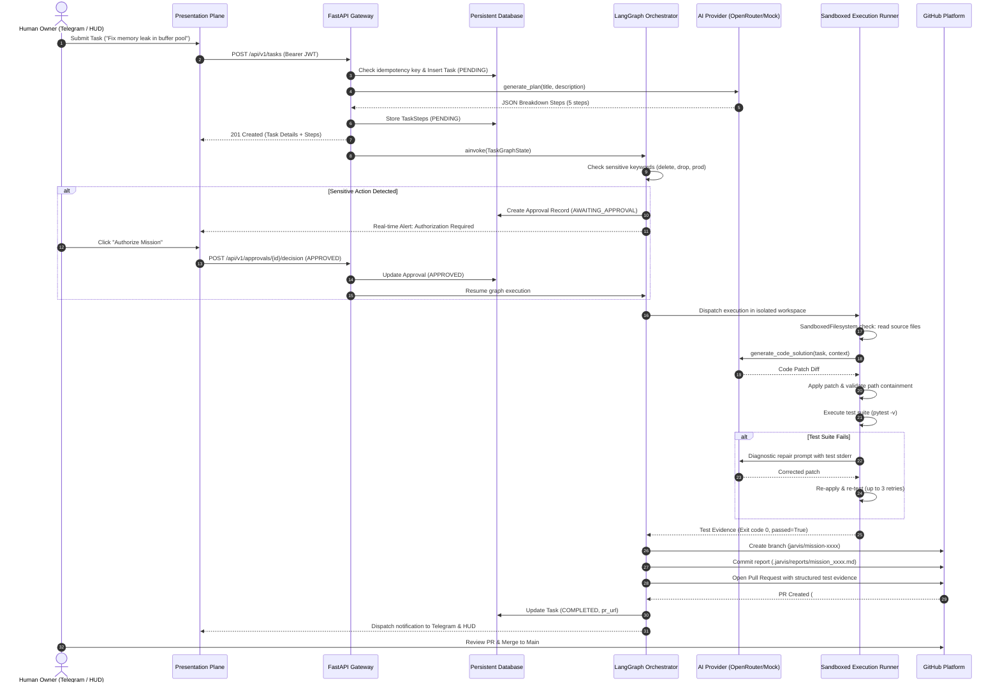

# Project Jarvis — System Data Flow & State Lifecycle

**Document Version:** 1.0.0  
**Status:** Verified Specification  

---

## 1. End-to-End Task Lifecycle Data Flow

The following sequence illustrates how an assignment transitions from intake to automated GitHub Pull Request:

---

## 2. Ingress & Egress Data Flow Matrix

| Stage | Data Transferred | Origin | Destination | Encryption / Security |
|---|---|---|---|---|
| **Intake** | Natural language prompt, priority, idempotency key | User (Browser/Telegram) | FastAPI Control Plane | TLS 1.3, JWT Bearer / Telegram HMAC |
| **Planning** | Task title, description, system prompt | Control Plane | OpenRouter API / Gemini | HTTPS TLS 1.3, Bearer Token |
| **Workspace Setup** | Git clone / branch archive | GitHub API | Sandbox Directory | HTTPS / Ephemeral GitHub App Token |
| **Execution** | Code files, test commands | Sandbox Filesystem | Subprocess Worker | Local OS memory, strict path chroot-like check |
| **Test Verification** | Stdout, Stderr, exit code | Subprocess Worker | Control Plane | Process pipes, strictly sanitized logs |
| **PR Delivery** | Code diff, test evidence markdown | Control Plane | GitHub REST API | HTTPS TLS 1.3, RS256 JWT -> App Token |
| **Audit Log** | Actor, action, target, metadata, timestamp | Control Plane | Database `audit_events` | Immutable DB append, secret redaction filter |

