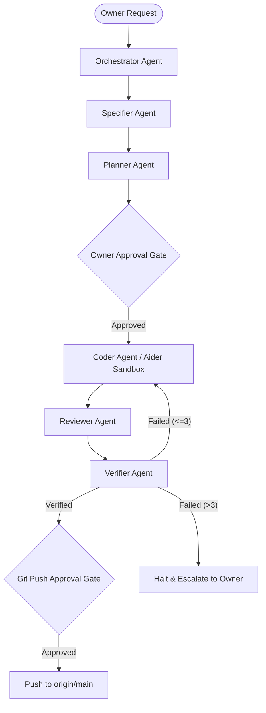

# JARVIS — Multi-Agent Architecture & Agent Design

**Document:** `docs/AGENT_DESIGN.md`  
**Version:** 1.0  
**Status:** Approved Baseline  
**Date:** 2026-11-15  

---

## 1. Architectural Philosophy

Jarvis avoids monolithic, single-agent prompt loops that quickly exceed context limits and accumulate hallucinations. Instead, Jarvis deploys a **federated, specialized multi-agent architecture** where each agent possesses a single responsibility, strict role boundaries, and explicit input/output contracts.

### Core Agent Tenets:
1. **Clean Context Discipline:** Context is treated as an expensive, consumable resource. Agents never ingest entire codebases. They use search-first tools (ripgrep, file symbol search) to inspect targeted snippets.
2. **Role Separation:** The agent that plans cannot execute unchecked; the agent that codes cannot verify its own work without an independent verifier.
3. **Bounded Repair (The 3-Strike Rule):** If an agent fails a build or test step, it has a maximum of 3 attempts to correct the specific failure before stopping and seeking human guidance.
4. **No Self-Privilege Escalation:** Agents are programmatically prohibited from approving their own permission requests or modifying the security policy.

---

## 2. Agent Roster & Specialization Matrix

### 2.1 Orchestrator Agent
- **Role:** Central coordinator and lifecycle manager.
- **Responsibilities:**
  - Route tasks between specialized agents.
  - Track token budget and daily INR spending.
  - Detect stalls or deadlocks in agent communication.
  - Write durable state updates to PostgreSQL.

### 2.2 Specifier Agent
- **Role:** Requirement clarity and scope engineering.
- **Responsibilities:**
  - Take ambiguous user requests and extract crisp functional requirements.
  - Ask targeted clarifying questions when requirements are underspecified.
  - Formulate unambiguous acceptance criteria (`Given-When-Then` format).
  - Explicitly define out-of-scope boundaries to prevent scope creep.

### 2.3 Planner Agent
- **Role:** Execution decomposition and risk assessment.
- **Responsibilities:**
  - Decompose specifications into atomic, testable execution steps.
  - Identify dependencies and map tasks into sequential waves.
  - Assign risk scores (`low`, `medium`, `high`) to proposed actions.
  - Tag actions requiring human approval (e.g., schema migrations, pushes).

### 2.4 Coder Agent (Sandbox Runner)
- **Role:** Code authoring and implementation.
- **Runtime:** GitHub Actions / Docker isolated container running Aider CLI.
- **Responsibilities:**
  - Implement code changes strictly addressing the assigned plan step.
  - Never modify files outside the approved plan scope.
  - Apply clean formatting and idiomatic language patterns.

### 2.5 Reviewer Agent
- **Role:** Automated code review and static security analysis.
- **Responsibilities:**
  - Inspect the generated `git diff`.
  - Scan for hardcoded credentials, API keys, or private tokens.
  - Check for code smells, improper exception handling, or anti-patterns.
  - Reject diffs that include extraneous or unnecessary modifications.

### 2.6 Verifier Agent
- **Role:** Empirical proof and acceptance criteria validation.
- **Responsibilities:**
  - Execute test suites (`vitest`, `playwright`, `pytest`) and examine exit codes.
  - Never accept verbal assurances or assume code works without captured proof.
  - Record test logs and diff patches into `run_artifacts`.
  - Approve the run for commit only when all acceptance criteria are met.

---

## 3. Context Window & Token Budget Management

To adhere to the INR 25 daily budget ceiling:
1. **Model Selection:** Free tier models (`meta-llama/llama-3.3-70b-instruct:free`, `google/gemini-2.0-flash-exp:free`, `qwen/qwen-2.5-coder-32b-instruct:free`) are utilized for 95%+ of operations.
2. **Maximum Context per Turn:** Capped at 16,000 tokens.
3. **System Prompt Compression:** Prompts are concise and declarative.
4. **Search Before Read:** Agents must query specific symbol tables or grep outputs rather than reading whole source files.
