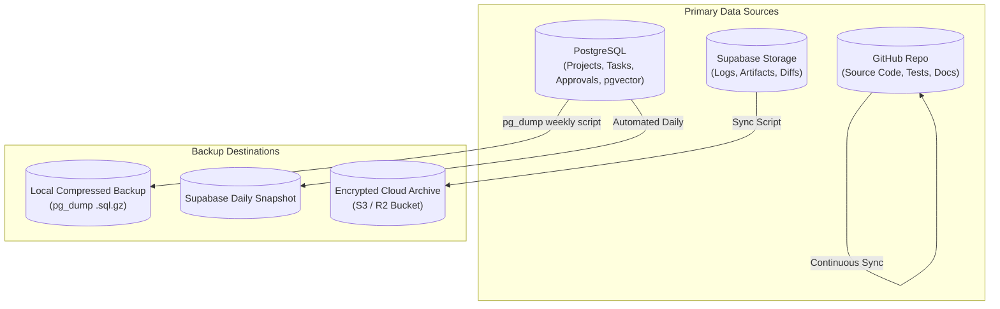

# JARVIS — Backup, Disaster Recovery & High-Availability Plan

**Document:** `docs/BACKUP_AND_RECOVERY.md`  
**Version:** 1.0  
**Status:** Approved Baseline  
**Date:** 2026-11-15  

---

## 1. Objectives & Metrics

| Metric | Target | Rationale |
|---|---|---|
| **RPO (Recovery Point Objective)** | **< 24 Hours** | Daily automated database snapshots; all code changes are preserved continuously in Git. |
| **RTO (Recovery Time Objective)** | **< 1 Hour** | Rapid rebuild using containerized migrations or cloud provisioning. |

---

## 2. Backup Architecture & Data Classification



### Data Classification:
1. **Critical (Non-reproducible):** User profiles, projects, task history, approvals, audit logs, and custom memories.
2. **Semi-Critical (Re-indexable):** Code vector embeddings (can be recomputed from repository AST).
3. **Transient:** Ephemeral build logs older than 30 days.

---

## 3. Disaster Recovery Procedures

### 3.1 Complete Cloud Database Loss (Supabase Outage / Deletion)
1. **Provision New Database:**
   - Create a fresh Supabase project or spin up local/self-hosted Docker Compose:
     ```bash
     cd deploy/self-hosted && docker compose up -d
     ```
2. **Apply Schema Migrations:**
   - Execute declarative migrations to restore tables, foreign keys, RLS, and vector extensions:
     ```bash
     supabase db push
     ```
3. **Restore Data Dump:**
   - Restore the latest verified SQL snapshot:
     ```bash
     pg_restore --clean --no-owner --dbname=$NEW_DATABASE_URL latest_backup.dump
     ```
4. **Re-index Vectors:**
   - Verify `pgvector` HNSW indexes:
     ```sql
     REINDEX INDEX idx_memories_embedding;
     ```
5. **Update Environment Secrets:**
   - Update `DATABASE_URL` and `NEXT_PUBLIC_SUPABASE_URL` in the Vercel control plane.

### 3.2 Git Repository Corruption / Divergence
- In accordance with Git Rule 10, never use force push or destructive history rewrites.
- In the event of history divergence, compare `origin/main` against local `main`, export uncommitted work to a patch, reset to the common ancestor, and cleanly apply verified commits.
