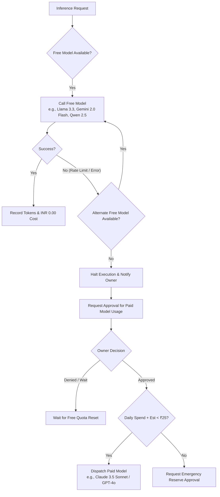

# JARVIS — Budget and Cost Control Specification

**Document:** `docs/BUDGET_AND_COST_CONTROL.md`  
**Version:** 1.0  
**Status:** Approved Baseline  
**Date:** 2026-11-15  

---

## 1. Financial Guardrails & Ceilings

Jarvis operates under strict financial constraints to ensure autonomous development remains cost-effective and predictable.

| Parameter | Limit (INR) | Enforcement Policy |
|---|---|---|
| **Normal Monthly Budget** | **₹750.00** | Hard monthly limit. Halts non-essential inference when reached. |
| **Normal Daily Spending Limit** | **₹25.00** | Daily ceiling. Halts further paid inference until the next UTC day. |
| **Emergency Reserve** | **₹250.00** | Access requires explicit owner authorization. |
| **Absolute Monthly Ceiling** | **₹1,000.00** | Total possible monthly spend under any circumstances. Inviolable. |

---

## 2. Model Selection & Fallback Hierarchy

To maximize the value of the INR 750 monthly budget, Jarvis prioritizes high-quality free models hosted on OpenRouter.

### Approved Free-Tier Models (OpenRouter):
1. `meta-llama/llama-3.3-70b-instruct:free` — General reasoning, planning, and task breakdown.
2. `google/gemini-2.0-flash-exp:free` — Fast multi-modal processing, specification extraction.
3. `qwen/qwen-2.5-coder-32b-instruct:free` — Specialized code generation and syntax verification.

### Strict Fallback Invariants:
1. **Never Fallback Automatically to Paid:** When free models fail due to rate limits or outages, Jarvis **never** routes to paid models autonomously.
2. **Explicit Consent Required:** Jarvis generates an approval request specifying:
   - Reason for paid model request (e.g., all free coder models rate-limited).
   - Recommended paid model and estimated token cost in INR.
   - Current daily and monthly accumulated spend.
3. **Execution Block:** Execution remains paused until the owner explicitly approves the paid inference or instructs Jarvis to wait for free quotas to refresh.

---

## 3. Cost Accounting & Tracking Architecture

### 3.1 Record Granularity
Every API call made to OpenRouter is recorded in `public.cost_records` with:
- `prompt_tokens`: Count of tokens sent.
- `completion_tokens`: Count of tokens generated.
- `total_tokens`: Total tokens consumed.
- `cost_inr`: Exact cost in Indian Rupees calculated from provider pricing or generation query.
- `is_estimated`: Boolean indicating whether cost was calculated from local rate tables or confirmed via OpenRouter generation stats endpoint.

### 3.2 Currency Conversion Tracking
- Model pricing on OpenRouter is denominated in USD.
- Jarvis maintains a configurable conversion baseline (default: **₹84.00 INR per $1.00 USD**).
- Conversions are computed server-side to guarantee precision.

---

## 4. Circuit Breakers & Alerts

1. **80% Daily Threshold Alert:** When daily spend reaches ₹20.00, Jarvis dispatches an informational notification via Telegram and dashboard toast.
2. **100% Daily Circuit Breaker:** When daily spend reaches ₹25.00, the AI Gateway adapter immediately rejects outgoing paid requests with `BUDGET_EXCEEDED_DAILY`.
3. **Monthly Cap Circuit Breaker:** When monthly spend hits ₹750.00, all billable requests are locked. Only manual owner intervention authorizing the ₹250.00 emergency reserve can unlock operations.
