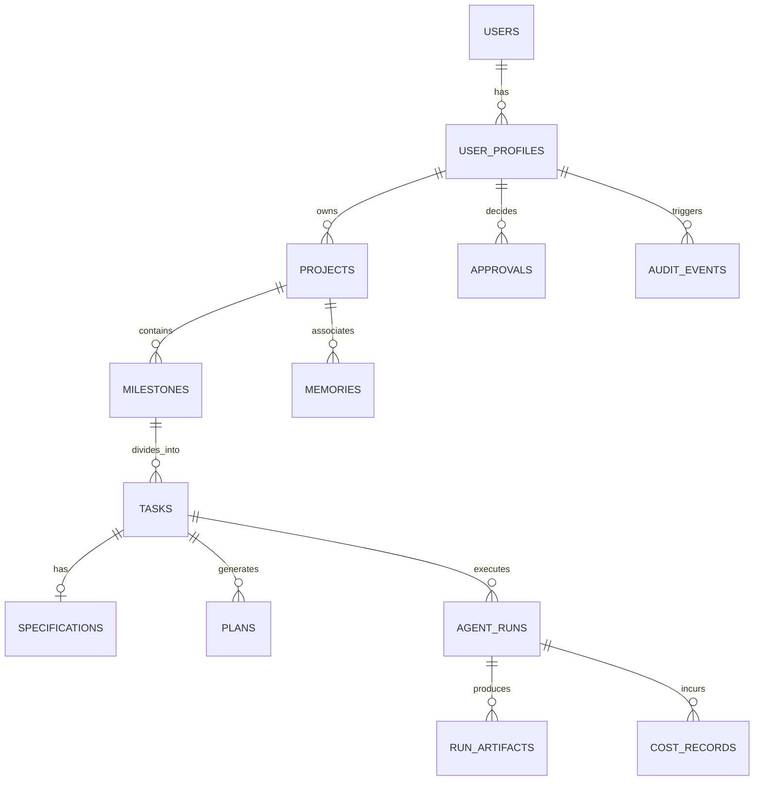

# JARVIS — Database Schema & Data Architecture

**Document:** `docs/DATABASE_SCHEMA.md`  
**Version:** 1.0  
**Status:** Approved Baseline  
**Date:** 2026-11-15  

---

## 1. Overview & Data Architecture Principles

Jarvis utilizes PostgreSQL 15+ as its single source of durable truth.
Key principles:
1. **Strong Typing & Foreign Key Integrity:** Foreign keys enforce strict relational integrity. Cascading deletes are restricted on audit and financial records.
2. **Row-Level Security (RLS) Everywhere:** Every tenant-accessible table is protected by PostgreSQL RLS policies tied to `auth.uid() = user_id`.
3. **Audit Immutability:** Audit events, approvals, and cost logs cannot be updated or deleted.
4. **Vector Search via `pgvector`:** Vector embeddings (e.g., 1536-dimensional or 768-dimensional) are stored in dedicated vector columns with IVFFlat or HNSW indexes.
5. **Durable Queuing:** State machines and asynchronous runner dispatches utilize PostgreSQL ACID transactions and `pgmq` queue semantics.
6. **Managed-to-Self-Hosted Portability:** All DDL statements are standard SQL compatible with Supabase Cloud and self-hosted PostgreSQL containers.

---

## 2. Entity-Relationship Diagram



---

## 3. Detailed Table Specifications

### 3.1 `user_profiles`
Stores extended user preferences and configuration.
```sql
CREATE TABLE public.user_profiles (
    id UUID PRIMARY KEY REFERENCES auth.users(id) ON DELETE CASCADE,
    full_name TEXT NOT NULL,
    timezone TEXT DEFAULT 'UTC' NOT NULL,
    telegram_chat_id BIGINT UNIQUE,
    monthly_budget_inr NUMERIC(10, 2) DEFAULT 750.00 NOT NULL,
    daily_budget_inr NUMERIC(10, 2) DEFAULT 25.00 NOT NULL,
    preferences JSONB DEFAULT '{}'::jsonb NOT NULL,
    created_at TIMESTAMPTZ DEFAULT NOW() NOT NULL,
    updated_at TIMESTAMPTZ DEFAULT NOW() NOT NULL
);
```

### 3.2 `projects`
Root container for software repositories and developer tasks.
```sql
CREATE TABLE public.projects (
    id UUID PRIMARY KEY DEFAULT gen_random_uuid(),
    user_id UUID NOT NULL REFERENCES public.user_profiles(id) ON DELETE RESTRICT,
    name TEXT NOT NULL,
    slug TEXT NOT NULL,
    description TEXT,
    repository_url TEXT,
    default_branch TEXT DEFAULT 'main' NOT NULL,
    status TEXT DEFAULT 'active' NOT NULL CHECK (status IN ('active', 'archived', 'paused')),
    settings JSONB DEFAULT '{}'::jsonb NOT NULL,
    created_at TIMESTAMPTZ DEFAULT NOW() NOT NULL,
    updated_at TIMESTAMPTZ DEFAULT NOW() NOT NULL,
    UNIQUE(user_id, slug)
);
CREATE INDEX idx_projects_user_id ON public.projects(user_id);
```

### 3.3 `milestones`
Sequential groupings of project deliverables.
```sql
CREATE TABLE public.milestones (
    id UUID PRIMARY KEY DEFAULT gen_random_uuid(),
    project_id UUID NOT NULL REFERENCES public.projects(id) ON DELETE CASCADE,
    title TEXT NOT NULL,
    description TEXT,
    sequence_order INT NOT NULL DEFAULT 0,
    status TEXT DEFAULT 'pending' NOT NULL CHECK (status IN ('pending', 'in_progress', 'completed', 'blocked')),
    created_at TIMESTAMPTZ DEFAULT NOW() NOT NULL,
    updated_at TIMESTAMPTZ DEFAULT NOW() NOT NULL
);
CREATE INDEX idx_milestones_project_id ON public.milestones(project_id);
```

### 3.4 `tasks`
Work items executed autonomously or semi-autonomously.
```sql
CREATE TABLE public.tasks (
    id UUID PRIMARY KEY DEFAULT gen_random_uuid(),
    project_id UUID NOT NULL REFERENCES public.projects(id) ON DELETE RESTRICT,
    milestone_id UUID REFERENCES public.milestones(id) ON DELETE SET NULL,
    title TEXT NOT NULL,
    description TEXT,
    priority TEXT DEFAULT 'medium' NOT NULL CHECK (priority IN ('low', 'medium', 'high', 'critical')),
    risk_level TEXT DEFAULT 'low' NOT NULL CHECK (risk_level IN ('low', 'medium', 'high')),
    status TEXT DEFAULT 'intake' NOT NULL CHECK (status IN ('intake', 'specifying', 'planned', 'awaiting_approval', 'running', 'verifying', 'completed', 'failed', 'cancelled')),
    estimated_cost_inr NUMERIC(10, 2) DEFAULT 0.00 NOT NULL,
    actual_cost_inr NUMERIC(10, 2) DEFAULT 0.00 NOT NULL,
    created_at TIMESTAMPTZ DEFAULT NOW() NOT NULL,
    updated_at TIMESTAMPTZ DEFAULT NOW() NOT NULL
);
CREATE INDEX idx_tasks_project_id ON public.tasks(project_id);
CREATE INDEX idx_tasks_status ON public.tasks(status);
```

### 3.5 `specifications`
Structured requirements and acceptance criteria for a task.
```sql
CREATE TABLE public.specifications (
    id UUID PRIMARY KEY DEFAULT gen_random_uuid(),
    task_id UUID NOT NULL REFERENCES public.tasks(id) ON DELETE CASCADE,
    scope TEXT NOT NULL,
    exclusions TEXT NOT NULL,
    acceptance_criteria JSONB NOT NULL DEFAULT '[]'::jsonb,
    raw_user_prompt TEXT NOT NULL,
    version INT DEFAULT 1 NOT NULL,
    created_at TIMESTAMPTZ DEFAULT NOW() NOT NULL
);
CREATE INDEX idx_specifications_task_id ON public.specifications(task_id);
```

### 3.6 `plans`
Structured execution plans with wave/step dependencies.
```sql
CREATE TABLE public.plans (
    id UUID PRIMARY KEY DEFAULT gen_random_uuid(),
    task_id UUID NOT NULL REFERENCES public.tasks(id) ON DELETE CASCADE,
    steps JSONB NOT NULL DEFAULT '[]'::jsonb,
    dependencies JSONB NOT NULL DEFAULT '[]'::jsonb,
    risk_assessment JSONB NOT NULL DEFAULT '{}'::jsonb,
    required_approvals JSONB NOT NULL DEFAULT '[]'::jsonb,
    status TEXT DEFAULT 'draft' NOT NULL CHECK (status IN ('draft', 'pending_approval', 'approved', 'rejected', 'superseded')),
    version INT DEFAULT 1 NOT NULL,
    created_at TIMESTAMPTZ DEFAULT NOW() NOT NULL
);
CREATE INDEX idx_plans_task_id ON public.plans(task_id);
```

### 3.7 `approvals`
Audit-gated permission requests for consequential operations.
```sql
CREATE TABLE public.approvals (
    id UUID PRIMARY KEY DEFAULT gen_random_uuid(),
    user_id UUID NOT NULL REFERENCES public.user_profiles(id) ON DELETE RESTRICT,
    task_id UUID REFERENCES public.tasks(id) ON DELETE CASCADE,
    action_type TEXT NOT NULL CHECK (action_type IN ('git_remote_push', 'production_deploy', 'paid_ai_inference', 'destructive_db_mutation', 'external_message')),
    target_resource TEXT NOT NULL,
    scope JSONB NOT NULL,
    status TEXT DEFAULT 'pending' NOT NULL CHECK (status IN ('pending', 'approved', 'rejected', 'expired')),
    decision_reason TEXT,
    requested_at TIMESTAMPTZ DEFAULT NOW() NOT NULL,
    decided_at TIMESTAMPTZ,
    expires_at TIMESTAMPTZ NOT NULL
);
CREATE INDEX idx_approvals_user_status ON public.approvals(user_id, status);
```

### 3.8 `agent_runs`
Individual execution sessions dispatched to the runner sandbox.
```sql
CREATE TABLE public.agent_runs (
    id UUID PRIMARY KEY DEFAULT gen_random_uuid(),
    task_id UUID NOT NULL REFERENCES public.tasks(id) ON DELETE CASCADE,
    agent_engine TEXT NOT NULL DEFAULT 'aider',
    status TEXT DEFAULT 'queued' NOT NULL CHECK (status IN ('queued', 'running', 'verifying', 'completed', 'failed', 'timed_out')),
    exit_code INT,
    git_head_before TEXT,
    git_commit_hash TEXT,
    diff_patch TEXT,
    test_results JSONB DEFAULT '{}'::jsonb,
    retry_count INT DEFAULT 0 NOT NULL,
    error_summary TEXT,
    started_at TIMESTAMPTZ,
    completed_at TIMESTAMPTZ,
    created_at TIMESTAMPTZ DEFAULT NOW() NOT NULL
);
CREATE INDEX idx_agent_runs_task_id ON public.agent_runs(task_id);
```

### 3.9 `run_artifacts`
Output artifacts, test logs, coverage files, and UI screenshots.
```sql
CREATE TABLE public.run_artifacts (
    id UUID PRIMARY KEY DEFAULT gen_random_uuid(),
    run_id UUID NOT NULL REFERENCES public.agent_runs(id) ON DELETE CASCADE,
    artifact_type TEXT NOT NULL CHECK (artifact_type IN ('test_log', 'build_log', 'diff', 'screenshot', 'linter_report')),
    storage_path TEXT NOT NULL,
    file_size_bytes BIGINT NOT NULL,
    mime_type TEXT NOT NULL,
    checksum_sha256 TEXT NOT NULL,
    created_at TIMESTAMPTZ DEFAULT NOW() NOT NULL
);
CREATE INDEX idx_run_artifacts_run_id ON public.run_artifacts(run_id);
```

### 3.10 `cost_records`
Fine-grained token and financial spend tracking.
```sql
CREATE TABLE public.cost_records (
    id UUID PRIMARY KEY DEFAULT gen_random_uuid(),
    user_id UUID NOT NULL REFERENCES public.user_profiles(id) ON DELETE RESTRICT,
    run_id UUID REFERENCES public.agent_runs(id) ON DELETE SET NULL,
    provider TEXT NOT NULL DEFAULT 'openrouter',
    model TEXT NOT NULL,
    prompt_tokens INT NOT NULL DEFAULT 0,
    completion_tokens INT NOT NULL DEFAULT 0,
    total_tokens INT NOT NULL DEFAULT 0,
    cost_inr NUMERIC(10, 4) NOT NULL DEFAULT 0.0000,
    is_estimated BOOLEAN NOT NULL DEFAULT false,
    created_at TIMESTAMPTZ DEFAULT NOW() NOT NULL
);
CREATE INDEX idx_cost_records_user_created ON public.cost_records(user_id, created_at);
```

### 3.11 `audit_events`
Immutable security and compliance log.
```sql
CREATE TABLE public.audit_events (
    id UUID PRIMARY KEY DEFAULT gen_random_uuid(),
    user_id UUID REFERENCES public.user_profiles(id) ON DELETE RESTRICT,
    event_type TEXT NOT NULL,
    resource_type TEXT NOT NULL,
    resource_id TEXT NOT NULL,
    details JSONB DEFAULT '{}'::jsonb NOT NULL,
    ip_address INET,
    user_agent TEXT,
    created_at TIMESTAMPTZ DEFAULT NOW() NOT NULL
);
CREATE INDEX idx_audit_events_created_at ON public.audit_events(created_at);
```

### 3.12 `memories` (pgvector)
Semantic and episodic memory store.
```sql
CREATE EXTENSION IF NOT EXISTS vector;

CREATE TABLE public.memories (
    id UUID PRIMARY KEY DEFAULT gen_random_uuid(),
    user_id UUID NOT NULL REFERENCES public.user_profiles(id) ON DELETE CASCADE,
    project_id UUID REFERENCES public.projects(id) ON DELETE CASCADE,
    category TEXT NOT NULL CHECK (category IN ('user_preference', 'project_decision', 'architecture_pattern', 'historical_error')),
    content TEXT NOT NULL,
    embedding VECTOR(1536),
    metadata JSONB DEFAULT '{}'::jsonb NOT NULL,
    created_at TIMESTAMPTZ DEFAULT NOW() NOT NULL,
    updated_at TIMESTAMPTZ DEFAULT NOW() NOT NULL
);
CREATE INDEX idx_memories_embedding ON public.memories USING hnsw (embedding vector_cosine_ops);
CREATE INDEX idx_memories_user_cat ON public.memories(user_id, category);
```

---

## 4. Row-Level Security (RLS) Policy Design

All user data tables enforce RLS:
```sql
ALTER TABLE public.projects ENABLE ROW LEVEL SECURITY;
CREATE POLICY "Users can only view their own projects"
    ON public.projects FOR SELECT
    USING (auth.uid() = user_id);

CREATE POLICY "Users can only insert their own projects"
    ON public.projects FOR INSERT
    WITH CHECK (auth.uid() = user_id);

CREATE POLICY "Users can only update their own projects"
    ON public.projects FOR UPDATE
    USING (auth.uid() = user_id);
```
Similar policies apply to `tasks`, `approvals`, `cost_records`, `memories`, and `agent_runs`.
Audit tables enforce append-only rules (`INSERT` permitted, `UPDATE` and `DELETE` denied).
