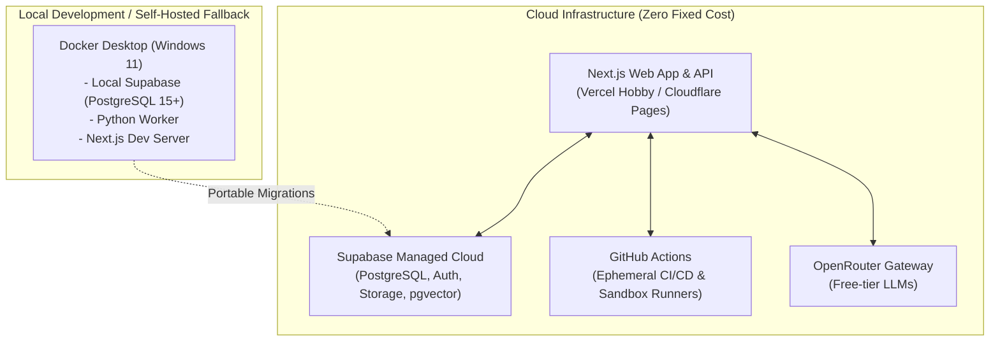

# JARVIS — Deployment & Infrastructure Strategy

**Document:** `docs/DEPLOYMENT_STRATEGY.md`  
**Version:** 1.0  
**Status:** Approved Baseline  
**Date:** 2026-11-15  

---

## 1. Hosting Architecture & Free-Tier Optimization

Jarvis is architected to operate **24/7 in the cloud without requiring the owner's laptop to remain powered on**, while incurring ₹0.00 in fixed infrastructure hosting costs.

---

## 2. Environment Matrix

| Environment | Control Plane Host | Database / Storage Host | Runner Host | Purpose |
|---|---|---|---|---|
| **Local Dev** | `localhost:3000` (Node.js) | Local Supabase CLI (Docker) | Local Docker Sandbox | Feature authoring, unit tests, fast feedback loop. |
| **Preview / Staging**| Vercel Preview Deployments | Supabase Cloud (Branch / Staging) | GitHub Actions Runner | Integration testing and end-to-end verification. |
| **Production** | Vercel Production (`jarvis.app`) | Supabase Cloud (Production) | GitHub Actions Runner | Live 24/7 personal command centre and Telegram bot. |

---

## 3. Promotion Gates: Preview vs Production

In alignment with Section 6 of the Master Directive:
- **Preview Deployments:** Automatically built upon verified commits landing on `main`. Allows real-time UI/API testing.
- **Production Promotions:** **Always require explicit human approval.** Jarvis will never deploy or promote application changes to live production without an immutable approval record signed by the owner.

---

## 4. Supabase Free-Tier Operational Constraints

The Supabase Free tier provides:
- 500 MB database storage.
- 1 GB file storage.
- 50,000 monthly active users (single owner is well within limits).
- 2 free projects.

### Critical Quota & Pause Guardrails:
1. **Inactivity Pausing:** Supabase free tier automatically pauses projects after 7 consecutive days without API/database traffic.
   - *Mitigation:* A lightweight scheduled health cron (Vercel Cron / GitHub Actions scheduled workflow) executes a single ping query every 3 days (`SELECT 1;`) to keep the project active.
   - *Recovery:* If paused, the owner is alerted with direct instructions to restore the project via the Supabase dashboard.
2. **Storage Quotas:** Build logs and test screenshots are automatically pruned after 30 days via a retention trigger to prevent exceeding the 1 GB storage threshold.

---

## 5. Self-Hosted Portability Guarantee

To eliminate platform lock-in:
1. All database migrations are pure standard PostgreSQL SQL scripts located in `supabase/migrations/`.
2. A complete `docker-compose.yml` configuration is maintained in `deploy/self-hosted/` mirroring the Supabase open-source stack.
3. Database backups are exportable using standard `pg_dump` and restorable via `pg_restore` on any commodity VPS (e.g., Hetzner, DigitalOcean) if the owner chooses to self-host in the future.
