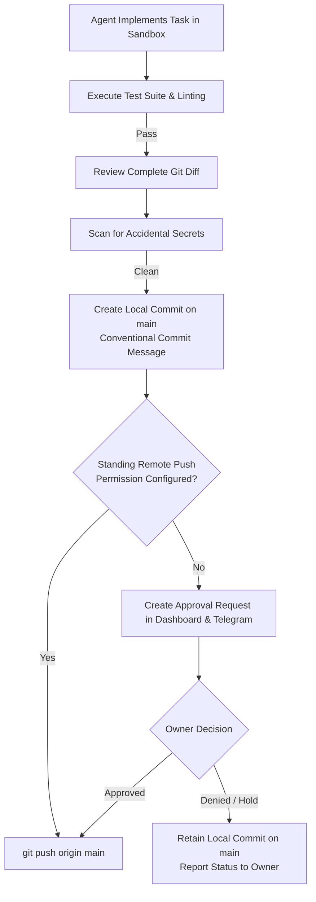

# JARVIS — GitHub Integration & Main-Only Source Control Policy

**Document:** `docs/GITHUB_INTEGRATION.md`  
**Version:** 1.0  
**Status:** Approved Baseline  
**Date:** 2026-11-15  

---

## 1. Mandatory GitHub Branch Policy — Main Only

The owner explicitly mandates that Jarvis operate exclusively on the GitHub `main` branch. This policy overrides any conventional Git-flow or PR-based workflows.

### Non-Negotiable Rules:
1. **Single Working Branch:** The only permitted working branch is `main`.
2. **Zero Secondary Branches:** Do not create feature branches, development branches, release branches, hotfix branches, or temporary remote branches.
3. **No Pull Requests:** Do not create, checkout, or merge pull requests. All development lands directly on `main`.
4. **Local Commits on `main` Only:** All commits must be made directly on the local `main` branch.
5. **Target Remote:** Permitted remote pushes must target `origin/main` exclusively.
6. **Pre-Work Inspection:** Before executing any Git operation, Jarvis must inspect:
   - `git status`
   - `git branch --show-current`
   - `git remote -v`
   - `git log -n 5 --oneline`
7. **Branch Guard:** If the active branch is not `main`, Jarvis must halt immediately and alert the owner. Jarvis must never create or switch branches automatically.
8. **Working Tree Guard:** If the working tree contains unexplained or uncommitted user changes, Jarvis must halt immediately before modifying, overwriting, or discarding anything.
9. **Destructive Command Ban:** Never execute `git push --force`, `git push --force-with-lease`, destructive `git reset --hard`, history rewrites, or any command that discards uncommitted work.
10. **Branch Protection Adherence:** Never attempt to bypass GitHub branch protection or required status checks. If a repository rule blocks direct push to `main`, halt and notify the owner.
11. **Serialized Repository Access:** Two coding agents must never write to the same repository concurrently.
12. **Pre-Commit Verification:** Run tests, linters, and inspect the complete diff before every commit.
13. **Clean Commit Hygiene:** Use conventional commit messages (`feat`, `fix`, `docs`, `test`, `chore`, `refactor`). Keep secrets, credentials, databases, and build artifacts out of Git.

---

## 2. Main-Only Safety Gate & Push Approval

Direct commits to `main` eliminate peer review branches. Therefore, Jarvis enforces a strict local-to-remote safety gate:

### Invariants:
- **Approval Scope:** Approval to edit local files or create local commits is distinct from approval to push to GitHub.
- **Explicit Push Request:** Push approval requests must show:
  - Local commit hash.
  - Summary of changed files.
  - Test verification results.
  - Target remote (`origin/main`).

---

## 3. GitHub App Authentication & Permissions

Jarvis connects to GitHub via a dedicated **GitHub App** providing least-privilege scoping:
- **Repository Permissions:**
  - `Contents: Read and write` — Allows cloning, reading files, and pushing verified commits to `main`.
  - `Issues: Read and write` — Allows reading task issues, adding comments, and updating issue status.
  - `Actions / Workflows: Read and write` — Allows dispatching ephemeral test runner workflows.
  - `Metadata: Read-only` — Allows repository discovery.
- **Ephemeral Installation Tokens:**
  - Jarvis generates short-lived (1-hour maximum) installation tokens using the GitHub App's private key (`GITHUB_APP_PRIVATE_KEY`).
  - Tokens are passed to the sandbox runner and expire automatically.
- **Webhook Ingress:**
  - Webhooks from GitHub (`issues.opened`, `workflow_run.completed`) are authenticated via HMAC SHA-256 secret tokens (`GITHUB_WEBHOOK_SECRET`).
