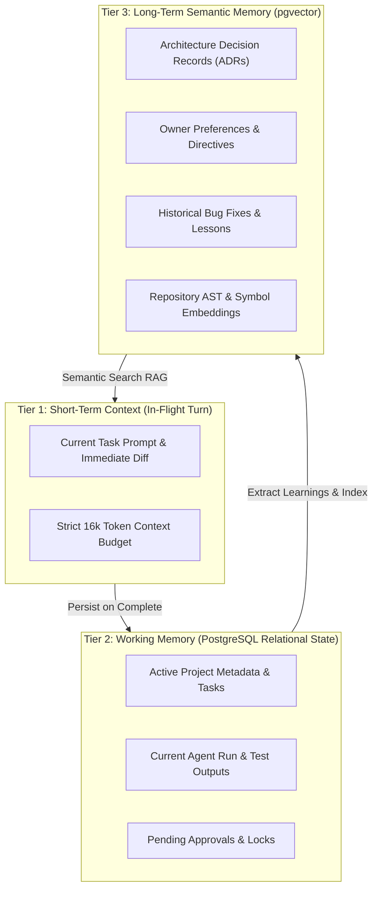

# JARVIS — Memory Architecture & Retrieval System

**Document:** `docs/MEMORY_ARCHITECTURE.md`  
**Version:** 1.0  
**Status:** Approved Baseline  
**Date:** 2026-11-15  

---

## 1. Overview & Memory Hierarchy

Jarvis implements a three-tier memory architecture to provide operational continuity across sessions, tasks, and system restarts while respecting token budgets and context window limits.



---

## 2. Memory Tier Specifications

### 2.1 Tier 1: Short-Term Working Context
- **Lifetime:** Transient; bounded to a single agent invocation turn.
- **Management:** Managed strictly in memory and injected into prompt templates.
- **Constraints:** Limited to 16,000 tokens maximum. Excess context is pruned using search-first filtering.

### 2.2 Tier 2: Relational State (PostgreSQL)
- **Lifetime:** Persistent across restarts.
- **Management:** Stored in structured relational tables (`projects`, `tasks`, `agent_runs`, `approvals`).
- **Access:** Direct ACID SQL queries. Provides instant, unambiguous ground truth for task state.

### 2.3 Tier 3: Semantic Long-Term Memory (`pgvector`)
- **Lifetime:** Permanent across the lifecycle of the system.
- **Storage:** `public.memories` table with `VECTOR(1536)` or `VECTOR(768)` embedding columns.
- **Indexing:** HNSW (Hierarchical Navigable Small World) index for fast approximate nearest neighbor (ANN) cosine similarity search.
- **Categories:**
  - `user_preference`: Explicit instructions from the owner (e.g., "Always use strict TypeScript types", "Prefer Tailwind v3").
  - `project_decision`: Key architectural decisions and rationale.
  - `architecture_pattern`: Proven code templates and integration patterns.
  - `historical_error`: Past bugs and their verified fixes to prevent repeating mistakes.

---

## 3. Retrieval Protocol (RAG Flow)

When an agent prepares to plan or execute a task:
1. **Query Construction:** The user prompt is converted into a search query string.
2. **Embedding Generation:** The query is embedded via an OpenRouter embedding endpoint (or local Python sentence-transformers worker).
3. **Similarity Search:**
   ```sql
   SELECT id, category, content, 1 - (embedding <=> :queryEmbedding) AS similarity
   FROM public.memories
   WHERE user_id = :userId 
     AND (project_id = :projectId OR project_id IS NULL)
     AND (1 - (embedding <=> :queryEmbedding)) > 0.78
   ORDER BY similarity DESC
   LIMIT 5;
   ```
4. **Context Injection:** The top 3–5 most relevant memory snippets are formatted and injected into the agent's system prompt under `<relevant_project_memory>` tags.

---

## 4. Privacy, Tenant Scoping & Hygiene

- **Strict User Scoping:** Memories are strictly partitioned by `user_id`. Multi-tenant leaks are prevented at the database level by PostgreSQL RLS.
- **Deduplication:** Before inserting a new memory, a cosine distance check ensures near-identical memories (>0.95 similarity) are merged or updated rather than duplicated.
- **Manual Curation:** The web dashboard provides a dedicated **Memory Management** interface where the owner can inspect, search, edit, or delete stored memories.
