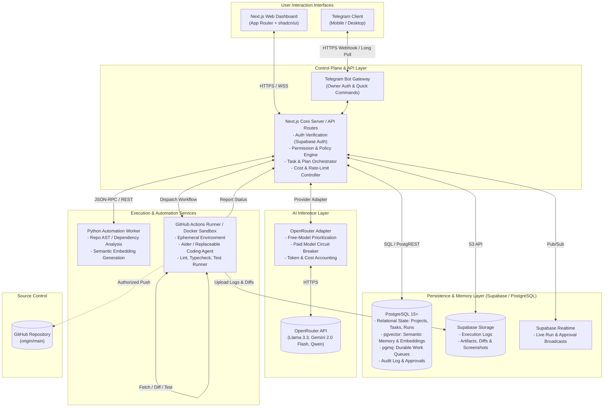
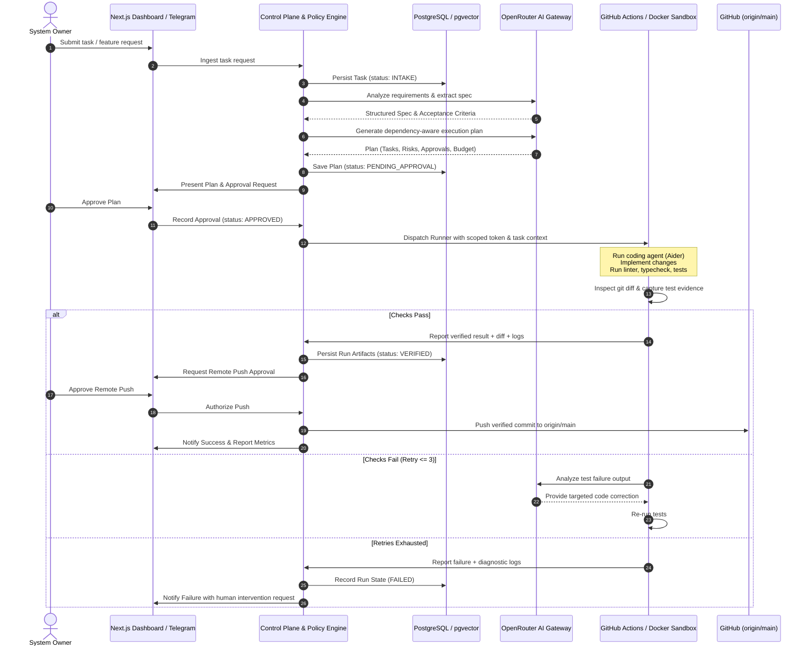

# JARVIS — System Architecture Specification

**Document:** `docs/SYSTEM_ARCHITECTURE.md`  
**Version:** 1.0  
**Status:** Approved Baseline  
**Date:** 2026-11-15  

---

## 1. Architectural Principles

Jarvis is architected as an **auditable, persistent, personal AI operating system** tailored for autonomous software development. The system adheres to six foundational architectural tenets:

1. **State Durability over Ephemeral Memory:** No critical state resides exclusively in memory. Workflows, tasks, runs, approvals, and decisions are modeled as durable state machines in PostgreSQL. If any process terminates or restarts, execution resumes seamlessly from the last recorded state.
2. **Strict Human-in-the-Loop Governance:** Autonomous operations are strictly bound by a central permission policy. High-consequence actions (external pushes, production deployments, financial spend, destructive mutations) require cryptographically bound, immutable approvals.
3. **Provider-Agnostic Isolation:** AI models and coding engines are isolated behind generic adapter interfaces. The system does not lock into proprietary vendor APIs.
4. **Disposable, Least-Privilege Sandboxing:** Code generation and test execution never run with access to production secrets or master API keys. Work is isolated in temporary, ephemeral containers (GitHub Actions / Docker).
5. **Main-Only Source Control Discipline:** The architecture enforces direct, small, fully verified commits on the local `main` branch. Pushes to `origin/main` are explicit, audited, and strictly regulated.
6. **Managed-First, Self-Hostable Portability:** The primary database and storage layer uses Supabase. All schemas, migrations, RLS policies, and background queues are designed to run interchangeably on managed Supabase and self-hosted Docker environments.

---

## 2. High-Level Architecture Diagram

---

## 3. Subsystem Descriptions

### 3.1 Control Plane & Web Application (Next.js App Router)
- **Role:** Central orchestrator and user interface.
- **Technology:** Next.js 14+ with React Server Components, TypeScript, Tailwind CSS, shadcn/ui.
- **Responsibilities:**
  - Authenticate the owner via Supabase Auth.
  - Render the cinematic command centre, holographic orb, project workspace, and approval centre.
  - Implement API Route Handlers for task intake, plan generation, and approval processing.
  - Enforce the Central Permission Policy prior to triggering any external or background actions.
  - Manage cost budgets, token meters, and safety circuit breakers.

### 3.2 Persistence & Semantic Memory Layer (Supabase / PostgreSQL)
- **Role:** Single source of truth for all system data.
- **Technology:** PostgreSQL 15+, `pgvector`, `pgmq` (or durable queue tables), Supabase Storage.
- **Responsibilities:**
  - Persist projects, milestones, tasks, agent runs, approvals, and audit events.
  - Secure data at rest and enforce tenant boundaries using PostgreSQL Row-Level Security (RLS).
  - Store code embeddings and user knowledge in `pgvector` for semantic retrieval.
  - Store build logs, test outputs, screenshots, and diff patches in Supabase Storage.
  - Guarantee zero schema lock-in to enable seamless migration to self-hosted Docker containers.

### 3.3 AI Gateway Adapter (OpenRouter)
- **Role:** Unified, provider-independent abstraction for LLM inference.
- **Technology:** Custom TypeScript/Node.js adapter implementing standard completion and streaming contracts.
- **Responsibilities:**
  - Route prompts to verified free-tier models (e.g., `meta-llama/llama-3.3-70b-instruct:free`, `google/gemini-2.0-flash-exp:free`, `qwen/qwen-2.5-coder-32b-instruct:free`).
  - Calculate exact token consumption and record latency and cost.
  - Enforce the INR 25 daily and INR 750 monthly budget ceilings.
  - Intercept paid model requests and halt execution until explicit owner approval is granted.

### 3.4 Execution Sandbox (GitHub Actions & Docker)
- **Role:** Isolated, disposable execution runtime for untrusted code generation, building, and testing.
- **Technology:** GitHub-hosted runners (`ubuntu-latest`) executing inside dedicated Docker containers.
- **Responsibilities:**
  - Receive scoped task instructions and an ephemeral repository checkout.
  - Run coding agents (e.g., Aider, Python workers) in a secure sandbox.
  - Never receive the master database service key or master OpenRouter API keys.
  - Execute automated test suites, linters, type checks, and security scans.
  - Capture test logs, generated diffs, and proof artifacts.
  - Maintain the `main`-only Git policy.

### 3.5 Telegram Gateway
- **Role:** Low-latency, mobile-first command and notification interface.
- **Technology:** Node.js Telegram Bot API client.
- **Responsibilities:**
  - Receive natural-language tasks, quick commands, and status inquiries.
  - Authenticate incoming requests against the verified single owner Telegram ID (`OWNER_TELEGRAM_ID`).
  - Render interactive inline keyboards for pending approval requests (Approve / Reject).
  - Deliver real-time status alerts on run completion, test failures, or budget warnings.

### 3.6 Python Automation Service
- **Role:** Specialized backend service for code intelligence, AST parsing, and semantic processing.
- **Technology:** Python 3.11+, FastAPI / standard CLI worker, Pydantic, tree-sitter.
- **Responsibilities:**
  - Parse repository syntax trees and extract class/function dependencies.
  - Chunk code and documentation for vector embeddings.
  - Execute specialized repository linting and compliance checks.
  - Communicate with the Next.js control plane via versioned, validated JSON contracts.

---

## 4. End-to-End Autonomous Development Lifecycle (The Ralph Loop)

---

## 5. Resilience & Fault Tolerance Strategy

1. **State Machine Invariants:** Every task and agent run transitions through formal, immutable state values (`DRAFT` -> `PLANNED` -> `APPROVED` -> `RUNNING` -> `VERIFYING` -> `COMPLETED` / `FAILED`). State transitions are written to the database in ACID transactions.
2. **Worker Crash Recovery:** If a background runner or API handler crashes midway, a periodic health monitor detects stale runs (heartbeat timestamp > 5 minutes old), marks them as `INTERRUPTED`, and provides a safe resume or rollback mechanism.
3. **Idempotent Webhooks & Events:** All incoming webhooks from GitHub or Telegram are deduplicated against an `event_id` store. Duplicate deliveries are acknowledged with HTTP 200 without executing side effects twice.
4. **Token & Cost Circuit Breaker:** OpenRouter requests are checked against real-time daily spending. If accumulated daily spend hits INR 25, inference calls halt immediately with an automated alert.
5. **Database Portability:** No managed-only proprietary extensions are used. All database features (tables, functions, triggers, vector indexes, pgmq) are expressed as declarative SQL migrations reproducible on standard PostgreSQL 15+ running in Docker Compose.
