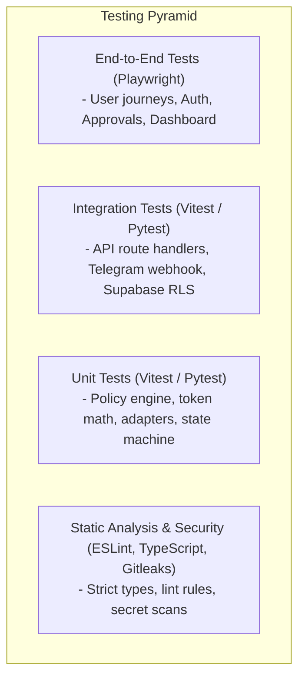

# JARVIS — Test Strategy & Empirical Proof Protocol

**Document:** `docs/TEST_STRATEGY.md`  
**Version:** 1.0  
**Status:** Approved Baseline  
**Date:** 2026-11-15  

---

## 1. Quality Philosophy: Empirical Proof Over Claims

A feature or task in Jarvis is **never complete** simply because code was written, a page was created, or an agent asserts that "it should work."

### Non-Negotiable Verification Protocol:
1. **Executed Proof Required:** Tests must be genuinely executed against the code changes, and the full output must be captured, parsed, and recorded.
2. **Zero False Pass Reports:** Never report that a test passed unless its exit code was `0` and its runner output was inspected and verified.
3. **Multi-Layer Quality Gate:** Every commit on `main` must satisfy all layers of the quality gate.

---

## 2. Test Pyramid & Tooling Matrix

| Layer | Runner / Tool | Target | Execution Timing | Pass Criteria |
|---|---|---|---|---|
| **Static Analysis** | `tsc --noEmit`, `eslint`, `ruff` | Full codebase | Pre-commit / Pre-run | 0 errors, 0 warnings. |
| **Secret Scanning** | `gitleaks` / `trufflehog` | Staged git diff | Pre-commit | 0 detected secrets or private keys. |
| **Unit Tests** | `vitest run` | Core logic, adapters, calculators | Pre-commit / Sandbox | 100% pass rate; >85% branch coverage on policy engine. |
| **Integration Tests**| `vitest run --testPathPattern=integration` | Route handlers, DB RLS, Telegram | Post-build / Sandbox | All HTTP endpoints return expected JSON schemas & status codes. |
| **E2E Tests** | `playwright test` | Critical user journeys | Staging / Milestone release | Headless browser passes all assertions and captures screenshots. |

---

## 3. Required Evidence Artifacts per Change Type

| Change Type | Minimum Required Empirical Proof | Captured Artifact |
|---|---|---|
| **Backend API Route** | Captured HTTP response status and body (`curl` or Vitest test log). | `artifacts/api-response.json` |
| **Database Migration** | Executed migration log and verified schema inspection output. | `artifacts/migration-verify.log` |
| **Frontend UI Component** | Headless browser screenshot rendered in light/dark mode. | `artifacts/ui-screenshot.png` |
| **Coding Agent Run** | Full test runner console output showing passed assertions and exit code 0. | `artifacts/runner-console.log` |
| **Git Commit** | Verified `git log -1` and `git diff` inspection output. | `artifacts/commit-diff.patch` |

---

## 4. Continuous Regression & Audit Gate

- **Milestone Audit Process:** After each milestone, the project's Master Engineering Audit prompt is executed.
- **Audit Rules:**
  - Audits are read-only and inspect actual repository commits.
  - P0 (Critical) and P1 (High) findings block advancing to the subsequent milestone.
  - All audit reports are archived in `docs/audits/milestone-<N>-audit.md`.
