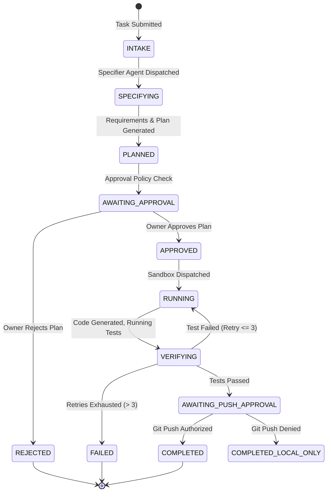

# JARVIS — Workflow Engine & State Machine

**Document:** `docs/WORKFLOW_ENGINE.md`  
**Version:** 1.0  
**Status:** Approved Baseline  
**Date:** 2026-11-15  

---

## 1. Engine Objective

The Jarvis Workflow Engine manages the lifecycle of tasks, runs, and approvals. It guarantees that:
1. Every task progresses through deterministic, verifiable states.
2. All state transitions are durable and persist in PostgreSQL.
3. Sudden crashes, restarts, or disconnects do not leave jobs in corrupted or ambiguous states.
4. Concurrency conflicts are prevented via transactional row-level locks.

---

## 2. Formal Task State Machine



---

## 3. Transition Rules & Invariants

| State | Allowed Transitions | Invariants & Pre-conditions |
|---|---|---|
| `INTAKE` | `SPECIFYING`, `CANCELLED` | Raw prompt received and stored. |
| `SPECIFYING` | `PLANNED`, `INTAKE` | Clarifications resolved; scope & acceptance criteria documented. |
| `PLANNED` | `AWAITING_APPROVAL`, `APPROVED` | Risk level assigned; dependency graph validated. |
| `AWAITING_APPROVAL` | `APPROVED`, `REJECTED` | Human approval required if risk > low or policy triggers. |
| `APPROVED` | `RUNNING`, `CANCELLED` | Valid approval ID attached; budget confirmed available. |
| `RUNNING` | `VERIFYING`, `FAILED` | Runner heartbeat active; repository lock acquired. |
| `VERIFYING` | `AWAITING_PUSH_APPROVAL`, `RUNNING`, `FAILED` | Unit/integration tests executed; evidence recorded. |
| `AWAITING_PUSH_APPROVAL`| `COMPLETED`, `COMPLETED_LOCAL_ONLY` | Owner decides whether to push to `origin/main`. |
| `COMPLETED` | *Terminal* | All artifacts saved; audit log updated; lock released. |
| `FAILED` | *Terminal* | Sandbox reverted; error diagnostics reported; lock released. |

---

## 4. Concurrency Control & Repository Locks

To satisfy Git Policy Rule 13 ("Serialize repository-writing jobs. Two coding agents must never write to the same repository concurrently"):
1. **Advisory Locks in PostgreSQL:**
   ```sql
   -- Acquire repository write lock before dispatching runner
   SELECT pg_try_advisory_xact_lock(hashtext(project_slug)) FROM projects WHERE id = :projectId;
   ```
2. **Lock Expiration (TTL):** Locks are held for a maximum of 30 minutes. If a runner fails to report heartbeat updates within 5 minutes, the orchestrator flags the run as timed out and safely releases the lock.
3. **Queue Serialization:** Subsequent tasks targeting the same repository are enqueued in `pgmq` and dispatched only after the active run transitions to a terminal state (`COMPLETED` or `FAILED`).

---

## 5. Crash Recovery & Job Resumption

- **Heartbeat Daemon:** A background cron worker checks active runs every 60 seconds.
- **Stale Run Recovery:**
  - If `status = 'RUNNING'` and `updated_at < NOW() - INTERVAL '5 minutes'`:
    - The runner is pinged via the GitHub Actions API.
    - If the runner job has died, the run is transitioned to `FAILED` with error `RUNNER_CRASH_DETECTED`.
    - The repository state is verified, and the user is alerted.
- **State Rehydration:** When the Next.js control plane restarts, it queries PostgreSQL for tasks in non-terminal states and restores their monitors without re-executing completed steps.
