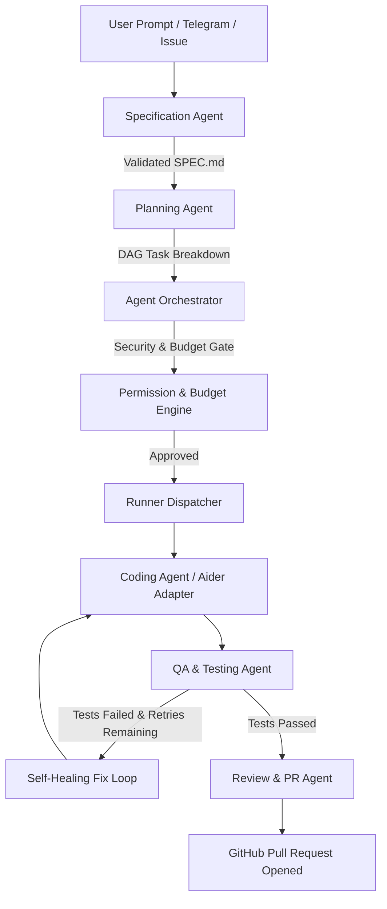

# Agent Design & Multi-Agent Architecture: Jarvis Autonomous Personal AI

**Document Version:** 1.0.0  
**Status:** Approved for Milestone 0  
**System Name:** Jarvis Autonomous Personal AI Software-Building System  
**Author:** Senior AI-Agent Engineer & Staff Systems Architect  
**Date:** November 14, 2026  

---

## 1. Overview & Multi-Agent Philosophy

Jarvis avoids monolithic "do-it-all" prompts. Complex software engineering tasks require specialized, bounded cognitive agents with distinct system prompts, restricted toolsets, explicit evaluation rubrics, and independent failure-recovery loops.

All agents operate under the supervision of the **Agent Orchestrator** and are mediated by the **Central Permission Engine** and **Budget Manager**.

---

## 2. Specialized Agent Profiles

### 2.1 Specification Agent (`SpecAgent`)
- **Objective:** Ingests unrefined human prompts and extracts core user stories, technical constraints, non-functional requirements, and explicit acceptance criteria.
- **Tools Permitted:** Read-only access to existing project documents and memory embeddings (`pgvector`).
- **Prompt Architecture:**
  - Identifies implicit assumptions and formulates clarifying questions if ambiguity exceeds confidence threshold (0.80).
  - Produces structured output: JSON schema conforming to `TaskSpecification` containing `userStories`, `acceptanceCriteria`, `outOfScope`, and `suggestedDependencies`.
- **Completion Condition:** Validated specification stored in database; triggers planning.

### 2.2 Planning Agent (`PlanAgent`)
- **Objective:** Converts approved specifications into a Directed Acyclic Graph (DAG) of actionable, testable tasks and milestones.
- **Responsibilities:**
  - Evaluates file dependency conflicts.
  - Generates estimated token count and expected cost profile.
  - Determines if task requires elevated human approval (e.g., changes to database schema or auth middleware).
- **Completion Condition:** Task hierarchy persisted in `tasks` table with dependencies and priority ordering.

### 2.3 Coding Agent (`CodingAgent`)
- **Objective:** Headless code modification, creation, and refactoring inside the isolated runner environment.
- **Execution Mechanism:** Dispatched as an ephemeral runner invoking the `Aider` CLI adapter.
- **Operating Constraints:**
  - Runs in restricted Docker container with minimal network egress.
  - Operates strictly on dedicated branch (`jarvis/<task-slug>`).
  - Never allowed to modify workflow configurations (`.github/workflows/`) or credentials.
  - Follows repository style guidelines, naming conventions, and linting rules.

### 2.4 QA & Self-Healing Agent (`QAAgent`)
- **Objective:** Verifies that code meets acceptance criteria through automated testing and executes bounded repair loops on failure.
- **Execution Strategy:**
  1. Executes test suite (`pnpm test` / `pytest`).
  2. Executes static analysis and linter (`eslint` / `flake8`).
  3. Executes security scan (`semgrep` / `trivy`).
- **Self-Healing Loop:**
  - If a test fails, extracts exact error stack traces and failing assertions.
  - Passes concise failure context back to `CodingAgent` with directive: *"Fix failing assertion without modifying test logic."*
  - **Bounded Retries:**
    - Routine syntax / minor test failures: Maximum **3 retries**.
    - Complex architectural / multi-file failures: Maximum **5 retries**, subject to available daily budget.
    - Security vulnerabilities or destructive signals: **Immediate Stop** and escalation to human operator.

### 2.5 Review & Maintenance Agent (`ReviewAgent`)
- **Objective:** Audits diffs, compiles comprehensive PR summaries, and monitors existing repositories for technical debt.
- **Deliverables:**
  - Clear PR description with task references, files modified, test proof, and token/cost summary.
  - Health check audits (dependency updates, deprecation warnings, coverage gaps).

---

## 3. Cognitive Guardrails & Safety Protocols

1. **Context Window Protection:** Agents operate with strict message pruning and retrieval-augmented context injection from `pgvector` to prevent context poisoning or distraction.
2. **Deterministic Output:** Structured JSON extraction is enforced using schema-constrained generation (Zod schema alignment).
3. **No Direct Production Commits:** Agents cannot commit to default branches; all code lands through pull requests requiring human review.
4. **Kill-Switch Observability:** Every agent execution run checks cancellation tokens prior to invoking LLM endpoints or executing runner commands.
