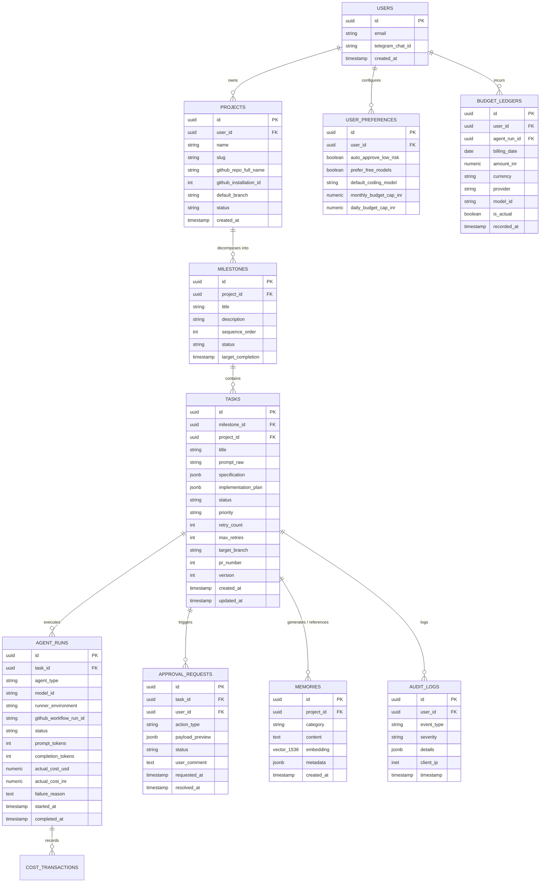

# Database Schema & Entity Specification: Jarvis Autonomous Personal AI

**Document Version:** 1.0.0  
**Status:** Approved for Milestone 0  
**System Name:** Jarvis Autonomous Personal AI Software-Building System  
**Author:** Database Architect & Staff Backend Engineer  
**Date:** November 14, 2026  

---

## 1. Overview & Architectural Principles

The Jarvis database is built on PostgreSQL 15+ hosted on Supabase. It strictly adheres to:
1. **Row Level Security (RLS) On All Public Tables:** Every table in the public schema has RLS enabled. Policies use `TO authenticated` combined with `(select auth.uid()) = user_id` to prevent IDOR vulnerabilities.
2. **Strict Concurrency Control:** Optimistic concurrency is enforced on task state transitions using `version` columns and `updated_at` triggers.
3. **Atomic Background Queuing:** Background tasks are queued natively using the `pgmq` extension.
4. **Vector Embeddings for Memory:** Long-term project decisions and code patterns are indexed via `pgvector` with HNSW cosine similarity search.
5. **Security Invoker Views:** All views specify `WITH (security_invoker = true)` to ensure underlying RLS is never bypassed.
6. **Audit Immutability:** Financial ledger entries and audit log records are append-only; `UPDATE` and `DELETE` privileges are revoked on these tables.

---

## 2. Entity-Relationship Diagram (ERD)



---

## 3. Core Tables Specification & DDL Outline

### 3.1 `projects`
Tracks GitHub-connected projects under active Jarvis management.
```sql
create table public.projects (
    id uuid primary key default gen_random_uuid(),
    user_id uuid not null references auth.users(id) on delete cascade,
    name text not null,
    slug text not null,
    github_repo_full_name text not null,
    github_installation_id bigint not null,
    default_branch text not null default 'main',
    status text not null default 'ACTIVE' check (status in ('ACTIVE', 'PAUSED', 'ARCHIVED')),
    created_at timestamptz not null default now(),
    updated_at timestamptz not null default now(),
    constraint uk_projects_user_slug unique (user_id, slug)
);

alter table public.projects enable row level security;

create policy "projects_owner_select" on public.projects
    for select to authenticated
    using ((select auth.uid()) = user_id);

create policy "projects_owner_insert" on public.projects
    for insert to authenticated
    with check ((select auth.uid()) = user_id);

create policy "projects_owner_update" on public.projects
    for update to authenticated
    using ((select auth.uid()) = user_id)
    with check ((select auth.uid()) = user_id);

create policy "projects_owner_delete" on public.projects
    for delete to authenticated
    using ((select auth.uid()) = user_id);
```

### 3.2 `tasks`
Central persistent state for every unit of autonomous engineering work.
```sql
create table public.tasks (
    id uuid primary key default gen_random_uuid(),
    project_id uuid not null references public.projects(id) on delete cascade,
    milestone_id uuid references public.milestones(id) on delete set null,
    user_id uuid not null references auth.users(id) on delete cascade,
    title text not null,
    prompt_raw text not null,
    specification jsonb not null default '{}'::jsonb,
    implementation_plan jsonb not null default '{}'::jsonb,
    status text not null default 'INTAKE' check (
        status in (
            'INTAKE', 'SPECIFYING', 'PLANNING', 'PENDING_APPROVAL', 
            'DISPATCHED', 'RUNNING', 'TESTING', 'SELF_HEALING', 
            'PR_CREATED', 'COMPLETED', 'ESCALATED', 'CANCELLED', 'EMERGENCY_ABORTED'
        )
    ),
    priority text not null default 'MEDIUM' check (priority in ('LOW', 'MEDIUM', 'HIGH', 'CRITICAL')),
    retry_count int not null default 0,
    max_retries int not null default 3,
    target_branch text,
    pr_number int,
    version int not null default 1,
    created_at timestamptz not null default now(),
    updated_at timestamptz not null default now()
);

alter table public.tasks enable row level security;

create policy "tasks_owner_select" on public.tasks
    for select to authenticated
    using ((select auth.uid()) = user_id);

create policy "tasks_owner_insert" on public.tasks
    for insert to authenticated
    with check ((select auth.uid()) = user_id);

create policy "tasks_owner_update" on public.tasks
    for update to authenticated
    using ((select auth.uid()) = user_id)
    with check ((select auth.uid()) = user_id);
```

### 3.3 `agent_runs` & Cost Telemetry
Tracks execution instances of agents (planning, coding, testing) and precise billing telemetry.
```sql
create table public.agent_runs (
    id uuid primary key default gen_random_uuid(),
    task_id uuid not null references public.tasks(id) on delete cascade,
    user_id uuid not null references auth.users(id) on delete cascade,
    agent_type text not null check (agent_type in ('SPEC_AGENT', 'PLAN_AGENT', 'CODING_AGENT', 'QA_AGENT', 'MAINTENANCE_AGENT')),
    model_id text not null,
    runner_environment text not null check (runner_environment in ('LOCAL', 'GITHUB_ACTIONS', 'DOCKER')),
    github_workflow_run_id text,
    status text not null default 'STARTING' check (status in ('STARTING', 'EXECUTING', 'SUCCEEDED', 'FAILED', 'TIMED_OUT', 'ABORTED')),
    prompt_tokens int not null default 0,
    completion_tokens int not null default 0,
    actual_cost_usd numeric(10, 6) not null default 0.000000,
    actual_cost_inr numeric(10, 4) not null default 0.0000,
    is_cost_confirmed boolean not null default false,
    openrouter_generation_id text,
    failure_reason text,
    started_at timestamptz not null default now(),
    completed_at timestamptz
);

alter table public.agent_runs enable row level security;

create policy "agent_runs_owner_select" on public.agent_runs
    for select to authenticated
    using ((select auth.uid()) = user_id);
```

### 3.4 `approval_requests`
Maintains the permission engine gate where humans explicitly sign off on high-impact operations.
```sql
create table public.approval_requests (
    id uuid primary key default gen_random_uuid(),
    task_id uuid not null references public.tasks(id) on delete cascade,
    user_id uuid not null references auth.users(id) on delete cascade,
    action_type text not null check (
        action_type in (
            'PROD_DEPLOY', 'SEND_MESSAGE', 'SPEND_FUNDS', 
            'PAID_AI_INFERENCE', 'MAJOR_ARCH_CHANGE', 
            'SENSITIVE_DB_OP', 'ACCOUNT_CHANGE', 'DESTRUCTIVE_ACTION'
        )
    ),
    payload_preview jsonb not null,
    status text not null default 'PENDING' check (status in ('PENDING', 'APPROVED', 'REJECTED', 'EXPIRED')),
    user_comment text,
    requested_at timestamptz not null default now(),
    resolved_at timestamptz
);

alter table public.approval_requests enable row level security;

create policy "approvals_owner_select" on public.approval_requests
    for select to authenticated
    using ((select auth.uid()) = user_id);

create policy "approvals_owner_update" on public.approval_requests
    for update to authenticated
    using ((select auth.uid()) = user_id)
    with check ((select auth.uid()) = user_id);
```

### 3.5 `budget_ledgers` (Immutable Financial Accounting)
Enforces auditability on all incurred costs with append-only ledger security.
```sql
create table public.budget_ledgers (
    id uuid primary key default gen_random_uuid(),
    user_id uuid not null references auth.users(id) on delete cascade,
    agent_run_id uuid references public.agent_runs(id) on delete set null,
    billing_date date not null default current_date,
    amount_inr numeric(10, 4) not null,
    amount_usd numeric(10, 6) not null,
    provider text not null default 'OpenRouter',
    model_id text not null,
    is_actual boolean not null default false,
    recorded_at timestamptz not null default now()
);

alter table public.budget_ledgers enable row level security;

create policy "budget_ledgers_owner_select" on public.budget_ledgers
    for select to authenticated
    using ((select auth.uid()) = user_id);

-- Explicitly revoke updates and deletes to preserve ledger integrity
revoke update, delete on public.budget_ledgers from authenticated, anon, public;
```

### 3.6 `memories` (Long-Term Vector Memory)
```sql
create extension if not exists vector;

create table public.memories (
    id uuid primary key default gen_random_uuid(),
    project_id uuid not null references public.projects(id) on delete cascade,
    user_id uuid not null references auth.users(id) on delete cascade,
    category text not null check (category in ('DECISION', 'PATTERN', 'BUG_FIX', 'PREFERENCE', 'ARCH_RECORD')),
    content text not null,
    embedding vector(1536),
    metadata jsonb not null default '{}'::jsonb,
    created_at timestamptz not null default now()
);

alter table public.memories enable row level security;

create policy "memories_owner_all" on public.memories
    for all to authenticated
    using ((select auth.uid()) = user_id)
    with check ((select auth.uid()) = user_id);

create index idx_memories_embedding on public.memories 
    using hnsw (embedding vector_cosine_ops);
```

---

## 4. Migration Strategy

- Migrations are version-controlled in `supabase/migrations/` using timestamped prefixes (`YYYYMMDDHHMMSS_description.sql`).
- Schema changes are tested locally against Dockerized Supabase before applying to remote environments.
- Rollback migrations (`*_down.sql`) are maintained for all DDL operations.
