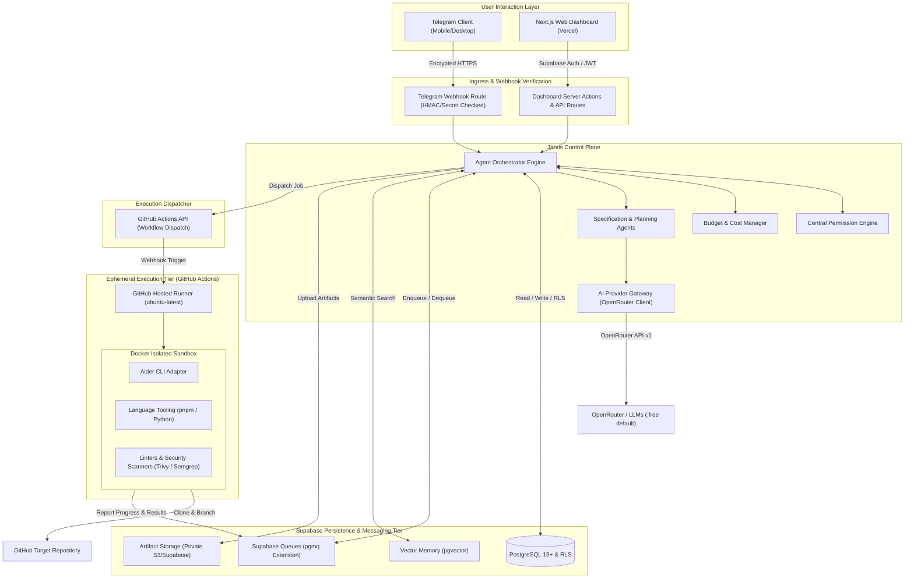
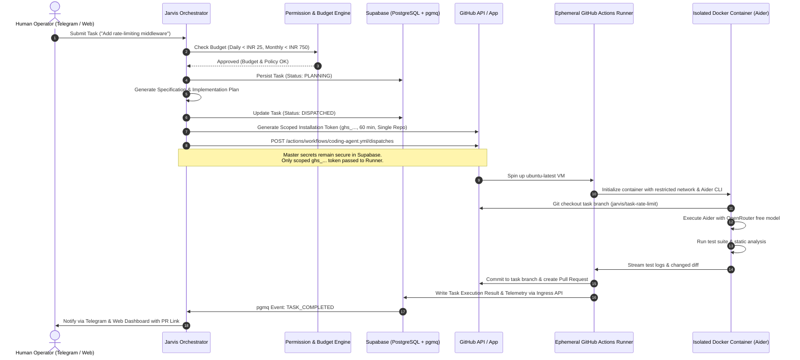
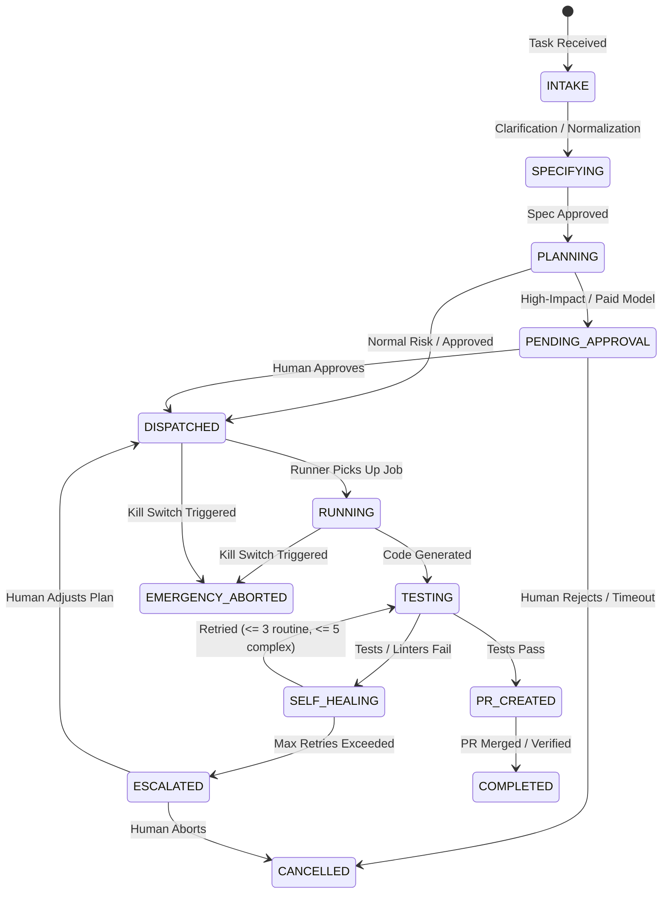

# System Architecture: Jarvis Autonomous Personal AI

**Document Version:** 1.0.0  
**Status:** Approved for Milestone 0  
**System Name:** Jarvis Autonomous Personal AI Software-Building System  
**Author:** Principal Software Architect & Staff Backend Engineer  
**Date:** November 14, 2026  

---

## 1. High-Level Architecture Overview

Jarvis is architected as an asynchronous, event-driven, cloud-first control plane paired with decoupled, ephemeral compute runners. The system is split across four distinct operational domains:

1. **User Interaction Tier:**
   - **Telegram Interface:** Real-time conversational intake, quick mobile approvals, and immediate alerting using Telegram Bot Webhooks.
   - **Web Dashboard:** Comprehensive project management, DAG visualizer, approval queue, telemetry explorer, and audit viewer built in Next.js (App Router), Tailwind CSS, and shadcn/ui.
2. **Control Plane & Orchestration Tier:**
   - **API & Orchestrator:** Hosted on Vercel / Node.js runtime and Supabase Edge Functions. Handles command intake, requirement distillation, milestone planning, and workflow orchestration.
   - **Central Permission Engine:** Evaluates requested actions against policy matrices, halts execution on high-impact actions, and triggers approval tickets.
   - **Budget Manager:** Enforces daily (INR 25) and monthly (INR 750/1,000) spending caps, tracks token telemetry via OpenRouter APIs, and blocks paid inference unless explicitly approved.
3. **Persistence & Messaging Tier:**
   - **Database (PostgreSQL via Supabase):** Multi-tenant relational storage, versioned migrations, Row Level Security (RLS), and database views with `security_invoker = true`.
   - **Native Queues (`pgmq`):** Message queuing for background task distribution, eliminating external Redis/SQS dependencies.
   - **Vector Memory (`pgvector`):** High-dimensional semantic embeddings for codebase patterns, technical decisions, and past failure logs.
   - **Object Storage (Supabase Storage):** Secure, private storage for build artifacts, test logs, and patch archives.
4. **Isolated Execution Tier:**
   - **Ephemeral GitHub Actions Runners:** Temporary, cloud-hosted virtual machines (`ubuntu-latest`) dispatched via GitHub Actions REST API (`workflow_dispatch`).
   - **Docker Sandbox Containers:** Containerized workspace execution running Aider CLI and test suites with strictly limited egress, minimal filesystem privileges, and task-scoped temporary tokens.

---

## 2. High-Level System Architecture Diagram



---

## 3. Sandboxed Execution & Credential Segregation Architecture

Untrusted code from GitHub issues, pull requests, or generative LLMs must never execute inside an environment holding master application credentials.



---

## 4. State Machine & Task Lifecycle

Every task transitions through an idempotent, strictly tracked finite state machine:



---

## 5. Monorepo Structure & Package Boundaries

The codebase is organized as a production-grade pnpm monorepo using Turborepo for build orchestration:

```
f:\Javis\
├── apps/
│   └── dashboard/                 # Next.js 15+ App Router, Tailwind CSS, shadcn/ui
├── supabase/
│   ├── migrations/                # Versioned SQL migrations (00000000000000_*.sql)
│   ├── functions/                 # Supabase Edge Functions (Webhooks, Cron triggers)
│   ├── seed.sql                   # Development seed fixtures
│   └── config.toml                # Local Supabase CLI configuration
├── packages/
│   ├── core/                      # Domain entities, value objects, domain events, errors
│   ├── database/                  # Supabase client factory, Drizzle/Kysely schemas, repositories
│   ├── ai-provider/               # OpenRouter client, dynamic model discovery, cost telemetry
│   ├── agent-orchestrator/        # Task lifecycle coordinator, DAG runner, agent adapters
│   ├── permission-engine/         # Policy evaluation matrix, approval ticket management
│   ├── budget-manager/            # Spending caps, balance tracking, ledger audit
│   ├── github-integration/        # GitHub App JWT issuance, Octokit client, PR manager
│   ├── telegram-integration/      # Bot API client, webhook router, command parser
│   ├── memory/                    # pgvector vector store, semantic search, RAG pipeline
│   ├── notifications/             # Multi-channel notification dispatcher (Telegram, Realtime)
│   └── shared-contracts/          # Zod schemas, TypeScript types, API contracts, JSON schemas
├── workers/
│   ├── coding-agent/              # Aider CLI execution wrapper, runner entrypoints
│   ├── research-agent/            # Codebase analyzer, doc fetcher, web search crawler
│   └── python-automation/         # Python automation workers for specialized data/ML tasks
├── infra/
│   ├── docker/                    # Dockerfiles for coding sandboxes & local development
│   ├── github-actions/            # Reusable GitHub Actions workflows (.github/workflows)
│   └── deployment/                # Docker Compose (self-hosted Supabase), Vercel configs
└── docs/                          # Comprehensive system documentation (24 documents + ADRs)
```

---

## 6. Offline Persistence Model & Reliability Guarantees

1. **Decoupling from Local Hardware:** The local developer machine is treated merely as a management client. The Jarvis control plane runs persistently in cloud environments (Supabase + Vercel).
2. **State Atomicity:** All state updates are persisted in PostgreSQL before external operations are triggered. In case of network interruption or server restart, pending tasks are resumed based on their persisted state.
3. **Queue Visibility Timeouts:** Messages processed from `pgmq` are invisible to other workers during execution (default: 300 seconds). If a worker crashes, the message naturally reappears in the queue for retry.
4. **Idempotent Transitions:** Every state transition checks the current state version (`etag` / `updated_at`) using optimistic concurrency control, preventing duplicate execution.
