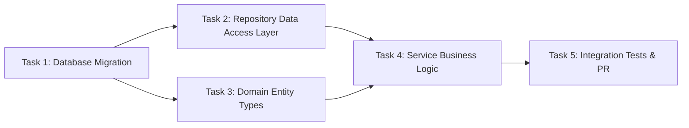

# Workflow Engine Specification: Jarvis Autonomous Personal AI

**Document Version:** 1.0.0  
**Status:** Approved for Milestone 0  
**System Name:** Jarvis Autonomous Personal AI Software-Building System  
**Author:** Staff Backend Engineer & Distributed Systems Lead  
**Date:** November 14, 2026  

---

## 1. Engine Philosophy & Design Principles

The Jarvis Workflow Engine orchestrates multi-step, asynchronous software engineering lifecycles. Given that code generation, compilation, and testing can span multiple minutes and traverse unreliable external boundaries (GitHub runners, LLM APIs), the engine is built on four core distributed systems principles:

1. **Persistent State as Single Source of Truth:** The workflow state machine lives in PostgreSQL (`tasks` and `agent_runs` tables). If the control plane or local developer environment goes offline, running tasks are neither orphaned nor lost.
2. **Durable Native Queuing (`pgmq`):** Steps are scheduled and distributed via PostgreSQL `pgmq` message queues, ensuring transactional atomicity with domain records.
3. **Idempotent Step Transitions:** Every state transition uses optimistic concurrency control (`version` column) and unique idempotency keys. Re-running a step produces safe, deterministic side-effects.
4. **Visibility Timeouts & Dead Letter Handling:** Unacknowledged messages re-enter the queue after visibility expiration, enabling automatic recovery from transient runner failures.

---

## 2. DAG Execution Lifecycle

A project milestone is represented as a Directed Acyclic Graph (DAG) of interdependent tasks:



### Step Lifecycle State Machine:
1. **Schedule / Enqueue:** When dependencies for a node resolve, the orchestrator enqueues a message to `pgmq.send('jarvis_task_queue', payload)`.
2. **Lease / Visibility Lock:** Worker pulls message using `pgmq.read('jarvis_task_queue', vt_seconds=300, 1)`. The task is locked for 300 seconds.
3. **Pre-flight Permission & Budget Verification:** The worker queries `PermissionEngine` and `BudgetManager`. If limits are exceeded or approvals are pending, the task transitions to `PENDING_APPROVAL` and the message is archived.
4. **Execution:** Runner executes the assigned step (Specification, Code Generation via Aider, Testing).
5. **Evaluation & Verification:** Results are audited against acceptance criteria.
6. **State Transition & Ack:** Upon success, state updates to `COMPLETED`, dependent downstream tasks are unlocked, and the message is deleted (`pgmq.delete()`).

---

## 3. Concurrency Control & Crash Recovery

### 3.1 Optimistic Concurrency Control
```sql
update public.tasks
set 
    status = 'RUNNING',
    version = version + 1,
    updated_at = now()
where id = :task_id and version = :expected_version;
```
If zero rows are updated, a concurrent worker has already modified the task. The current worker immediately discards the duplicate operation.

### 3.2 Visibility Timeout & Auto-Recovery
- If a runner crashes or network drops during a GitHub Actions execution, the visibility timeout on the `pgmq` message will elapse (e.g., after 5 minutes).
- The message becomes visible again and is read by the next orchestrator cycle.
- The orchestrator checks the GitHub Actions run status via GitHub API:
  - If GitHub run is still active, visibility timeout is extended (`pgmq.set_vt`).
  - If GitHub run failed or vanished, the retry counter is incremented and a fresh runner is dispatched (up to `max_retries`).

---

## 4. Bounded Retry & Self-Healing Matrix

| Failure Category | Classification | Max Retries | Strategy |
|---|---|---|---|
| **Linter / Formatting Failure** | Routine | 3 | Pass exact linter stdout to Aider with instruction to fix styling |
| **Unit Test Assertion Failure** | Routine | 3 | Pass failing assertion and stack trace to Aider; keep test file read-only |
| **Compilation / Type Error** | Routine | 3 | Feed TypeScript compiler output (`tsc --noEmit`) to Aider |
| **Integration Test Failure** | Complex | 5 | Provide broader context; requires available daily budget |
| **Security Finding (Semgrep/Trivy)** | Critical | 0 (Immediate Stop) | Escalate to human operator via Telegram/Web; do not attempt automated fix |
| **Out-of-Budget Condition** | Financial | 0 (Immediate Stop) | Transition to `PENDING_APPROVAL`; requires human fund replenishment |
