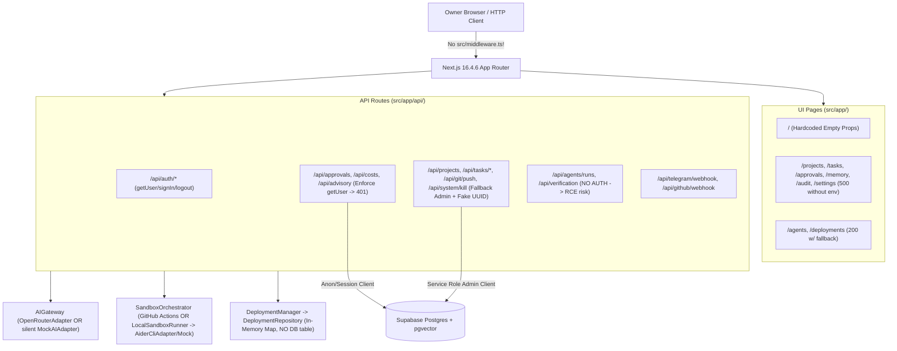

# JARVIS — Technical & Security Audit Report

**Audit Date:** 2026-11-27  
**Repository:** `f:\Javis` (`origin` = `https://github.com/sulekhniwal-star/Jarvis.git`)  
**Branch / Commit:** `main` @ `c8a2615`  
**Package Version:** `10.0.0`  
**Overall Health Classification:** **NON-OPERATIONAL**

---

## 1. Executive Summary

Despite `docs/MASTER_ENGINEERING_AUDIT.md` certifying Jarvis v10.0.0 as *"FULLY CERTIFIED & PRODUCTION READY (Zero Defects / Clean Build)"*, an empirical forensic audit of the actual codebase, environment, runtime behavior, and security posture establishes that **Jarvis is currently NON-OPERATIONAL and NOT READY for production or real-world use**.

While `tsc --noEmit` (0 errors), `eslint .` (0 errors, 65 warnings), `vitest run` (132 files / 821 tests mocked), and `next build --webpack` (when run outside the Windows sandbox) succeed, the running application cannot function end-to-end:

1. **Missing Runtime Environment & Infrastructure:** No `.env` or `.env.local` exists, Docker is not installed, `aider` CLI is not installed, and no local or remote Supabase instance is connected.
2. **Runtime Server Crashes (HTTP 500):** 6 of 9 UI pages (`/projects`, `/tasks`, `/approvals`, `/memory`, `/audit`, `/settings`) and `GET /api/projects` crash with **HTTP 500** when Supabase environment variables are absent because their `catch` blocks call `createAdminClient()`, which throws an uncaught `Error`.
3. **Critical Security & Authorization Failures:**
   - **Unauthenticated Remote Code Execution (RCE):** `POST /api/verification` has zero authentication and passes user-supplied `customCommand` and `cwd` directly to `child_process.spawn("cmd.exe" | "/bin/sh", ...)` in `VerificationHarness`.
   - **Missing Middleware & Login UI:** There is no `src/middleware.ts` (so `updateSession` in `src/lib/supabase/middleware.ts` is dead code), no login/sign-up UI page, and `Topbar` renders a static `<User />` icon (`title="Authenticated Owner"`).
   - **Auth Bypass & User Impersonation:** Multiple API routes (`projects`, `tasks/intake`, `tasks/[id]/plan/decision`, `git/push`, `system/kill`, `agents/runs`) either lack authentication entirely or fall back to `createAdminClient()` + hardcoded UUID `00000000-0000-0000-0000-000000000001` or accept a caller-supplied `userId` in the JSON body.
   - **RLS Bypass in `match_memories` RPC:** `20261116000001_match_memories_rpc.sql` uses `SECURITY DEFINER` with `WHERE (filter_user_id IS NULL OR m.user_id = filter_user_id)`, allowing any authenticated caller to query other users' memories.
4. **Disconnected / Mocked Core Workflows:**
   - **Dashboard (`/`):** `src/app/page.tsx` passes hardcoded empty props (`approvals={[]}`, `projects={[]}`, `events={[]}`, `dailySpendInr={0.0}`).
   - **Web Chat / Conversations:** `conversations` and `messages` tables and `ConversationRepository` exist, but there is **no web chat UI** and **no `/api/conversations` API**.
   - **AI Gateway:** Silently falls back to `MockAIAdapter` (`"Mock response from Jarvis AI"`) when `OPENROUTER_API_KEY` is missing.
   - **Deployments:** `deployments` table does not exist in `supabase/migrations/`; `DeploymentRepository` silently falls back to an in-memory `Map`, and `DeploymentManager` generates fake `https://jarvis-preview-<sha>.vercel.app` URLs without deploying anything.

---

## 2. Actual Implemented Architecture

---

## 3. Modules Audited & Classification

| Module | Classification | Key Evidence |
|---|---|---|
| **Frontend Shell & Navigation** | Partially Working | `Sidebar`, `Topbar`, `MobileNav` compile and render, but `Topbar` has static user icon with no login/logout UI. |
| **Dashboard (`/`)** | Broken (Hardcoded) | `src/app/page.tsx` passes `approvals={[]}`, `projects={[]}`, `events={[]}`, `dailySpendInr={0.0}`. |
| **Projects, Tasks, Approvals, Memory, Audit, Settings Pages** | Broken (500 on missing env) | `catch` block calls `createAdminClient()` which throws uncaught error; auth bypassed via hardcoded UUID fallback. |
| **Web Chat / Conversations** | Not Implemented | `conversations` table & `ConversationRepository` exist, but zero web UI or `/api/conversations` routes. |
| **Authentication & Session Middleware** | Broken / Incomplete | `/api/auth/*` routes exist, but `src/middleware.ts` is missing (`updateSession` unused) and no `/login` page exists. |
| **API Authorization** | Broken (Critical) | Unauthenticated RCE on `/api/verification`, unauthenticated `/api/agents/runs`, body `userId` spoofing on `/api/git/push` & `/api/projects`. |
| **Database & Migrations** | Partially Working / Blocked | 5 SQL migrations cover 14 tables + RLS, but `deployments` table is missing and `match_memories` RPC bypasses RLS (`SECURITY DEFINER`). Live DB unverified (no Supabase running). |
| **AI Gateway & OpenRouter** | Blocked / Silent Mock | `OpenRouterAdapter` implemented, but `createDefaultAIGateway()` silently returns `MockAIAdapter` when `OPENROUTER_API_KEY` is unset. Live inference blocked (no key). |
| **Agent Execution & Sandbox** | Blocked / Unverified | `LocalSandboxRunner` creates empty `.sandbox/<runId>` without cloning repo; `aider` CLI and Docker are not installed. |
| **GitHub & Git Guard** | Partially Working / Unverified | `RepoSyncMonitor` reads local git state; `origin` still has 6 non-`main` branches despite `main`-only policy. |
| **Telegram Integration** | Broken (Env Mismatch) | Reads `OWNER_TELEGRAM_ID` and `OWNER_USER_ID` while `.env.example` defines `TELEGRAM_OWNER_CHAT_ID`; webhook secret optional; no `update_id` dedup. |
| **Deployments** | Broken (Simulated) | No `deployments` DB table; uses in-memory `Map` and fabricates `https://jarvis-preview-<sha>.vercel.app` URLs. |

---

## 4. Critical Blockers Preventing Operation

1. **No Environment Configuration / Connected Services:** `.env.local`, Supabase, OpenRouter API key, Telegram bot token, Docker, and `aider` CLI are all absent.
2. **Unauthenticated RCE & Auth Bypass:** `POST /api/verification` executes arbitrary shell commands without authentication; 10+ endpoints/pages bypass auth via `createAdminClient()` and hardcoded UUIDs.
3. **Uncaught SSR Crashes:** Missing env vars crash 6/9 pages with HTTP 500 instead of rendering a setup/login screen or graceful error state.
4. **Missing Core User Flows:** No login page, no web chat/conversation UI, hardcoded dashboard overview, and simulated deployments without a database table.

---

## 5. Release-Readiness Assessment

**Production Readiness:** **NOT READY**  
Jarvis must **not** be deployed or relied upon for autonomous software engineering until all Critical and High findings in `BUG_REGISTER.md` are resolved and verified against a real Supabase instance and real AI/sandbox infrastructure.
