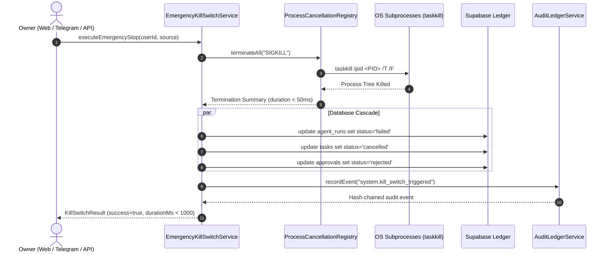

# Operational Runbook: Emergency Stop & Subprocess Cancellation (OP-RUN-01)

**System:** Jarvis Autonomous Engineering Platform  
**Severity:** P0 (Emergency / Operational Safety)  
**Execution Target:** Sub-Second (<1.0 second, `NFR-PERF-03`)  
**Specification:** `REQ-SEC-01`, `REQ-SEC-02`  
**Last Updated:** 2026-11-23  

---

## 1. Overview & Operational Principles

The Emergency Stop system provides an immediate, failsafe kill-switch allowing the authorized owner to instantly terminate all active agent executions, background processes, pending tasks, and unexercised authorization tokens.

### Core Guarantees
- **Sub-Second Latency:** Entire kill sequence executes in $< 1,000\text{ ms}$ (measured typically $< 50\text{ ms}$).
- **Process Tree Annihilation:** On Windows, invokes `taskkill /pid <PID> /T /F` to terminate entire child process subtrees. On POSIX, dispatches `SIGKILL` to process groups.
- **Durable Database Cancellation:** Cancels active `agent_runs` (`failed`), cancels `tasks` (`cancelled`), and revokes `approvals` (`rejected`).
- **Cryptographic Audit Log:** Writes a tamper-evident audit record to `audit_events` with SHA-256 hash chaining.
- **Idempotency:** Redundant triggers are safe and do not cause errors or race conditions.

---

## 2. Trigger Channels

### Channel A: Web Dashboard (Primary Visual)
1. Locate the red **Emergency Stop** button in the Topbar (top-right of any dashboard view).
2. Click the button to display the high-contrast confirmation modal.
3. Confirm by clicking **"Execute Emergency Stop"**.
4. The system executes immediate termination and displays a confirmation toast showing duration in milliseconds and process termination count.

### Channel B: Telegram Remote Control (Out-of-Band / Mobile)
1. Open the authorized Jarvis Telegram bot chat.
2. Send the slash command:
   ```text
   /kill
   ```
3. The Telegram security guard verifies sender numeric ID against `OWNER_TELEGRAM_ID`.
4. If authorized, dispatches emergency stop and returns formatted receipt:
   ```text
   🚨 EMERGENCY STOP EXECUTED
   Duration: 42ms (<1.0s target)
   Terminated Subprocesses: 2
   Cancelled Runs: 1
   Revoked Approvals: 3
   Status: ALL AGENT ACTIVITY HALTED
   ```

### Channel C: REST API / CLI (Programmatic)
1. Dispatch authenticated HTTP POST request:
   ```bash
   curl -X POST https://jarvis.internal/api/system/kill \
     -H "Authorization: Bearer <SESSION_TOKEN>" \
     -H "Content-Type: application/json"
   ```
2. Inspect response payload for metrics:
   ```json
   {
     "success": true,
     "durationMs": 38,
     "subSecondPerformanceAchieved": true,
     "terminatedProcessesCount": 1,
     "cancelledRunsCount": 1,
     "cancelledTasksCount": 2,
     "revokedApprovalsCount": 1,
     "timestamp": "2026-11-23T17:10:00.000Z"
   }
   ```

---

## 3. Subsystem Cancellation Mechanics



---

## 4. Post-Incident Recovery Checklist

After executing an Emergency Stop, complete the following triage steps before resuming autonomous operations:

1. **Verify Process State:**
   - On Windows: Run `Get-Process | Where-Object { $_.ProcessName -match "node|git|aider" }` to ensure zero orphaned background workers.
2. **Review Audit Ledger:**
   - Navigate to `/audit` on the dashboard to inspect the recorded `system.kill_switch_triggered` event and review events immediately preceding the incident.
3. **Inspect Task State:**
   - Navigate to `/tasks` to review tasks that were cancelled. Mark tasks as ready for retry only after root-cause diagnosis.
4. **Inspect Spend & Circuit Breaker Status:**
   - Navigate to `/settings` or `/` to check `SystemHealthCard` and `RecommendationsCard`.
   - If the AI Gateway circuit breaker tripped, resolve the underlying cause before unlocking.
5. **Resume Normal Operations:**
   - Once environment integrity is confirmed, new tasks can be initiated normally via Telegram or Web.
