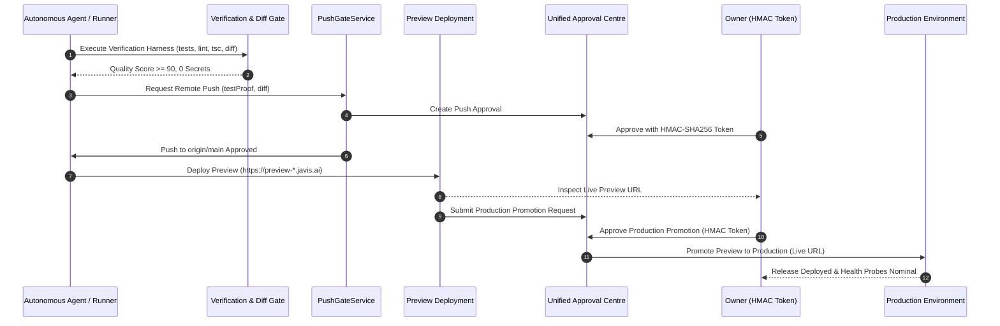

# Operational Runbook: Production Release & Automated Rollback Guide (OP-RUN-03)

**System:** Jarvis Autonomous Engineering Platform  
**Target Architecture:** Multi-Environment (Preview -> Production Gate)  
**Safety Policy:** Single-Branch `main`-Only Invariant (`NFR-SEC-04`)  
**Specification:** `REQ-DEP-01`, `REQ-DEP-02`, `REQ-DEP-03`  
**Last Updated:** 2026-11-23  

---

## 1. Overview & Release Philosophy

Jarvis operates on a strict **trunk-based, branchless continuous integration** discipline:
- Strictly one local branch exists: `main`. Feature branches and PRs are prohibited.
- All code changes are verified through an automated 4-stage quality gate (lint, typecheck, tests, diff inspection).
- Pushes to `origin/main` require explicit owner approval via the Unified Approval Centre or Telegram.
- Production deployments generate a verified Preview URL before owner promotion authorization.
- 1-Click rollbacks immediately restore traffic to the prior known-good deployment.

---

## 2. Pre-Deployment Verification Checklist

Before authorizing any production promotion, the autonomous pipeline and owner must verify:

| Gate | Verification Mechanism | Required Result |
|---|---|---|
| **1. Branch Hygiene** | `auditBranchHygiene(cwd)` | `isCompliant: true`, strictly `* main` |
| **2. Test Suite** | `npm test` / Vitest | 100% passing tests (0 failures) |
| **3. Type Safety** | `npx tsc --noEmit` | Exit code 0, 0 TypeScript errors |
| **4. Secret Scanner** | `SecretScanner.scanText(diff)` | `passed: true`, 0 detected credentials |
| **5. Diff Inspection** | `DiffInspector.inspect(diff)` | Quality score $\ge 90$, risk tier $\le \text{medium}$ |
| **6. Security Controls**| `SecurityAuditSuite.runFullSecurityAudit()` | 0 critical/high vulnerabilities |
| **7. Accessibility** | `AccessibilityAuditor.generateComplianceReport()` | WCAG 2.1 AA compliant, 0 broken links |

---

## 3. Production Deployment Workflow



---

## 4. Rollback Execution Protocol

If unexpected anomalies, elevated error rates, or regressions occur post-release:

### 1-Click Dashboard Rollback
1. Navigate to `/deployments` on the web dashboard.
2. Under **Deployment History**, locate the desired previous stable deployment ID.
3. Click the **"Rollback"** action button.
4. Confirm in the dialog. The platform:
   - Updates previous deployment status to `promoted`.
   - Flags the failed deployment as `rolled_back`.
   - Records an immutable audit ledger entry (`deployment.rollback_executed`).

### Telegram Remote Rollback
1. Send Telegram slash command:
   ```text
   /rollback
   ```
2. The bot returns the last 3 deployments with interactive inline buttons.
3. Tap the desired target deployment ID to trigger instant rollback.

### API Rollback Trigger
```bash
curl -X POST https://jarvis.internal/api/deployments/<PREVIOUS_DEPLOYMENT_ID>/rollback \
  -H "Authorization: Bearer <SESSION_TOKEN>" \
  -H "Content-Type: application/json"
```
Verify response:
```json
{
  "success": true,
  "rolledBackDeploymentId": "dep-failed-001",
  "activeDeploymentId": "dep-stable-prev",
  "timestamp": "2026-11-23T17:15:00.000Z"
}
```
