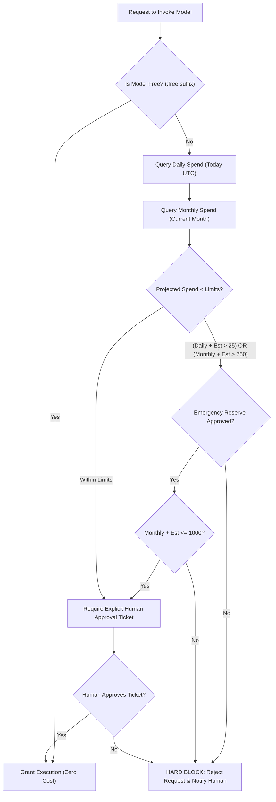

# Budget & Cost Control Specification: Jarvis Autonomous Personal AI

**Document Version:** 1.0.0  
**Status:** Approved for Milestone 0  
**System Name:** Jarvis Autonomous Personal AI Software-Building System  
**Author:** Staff Backend Engineer & Finance/Governance Lead  
**Date:** November 14, 2026  

---

## 1. Core Financial Mandates

Jarvis operates under strict financial constraints to eliminate the risk of unexpected AI inference bills or resource runaway. All financial policies are hard-coded into the **Central Budget Manager** and cannot be bypassed by any agent or automated fallback loop.

### Hard Budget Allocations:
- **Normal Monthly Budget:** **INR 750**
- **Daily Spending Limit:** **INR 25**
- **Emergency Reserve:** **INR 250** (Strictly requires explicit human approval before unlocking)
- **Absolute Maximum Monthly Spend:** **INR 1,000** (INR 750 Base + INR 250 Emergency Reserve)

---

## 2. Pre-Flight Budget Verification Algorithm

Before any outbound request to a paid LLM provider or cloud resource is executed, the `BudgetManager` executes a synchronous pre-flight check:

---

## 3. Telemetry Ingestion & Cost Accounting

### 3.1 Estimated vs. Actual Costs
To maintain absolute financial integrity, Jarvis distinguishes strictly between **Estimated Costs** and **Confirmed Actual Charges**:
1. **Pre-Execution Estimation:** Calculated using model pricing fetched from OpenRouter `GET /api/v1/models` multiplied by anticipated prompt/completion tokens. Stored as `is_actual = false`.
2. **Post-Execution Telemetry:** Following completion, the orchestrator queries `GET /api/v1/generation?id={generation_id}`. This yields the exact USD cost billed by OpenRouter, cache discounts, and token counts. Stored as `is_actual = true`.
3. **No Assumptions Rule:** Jarvis *never* claims an estimated price is an actual charged amount. UI reports explicitly state `(Estimated)` or `(Confirmed Actual)`.

### 3.2 Currency Conversion Handling
- OpenRouter bills in USD; Jarvis governs limits in INR.
- Jarvis maintains a daily exchange rate cache in PostgreSQL (`fx_rates` table), refreshed every 24 hours from authoritative public feeds (or configured default: 1 USD = 87.50 INR).
- Calculations use fixed-point arithmetic (`numeric(10, 4)`) to avoid floating-point rounding errors.

---

## 4. Anti-Runaway & Fallback Protections

1. **No Automatic Paid Fallback:** If a free model fails or rate-limits, Jarvis is strictly prohibited from silently falling back to a paid model (e.g., Claude 3.7 or GPT-4o). The system must halt, retry another free model, or prompt the human operator for approval.
2. **Consecutive Failure Cutoff:** If three consecutive requests fail within a 10-minute window, the Budget Manager temporarily suspends model requests for that project to prevent token-drain loops.
3. **Budget Alert Thresholds:**
   - **Warning Alert (Telegram):** Dispatched when daily spend reaches 80% (INR 20).
   - **Exhaustion Alert:** Dispatched when daily spend reaches 100% (INR 25). All further paid requests are locked until 00:00 UTC.
