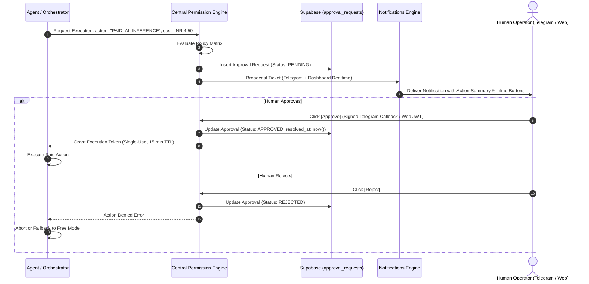

# Permission Policy & Autonomy Matrix: Jarvis Autonomous Personal AI

**Document Version:** 1.0.0  
**Status:** Approved for Milestone 0  
**System Name:** Jarvis Autonomous Personal AI Software-Building System  
**Author:** Principal Software Architect & DevSecOps Engineer  
**Date:** November 14, 2026  

---

## 1. Governance Principles

Jarvis operates under a model of **Bounded Autonomy**. The agent is granted full operational freedom within low-risk sandbox boundaries, while high-impact, irreversible, or financial actions are strictly gated behind explicit, non-bypassable human approvals.

No agent prompt, tool instruction, or external command may override the **Central Permission Engine**.

---

## 2. Autonomy Classification Matrix

| Action Category | Specific Operations | Autonomy Level | Approval Mechanism | Risk Profile |
|---|---|---|---|---|
| **Autonomous Operations** | • Codebase exploration & research<br/>• Drafting specifications & acceptance criteria<br/>• Task dependency decomposition & DAG planning<br/>• Code generation via Aider in task branch<br/>• Running unit, integration, and lint tests<br/>• Automated low-risk fix retries (<= 3)<br/>• Creating Pull Requests on GitHub<br/>• Updating project progress in DB | **Fully Autonomous** | Zero human interruption required within approved project sandbox | **LOW** |
| **Financial Actions** | • Invoking paid AI models on OpenRouter<br/>• Purchasing credits or cloud resources<br/>• Utilizing the emergency reserve (INR 250) | **Strictly Gated** | Pre-execution Approval Ticket required | **MEDIUM-HIGH** |
| **Production Impact** | • Merging PRs to default/production branch<br/>• Triggering production deployments (Vercel/Cloud)<br/>• Modifying production DNS or domains | **Strictly Gated** | Two-Factor / Dashboard Approval required | **HIGH** |
| **Destructive Database Ops** | • Running DDL migrations that drop tables/columns<br/>• Bulk deletion of records<br/>• Disabling Row Level Security (RLS) | **Strictly Gated** | Explicit human sign-off with preview diff | **CRITICAL** |
| **External Communications** | • Sending emails or WhatsApp messages<br/>• Submitting job applications or proposals<br/>• Publishing public content | **Strictly Gated** | Exact draft preview approved by human | **HIGH** |
| **Security & Permissions** | • Altering user roles or RLS policies<br/>• Adding dependencies requiring root/system privileges<br/>• Modifying GitHub App permissions | **Strictly Gated** | Explicit cryptographic human approval | **CRITICAL** |

---

## 3. Permission Engine Architecture



---

## 4. Approval Ticket Specification

Approval requests are delivered simultaneously to Telegram and the Web Dashboard:

### Telegram Presentation:
```
⚠️ APPROVAL REQUIRED: Paid AI Inference
Task: Implement Vector Similarity Search
Model Requested: anthropic/claude-3.7-sonnet
Estimated Cost: INR 3.20 (Daily Remaining: INR 21.80)
Justification: Free model failed complex AST refactor twice.

[ ✅ Approve (1-Click) ]   [ ❌ Reject ]
```

### Security Guarantees:
- **Single-Use Execution Tokens:** Once an approval ticket is resolved, the engine issues a cryptographically signed, single-use nonce valid for exactly 15 minutes.
- **Audit Logging:** Every approval and rejection is immutably logged in `audit_logs` with the human operator's identity, IP address, and timestamp.
